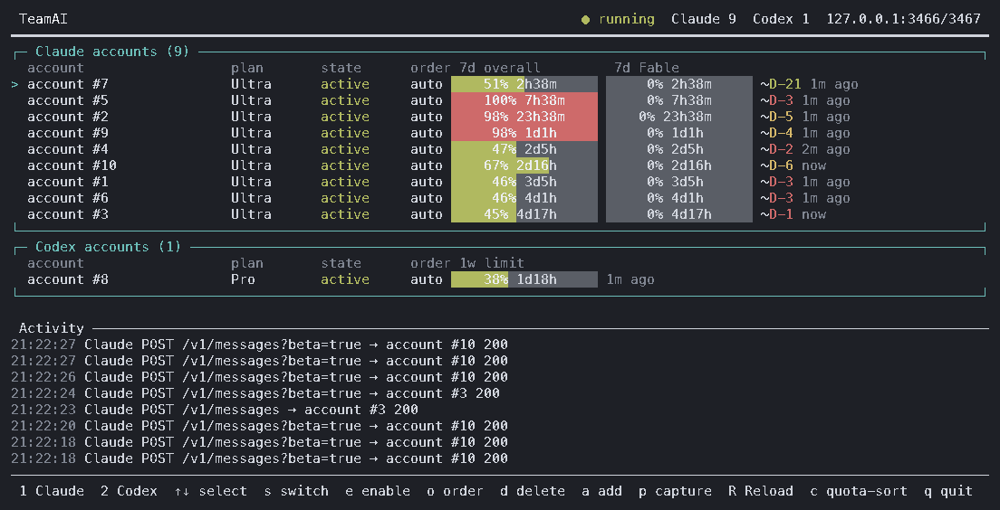

# TeamAI

[English](README.md) · [한국어](README.ko.md) · [日本語](README.ja.md) · [中文](README.zh-CN.md) · **Español**

> **Traducción desactualizada:** esta traducción aún no refleja los cambios recientes del README en inglés (las funciones y claves de configuración añadidas desde la actividad en curso). Para el comportamiento y la configuración, consulta el [README en inglés](README.md).

> **Pendiente de traducir:** los reintentos de capacidad de Codex, las opciones `codexCapacity*`, Claude keep-warm, las opciones `warmup.claude` / `warmup.codex`, y la política de fijación de sesiones de Claude sin traspaso automático se describen en el [README en inglés](README.md).

TeamAI es un relé local multicuenta para **Claude Code** y la CLI oficial de **Codex**. Mantiene un grupo de cuentas independiente para cada proveedor. Para Codex CLI, reintenta la solicitud con otra cuenta cuando la suscripción seleccionada no está disponible o se quedó sin cuota. Para Claude Code, cada sesión queda permanentemente fijada a su cuenta inicial (`sessions.json`) para preservar el historial de conversación, bloqueando la transferencia automática a otras cuentas en caso de agotamiento de cuota o error.



<sub>El panel de arriba es una captura real hecha con <code>teamai capture --redact full</code>: cuota y actividad reales, sin direcciones de cuentas.</sub>

> TeamAI es un proyecto de código abierto independiente. No está afiliado a Anthropic, a OpenAI ni al servicio no relacionado de teamai.com.

## Grupos de cuentas de Claude

Añada `"groups": {"master": ["lead@example.test", "backup@example.test"], "worker": ["worker@example.test", "backup@example.test"]}` al `config.json` existente. Los miembros son etiquetas o ids de `teamai accounts claude`; una cuenta puede pertenecer a varios grupos. Use `teamai claude --group master` o `TEAMAI_GROUP=worker tac`; la opción explícita tiene prioridad. TeamAI consume la opción antes de ejecutar Claude y Codex la rechaza. Un grupo desconocido falla antes del lanzamiento; referencias desconocidas o ambiguas a cuentas impiden el inicio o la recarga completa. Los nombres empiezan por una letra ASCII o un dígito y contienen hasta 64 letras, dígitos, `_`, `.` o `-`; las listas no pueden estar vacías.

Una sesión nueva elige su primera cuenta dentro del grupo con las reglas existentes de prioridad y cuota. Omite miembros en enfriamiento; si ninguno está disponible, devuelve 429 sin salir del grupo. Las rutas de modelos tampoco pueden salir del grupo. Sin grupo, el comportamiento no cambia. El grupo se guarda en el registro pendiente y en la vinculación persistente, conservándose tras reiniciar, `--resume` y `--continue`. **Claude mantiene la vinculación permanente a la primera cuenta: una sesión vinculada no cambia a otra cuenta del grupo ante enfriamiento o errores.** Al reanudar, omita el grupo para usar el guardado; especificar otro devuelve 409. Eliminar el grupo o la pertenencia de la cuenta vinculada devuelve 503 sin cambiar la vinculación. Mantenga las referencias válidas al renombrar o eliminar cuentas.

Tras editar, reinicie el relay o recargue la configuración mediante un comando de cuentas o el panel. Los cambios inválidos rechazan toda la recarga. `teamai status` muestra la capacidad restante por grupo y los grupos de sesiones guardadas; el panel muestra esa capacidad y `[group:name]` en Activity. La capacidad suma, en unidades de cuenta, lo restante de la ventana conocida más usada de cada miembro habilitado; las cuentas sin medir se muestran por separado. No sume totales de grupos con miembros compartidos. Consulte el [README inglés](README.md#claude-account-groups) para los detalles.

En ambos diseños del panel, el recuadro de cuentas Claude se divide en grupos según el orden de configuración, con cuentas disponibles y capacidad restante en cada encabezado. Cada sección conserva el orden actual por cuota/configuración; las cuentas sin grupo aparecen al final bajo `그룹 없음`. Una cuenta compartida aparece en todos sus grupos con `↔` delante del nombre. La selección resalta todas las copias; ↑/↓ visita cada cuenta una sola vez según su primera aparición y las acciones afectan a esa misma cuenta. La edición de prioridad mantiene fijo el orden dentro de cada sección. Sin grupos, el panel no cambia.


## Requisitos

- Node.js 20 o superior
- macOS o Linux
- `claude` y/o `codex` instalados por separado
- Tus propias cuentas de suscripción Claude Pro/Max o ChatGPT Codex

## Instalación

```bash
git clone https://github.com/soulduse/team-ai.git
cd team-ai
./scripts/install.sh
```

`install.sh` instala las dependencias, compila, enlaza los comandos
`teamai`/`tai`/`tac`/`tax` y ofrece agregar el bloque de shell. Es idempotente:
vuelve a ejecutarlo para actualizar. Usa `--no-shell` para omitir el bloque de
shell, o `--dry-run` para ver qué haría sin aplicar cambios.

Para hacer lo mismo a mano:

```bash
npm install
npm run build          # obligatorio: dist/ no está versionado
npm link
```

¿Quieres automatizar esto desde un agente de IA? Consulta [AGENTS.md](AGENTS.md),
que expone los mismos pasos como comandos deterministas con verificación y
ramas de error.

## Inicio rápido

```bash
teamai login
tai
```

`login` pregunta si quieres agregar `[1] Claude` o `[2] Codex`. Repítelo para sumar más cuentas. `tai` es el comando corto de sesión y equivale a `teamai start`: levanta el relé local y abre el panel.

Para iniciar una sesión directa con un proveedor, usa los lanzadores dedicados. Inician el relé de TeamAI automáticamente cuando hace falta y pasan todos los argumentos finales al cliente oficial:

```bash
tac                   # Claude Code a través del grupo de cuentas de TeamAI
tac --resume          # equivale a: teamai claude --resume
tax                   # Codex a través del grupo de cuentas de TeamAI
tax resume            # equivale a: teamai codex resume
teamai claude         # forma larga de tac
teamai codex          # forma larga de tax
teamai session        # elige [1] Claude o [2] Codex de forma interactiva
```

Los nombres evitan deliberadamente reemplazar una función de shell `tc` existente de TeamClaude. `tc` puede seguir apuntando a TeamClaude mientras `tac` y `tax` apuntan a TeamAI.

### Fijación de sesiones y reanudación en Claude

Cada sesión de Claude Code queda fijada permanentemente a su cuenta inicial en `sessions.json` y en un libro mayor persistente para proteger el historial de conversación:

- **Nuevas sesiones:** Antes de iniciar Claude Code, `tac` y `teamai claude` obtienen y registran un UUID emitido por el relé a través del puerto de control local autenticado. La primera solicitud consume el registro y fija la cuenta de forma atómica. Los ID sin registro se rechazan con `409`, sin usar cantidad de mensajes, roles ni metadatos de cuenta como prueba. No se admiten `--session-id` ni `--fork-session` proporcionados por el usuario.
- **Turnos, compactación y subsolicitudes:** El mismo ID canónico (`x-claude-code-session-id` o metadatos coincidentes) conserva la cuenta tras cambios de modelo o compactación. Se rechazan subagentes y operaciones `/resume`, `/clear` o fork dentro de la sesión que introduzcan un ID sin registro. No se deduce la sesión padre ni se registran ID desde el cuerpo. La compatibilidad depende de que el cliente conserve el ID; las pruebas usan solicitudes sintéticas, no suscripciones reales.
- **Reanudación (`--resume`, `--continue`):** Los argumentos se transmiten sin crear registros. Solo un ID con una vinculación previa puede reanudarse en su cuenta original. Las sesiones sin prueba devuelven `409`; el almacenamiento ausente o incoherente devuelve `500`. Un selector o nombre también debe resolver a un ID previamente vinculado.
- **Almacenamiento y migración:** El registro, la validación del libro y la vinculación comparten un bloqueo de archivo entre procesos. Archivos ausentes, ilegibles, dañados o incoherentes, entradas borradas tras reiniciar y escrituras interrumpidas devuelven `500`. Se conservan las vinculaciones completas con libros antiguos coherentes; las conversaciones sin registros no se adoptan automáticamente (véase abajo). Para reparar, restaure una copia coherente en vez de borrar archivos. El calentamiento interno usa un token privado del proceso y no registra ID de conversación.
- **Adoptar una sesión anterior al registro:** Tras una actualización, una sesión de Claude iniciada con un relé anterior no tiene registro y recibe `409`. Un administrador puede registrarla explícitamente: `teamai adopt claude <id-de-sesión> --account <cuenta>` (`<cuenta>` es la etiqueta o el id que muestra `teamai accounts`) lo pide al relé en marcha por su puerto de control autenticado (`POST /claude/sessions/adopt`, cuerpo `{"sessionId", "account"}`). El relé toma la credencial y el id real de la cuenta de su propio grupo de cuentas y escribe juntos la vinculación y su registro en el libro bajo el bloqueo de sesiones; ninguna credencial se envía ni se devuelve. **La cuenta elegida pasa a ser la primera cuenta de esa sesión**: desde entonces solo la atiende esa cuenta, sin traspaso por cuota, desactivación o error, así que elija la cuenta que la sesión usaba de verdad. Repetirlo con la misma cuenta no cambia nada; otra cuenta, un ID emitido por el relé aún `pending`, una cuenta desactivada, eliminada o desconocida, o un ID no válido se rechazan, y un almacenamiento dañado falla con `500` sin escribir nada. El ID de sesión es el valor completo que Claude Code envía como `x-claude-code-session-id` (el nombre de su archivo de transcripción en `~/.claude/projects/`).

La [referencia de Claude Code CLI](https://code.claude.com/docs/en/cli-reference) documenta los UUID, la reanudación y el nuevo ID de fork. La [referencia de hooks](https://code.claude.com/docs/en/hooks#common-input-fields) distingue el ID de sesión del ID de subagente, pero no garantiza las cabeceras HTTP de todas las funciones o versiones.


## Configuración del shell

```bash
./scripts/install-shell.sh            # agrega un bloque delimitado a ~/.zshrc
./scripts/install-shell.sh --dry-run  # muestra el diff, no escribe nada
./scripts/install-shell.sh --uninstall
```

Define `cl` (Claude Code) y `co` (Codex) a través del grupo, además de `tai`,
`tais` y `taistart`/`tairestart`/`taistop` para el LaunchAgent, y desactiva
cualquier `ANTHROPIC_BASE_URL` fijada globalmente: TeamAI apunta cada sesión a
su propio puerto, así que un valor global obsoleto solo enruta el tráfico hacia
un proxy que quizá ya no esté en ejecución. El bloque está delimitado por
marcadores y se reescribe en su lugar, de modo que volver a ejecutarlo actualiza
en vez de acumular; cada escritura deja una copia de seguridad con marca de
tiempo, y los ciclos de instalación/desinstalación restauran el archivo byte a
byte.

El supervisor es opcional: `cl`, `co`, `tai` y `teamai run` levantan el relé por
su cuenta cuando no hay nada escuchando, así que siguen funcionando aunque el
LaunchAgent esté descargado, falle o nunca se haya instalado. Un `server.json`
obsoleto dejado por un proceso terminado se ignora y se reemplaza. Cuando el
arranque sí falla, se informa el motivo que devuelve el servidor (un puerto ya
en uso, un archivo de credenciales ilegible) en lugar de un escueto "did not
start", y la salida completa queda en
`~/.config/teamai/server-start.log`.

### Ejecutar el relé como elemento de inicio de sesión

Esto es opcional. Los alias `taistart`/`tairestart`/`taistop` instalados arriba
controlan un LaunchAgent con la etiqueta `com.teamai.proxy`, así que usa
exactamente esa etiqueta:

```xml
<!-- ~/Library/LaunchAgents/com.teamai.proxy.plist -->
<?xml version="1.0" encoding="UTF-8"?>
<!DOCTYPE plist PUBLIC "-//Apple//DTD PLIST 1.0//EN" "http://www.apple.com/DTDs/PropertyList-1.0.dtd">
<plist version="1.0">
<dict>
  <key>Label</key>          <string>com.teamai.proxy</string>
  <key>ProgramArguments</key>
  <array>
    <string>/usr/local/bin/node</string>
    <string>/ABSOLUTE/PATH/TO/team-ai/dist/src/cli.js</string>
    <string>server</string>
  </array>
  <key>RunAtLoad</key>      <true/>
  <key>KeepAlive</key>      <true/>
  <key>StandardErrorPath</key> <string>/tmp/teamai.err.log</string>
</dict>
</plist>
```

```bash
launchctl bootstrap gui/$(id -u) ~/Library/LaunchAgents/com.teamai.proxy.plist
```

Usa `command -v node` para obtener la ruta real de Node; un LaunchAgent no
hereda el PATH de tu shell.

## Cuentas

**Iniciar sesión desde otra máquina.** `teamai login claude` abre el navegador y espera su callback en `localhost`, y a la vez acepta un pegado en la terminal. Si el navegador está en un dispositivo distinto del de TeamAI, tras aprobar termina en una página de `localhost` que allí no carga: copia la URL de la barra de direcciones (o solo el código que contiene) y pégala. Lo que llegue primero completa el inicio de sesión y lo otro se cierra; una URL o un `code#state` pegado cuyo `state` no sea el de este inicio de sesión se rechaza y se vuelve a pedir, y una petición ajena al puerto del callback recibe `400` sin terminar el inicio de sesión. `teamai login claude --manual` no levanta ningún servidor de callback: abre la URL impresa en cualquier dispositivo, aprueba y pega el código que muestra la página. Un inicio de sesión lanzado desde el panel (`a` → `1`) solo espera el callback del navegador, para no quitarle las teclas al panel; tampoco se lee un pegado cuando stdin no es una terminal.

Codex usa su flujo habitual de inicio de sesión por navegador (`codex login`). En una máquina remota, `teamai login codex --device-auth` ejecuta en su lugar `codex login --device-auth`, que muestra un código para introducir en cualquier dispositivo; eso requiere tener habilitada la autorización por código de dispositivo en la configuración de ChatGPT. Sin esa opción, TeamAI no exige ese ajuste.

Importar credenciales es opcional y solo funciona cuando existe un archivo de credenciales exportable:

```bash
# Importa todas las cuentas desde una configuración existente de TeamClaude.
teamai import claude --from ~/.config/teamclaude.json

# Importa el inicio de sesión actual basado en archivos de la CLI de Codex, si existe.
teamai import codex
```

Las versiones recientes de Claude Code pueden guardar las credenciales en el Llavero de macOS en lugar de en `~/.claude/.credentials.json`; en ese caso usa `teamai login`. `import` nunca modifica los archivos originales de TeamClaude, Claude Code ni Codex. TeamAI usa un directorio de Codex aislado y persistente para las sesiones que pasan por el relé, de modo que el `~/.codex` original del usuario queda intacto.

## Operación

```bash
teamai status                                  # estado del servidor + tabla de cuentas
teamai accounts [claude|codex]                 # solo la tabla de cuentas
teamai start                                   # inicia el relé y abre el panel
teamai stop                                    # detiene el relé
teamai restart                                 # detiene, inicia y abre el panel
teamai server                                  # ejecuta el relé en primer plano
teamai tui                                     # solo el panel, sin inicio automático
teamai disable codex user@example.com
teamai enable codex user@example.com
teamai priority claude user@example.com 1      # o bien: auto
teamai capture [--redact partial|full|none] [--out DIR]   # guarda el panel como .txt y .png (sin TTY)
teamai adopt claude <id-de-sesión> --account user@example.com   # sesión de un relé anterior: esta será su primera cuenta
teamai route list                              # rutas por modelo, en el orden en que se prueban
teamai route add luna --provider codex --match 'gpt-6-luna*' --accounts a@x.com,b@y.com --mode prefer --color blue
teamai route rm luna
```

Las cuentas con la misma prioridad se ordenan por **ritmo semanal**, tanto en el
panel como en la selección del propio pool, así que la fila superior es la
cuenta a la que iría la siguiente solicitud. Cada presupuesto semanal se lee
como una recta que va del 0 % al empezar la semana al 100 % en su reinicio, y
la desviación de una cuenta es su uso semanal menos la fracción de semana ya
transcurrida: una cuenta *por detrás* de su recta (negativa) tiene presupuesto
que perderá en el reinicio si no lo gasta, así que va primero. Es un orden, no
un bloqueo: si todas van por delante, se usa la que menos. Una cuenta a punto de
reiniciarse con presupuesto sobrante ya es la más retrasada, por lo que no hay
una regla aparte de "reinicio próximo". La ventana semanal es la que gasta la
solicitud: `7d` en Claude (su ventana semanal Fable para una solicitud Fable) y,
en Codex, la ventana de 10080 minutos, se llame como se llame. Desviaciones a
menos de 5 puntos cuentan como empate, para que dos cuentas no se alternen en
cada solicitud; un empate lo gana la cuenta en la que ya está la sesión, luego
la que más presupuesto semanal tiene por semana restante, luego el reinicio
semanal más temprano y luego la ventana de 5 horas que se reinicia antes y está
menos usada. Una cuenta sin ventana semanal que se reinicie en el futuro (sin
medir, o con el reinicio ya pasado) va detrás de las que la tienen. La
prioridad explícita, el umbral de cambio (que también aparta una
cuenta cuya ventana de 5 horas lo alcanza, por atrasada que vaya su semana), el
anclaje de sesión y el límite de concurrencia se aplican antes, como siempre.
Cada fila muestra su desviación como `+12%p` / `-30%p`. `routing.balance:
"level"` solo se aplica a Claude y recupera el orden anterior (la más llena de
las ventanas de 5 horas y semanal, en pasos del 10 %, con menos solicitudes en
curso primero). Codex siempre usa el ritmo semanal, sin importar
`routing.balance`; su ventana de 5 horas sirve como umbral y desempate. `c`
vuelve al orden configurado.

**Fable y los demás modelos.** Solo el modelo superior (el nivel Fable de
Claude) consume la ventana semanal por modelo. El pool no aparta cuentas para
él: dentro de una ruta, toda solicitud —Fable o no— sigue la prioridad (primero
los valores explícitos, el número menor primero) y luego el equilibrio descrito
arriba, que para una solicitud no Fable lee la ventana semanal compartida y para
una Fable la ventana Fable. Las solicitudes de Codex siempre leen la ventana
semanal en este paso. Lo único que una solicitud Fable salta es una cuenta
que no puede atenderla: la que tiene la ventana Fable agotada (100 %) y la cuenta
medida que no informa ninguna ventana Fable (un plan sin Fable, como Pro); una
cuenta aún sin medir se intenta. Esas cuentas siguen atendiendo los demás
modelos. Para apartar el tráfico de Opus o Sonnet de las cuentas que quieres
guardar para Fable, usa una ruta de modelo. La antigua clave
`fableReserveThreshold` ya no se lee; un `config.json` que aún la tenga arranca
igual.

Un 429 de nivel Fable (`7d_oi` rechazada mientras las ventanas compartidas
`5h`/`7d` siguen permitidas) solo limita la ventana Fable de esa cuenta, no la
cuenta: todos los demás modelos se siguen atendiendo desde ella, en vez de que
la cuenta entera quede inactiva hasta una semana por un presupuesto que solo
consume el modelo superior. Un 429 que rechaza una ventana compartida limita la
cuenta como de costumbre.

La TUI a pantalla completa agrupa las cuentas de Claude y de Codex, y mantiene anclada la cuenta seleccionada aunque cambie el uso. Las filas de Claude muestran de forma independiente las ventanas `5h session`, `7d` y la ventana por modelo `7d Fable`; las filas de Codex muestran sus ventanas, cada una titulada con el periodo que esa cuenta realmente reporta (`5h`, `7d`). En todo el panel una semana se escribe `7d`, también en los recuadros de otros agentes y en el diseño estrecho. Todos los recuadros —los de cuentas y los de otros agentes debajo— dibujan sus barras en las mismas tres columnas y con el mismo ancho: primero la ventana de sesión (5h), después la semanal y en tercer lugar lo que el proveedor tenga además (`7d Fable` de Claude, `30d` de OpenCode Go). Cada ventana va a la columna que indica su duración, así que una cuenta de Codex o Grok con solo ventana semanal deja vacía la primera columna en lugar de desplazar la barra semanal a la izquierda. La columna anterior a las barras (account, plan, state y order, o el nombre del grupo) tiene el mismo ancho en todos los recuadros, y los campos tras las barras —la antigüedad de la medición, la desviación de ritmo (`+12%p`) y después `RC<n>` en filas de Codex— empiezan cada uno en una misma columna en todos los recuadros; en una terminal estrecha todos los recuadros se estrechan igual. Las cuotas se aprenden de las respuestas del cliente oficial y se conservan entre reinicios.

**Terminales estrechas.** El panel se dibuja al tamaño real de la terminal y se redibuja en cuanto ese tamaño cambia (el primer cuadro tras un cambio de tamaño borra antes la pantalla, así que no quedan restos del anterior), algo que importa cuando un teléfono y un escritorio se turnan para mirar la misma terminal. Por debajo de 80 columnas —o donde los recuadros anchos no caben con sus tres barras (78 columnas más una por marcador de ruta)— pasa a un resumen. La línea de regla de cada sección nombra sus ventanas una sola vez (`5h`, `7d`, la `F` de Claude, una tercera como `30d`) sobre las columnas; las filas de cuenta y de grupo de uso que van debajo solo llevan las cifras: un nombre corto (cortado con `…`), el cursor `>` y la marca `►` de la cuenta siguiente, y hasta tres barras cortas, alineadas a la derecha en su columna. La segunda línea de cada fila, atenuada, pone el reinicio de cada ventana bajo su barra para que la cifra, el nombre de la ventana encima y el reinicio terminen en la misma columna; las ventanas sin reinicio quedan en blanco y una fila sin ningún reinicio se queda en una línea. En esta forma desaparecen los nombres y la columna de reinicio de la derecha, así que ese ancho pasa a las barras y al nombre: con 40 columnas ya se ven las tres ventanas, cada una con su reinicio. Cuando la terminal es demasiado baja para dos líneas por cuenta —la lista completa de cuentas junto con la cabecera, la línea de regla de Activity y el pie no caben—, vuelve a las filas de una línea con la columna de reinicio que muestra el de la ventana más gastada. En pantallas muy estrechas se dibujan solo porcentajes del color de las barras. El nombre de una cuenta desactivada va en gris, con error en rojo y en enfriamiento en amarillo. Plan, estado, orden, antigüedad de la medición y ritmo quedan para el diseño ancho. La actividad pasa a una línea por petición —hora, sesión, `C`/`X`, estado (o segundos transcurridos mientras sigue en curso) y la cuenta—, cortada en el borde y nunca partida en dos, y ocupa las filas que quedan; si una dirección completa no cabe, conserva la parte local en vez de solo el principio. El pie muestra en forma abreviada (`↑↓ sel`, `p shot`) las teclas que caben y `? help`; `?` lista todas las teclas con su nombre completo en cualquiera de los dos diseños. Si además falta altura, las líneas ceden en un orden fijo —el resto del registro de actividad, los otros agentes, la cabecera, las cuentas que no son la actual ni la seleccionada—, de modo que la cuenta actual de cada proveedor y sus cifras siguen en pantalla. Ninguna línea es más ancha que la terminal, contando los caracteres anchos como dos columnas. Todas las teclas funcionan como antes.

**Carga del equipo.** La cabecera muestra el uso de CPU y RAM de este PC, medido por el propio panel con el módulo `os` de Node (sin API de servidor ni dependencias nuevas) y actualizado en cada redibujado: `CPU 12% · RAM 46% 7.3/16.0GB`. El CPU% es la fracción ocupada desde el redibujado anterior, así que el primer cuadro muestra `CPU –`; una cifra se pone amarilla desde el 70% y roja desde el 90%. La cantidad usada/total aparece solo en el diseño ancho. Junto al título, la cabecera solo muestra esto y, en el diseño ancho, la dirección y los puertos del relay; si le falta sitio, primero desaparece la cantidad y luego CPU/RAM entero, antes que los puertos. `teamai status` imprime las mismas cifras en una línea `Host:` y una captura también las incluye.

El pie de página ofrece el mismo flujo de trabajo de cuentas que TeamClaude: seleccionar, cambiar, habilitar/deshabilitar, ordenar, eliminar, agregar/iniciar sesión, volver a medir (`R`) y salir. `switch` fija la cuenta seleccionada al frente del grupo de su proveedor; el modo de orden permite asignar un puesto o devolver una cuenta a la programación automática. Al actualizar el perfil de Claude se muestra el nivel del plan y, en rojo, los estados de suscripción problemáticos como `past_due`.

**Los cambios de cuentas se aplican sin reiniciar.** Cada cambio, habilitar/deshabilitar, cambio de prioridad, inicio de sesión y borrado en el panel se guarda en `config.json` y luego se envía al servidor en ejecución por el puerto de control (`POST /reload`, solo loopback, el mismo token de cliente), que vuelve a leer en el sitio las cuentas, las rutas de modelo y `routing.balance`. No se corta nada en curso: una solicitud conserva hasta el final la cuenta con la que empezó — incluso una que se acaba de deshabilitar o borrar; una cuenta borrada termina las solicitudes que está atendiendo, no acepta ninguna nueva y sale del pool cuando acaba la última — y la siguiente solicitud se elige con la nueva configuración. El estado aprendido (uso, ventanas, enfriamientos, créditos de reinicio, las lecturas de otros agentes) se queda como estaba. El archivo se comprueba entero antes de cambiar nada — cada cuenta, las rutas de cada proveedor, el ajuste de balance — y un archivo que el servidor no puede usar se rechaza con el motivo en el panel mientras el servidor mantiene la configuración que tenía. `proxy`, `switchThreshold` y `maxConcurrentPerAccount` no se pueden cambiar en un proceso en marcha: si cambiaron, la recarga lo indica y se aplican en el siguiente `teamai restart`. El panel solo arranca un servidor cuando no hay ninguno en ejecución. `teamai login`, `import`, `enable`, `disable` y `priority` recargan del mismo modo un servidor en ejecución (y dejan parado uno parado). Tras actualizar TeamAI, ejecute `teamai restart` una vez: un servidor arrancado con la versión anterior no tiene la ruta de recarga, y el panel lo indica.

**Rutas por modelo.** `routes.claude` / `routes.codex` envían las peticiones de ciertos modelos a ciertas cuentas (se aplica la primera ruta que coincide). En el panel, `g` abre las rutas del proveedor de la fila seleccionada: listar, añadir (`a`), editar (`e`), borrar (`d`, se confirma con `y`) y reordenar (`[` `]`); `Tab` cambia entre Claude y Codex y `Esc` sale sin guardar. Antes de guardar, la ruta se valida con el mismo analizador que usa el servidor al arrancar; si falla, no se escribe nada y el motivo queda en pantalla. Guardar reescribe de forma atómica solo `routes` en `config.json` y pide al servidor en marcha que relea las rutas por el puerto de control, sin reiniciar. `teamai route list|add|rm` sigue el mismo camino. El significado de cada campo (`match`, `accounts`, `prefer` / `exclusive`, `color`) está en las secciones Model routes / Editing routes del README en inglés.

Antes de escribir, el panel compara la lista de rutas que abrió con el archivo actual; si la CLI u otro editor la cambió, rechaza el guardado y pide volver a cargar en vez de sobrescribirlo. Una ruta `exclusive` debe incluir al menos una cuenta configurada para ese proveedor. El reload de control solo acepta loopback y analiza todos los proveedores antes de intercambiar los pools, así que un proveedor inválido deja intactas todas las rutas activas.

`p` guarda una captura del panel, y `teamai capture` hace lo mismo desde un script o un agente sin necesidad de terminal. Cada captura es un par de archivos bajo `~/.config/teamai/captures/` (o `--out DIR`): el cuadro como texto con sus colores intactos, y el mismo cuadro como PNG dibujado con una fuente de mapa de bits integrada, así que no hace falta nada más que Node. Las direcciones de las cuentas se enmascaran antes de dibujar el cuadro —en la columna de cuentas, en el pie y en el registro de actividad por igual— como `de•••••••••w@gm•••.com` de forma predeterminada; `--redact full` las reemplaza por `account #N`, y `--redact none` las conserva para una captura que se quede en privado. Desde el panel, `p` además muestra el PNG en el administrador de archivos y copia la imagen al portapapeles —en macOS sin configurar nada, en Linux si están instalados `xdg-open` y `wl-copy` o `xclip`— y el pie indica cuáles de esas acciones ocurrieron. La imagen al comienzo de este README es una de esas capturas. Una captura tiene el ancho de la terminal desde la que se toma (40 columnas como mínimo, 120 sin terminal), así que una tomada desde un teléfono muestra el diseño estrecho.

Las cuentas habilitadas también actualizan su cuota en segundo plano cada cinco minutos (más hasta 30 segundos de jitter por cuenta, un máximo de dos lecturas simultáneas y backoff exponencial de 30 segundos a 15 minutos en caso de fallo) desde el endpoint de uso sin coste de cuota de cada proveedor (`/api/oauth/usage` para Claude, `/wham/usage` para Codex), renovando primero los tokens próximos a vencer y omitiendo las cuentas deshabilitadas (`disabled`); `POST /reload` actualiza al instante las cuentas objetivo. `R` vuelve a medir la cuota de toda la flota de inmediato: primero lee el endpoint de uso y, solo para las cuentas que no pudieron leerse allí, reproduce en paralelo una forma de solicitud que ya se sabe aceptada contra cada cuenta inactiva (incluidas las ya medidas y las limitadas, cuyos 429 igualmente traen encabezados autoritativos) e informa un recuento honesto de `measured/targets`. Esa forma de solicitud solo se fija a partir de un 2xx real que haya pasado por el proxy, de modo que hasta que una solicitud no haya tenido éxito, `R` informa que todavía no existe una plantilla de sondeo en lugar de adivinar una carga útil. Las cuentas a las que les falta la ventana semanal por modelo (Fable) reciben un sondeo complementario adicional, porque esa ventana solo aparece en las respuestas a solicitudes de nivel Fable.

El keep-warm de Codex es impulsado por eventos. Diez segundos después de reiniciarse una ventana de 5 horas medida, TeamAI vuelve a leer el usage de esa cuenta y, solo si la lectura nueva confirma que la ventana anunciada está vacía (`0%`), ejecuta una vez el `codex exec` real con el modelo más pequeño y el prompt `hi` mediante la ruta local fija `/tc-acct/<account>/codex`. Las cuentas se procesan de una en una; un fallo permanente se reintenta una vez tras diez minutos, después se marca como `gave-up` y el estado muestra su caducidad y próxima comprobación dentro de una hora. Un fallo que el relé clasifica como capacidad o sobrecarga, un stream que termina sin evento final, o un timeout o signal del warm es temporal: no consume el contador de fallos permanentes y se reintenta con backoff exponencial limitado a una hora. Se usa la hora en que se envió la lectura, así que una respuesta retrasada anterior al warm no provoca otro warm. Seis minutos después de un warm (pasado el margen de cinco minutos que distingue una ventana vacía de una recién abierta) se vuelve a leer el usage: si la ventana sigue vacía, cuenta como fallo, y el temporizador de reintento envía otro warm en vez de contar la lectura de confirmación como un segundo fallo. Una ventana abierta no se vuelve a calentar hasta que se reinicia, aunque siga marcando `0%`. Una ruta fija que no nombra ninguna cuenta configurada se rechaza con 404 en lugar de servirse con otra cuenta. Cada cambio en la decisión del warmer y cada resultado de warm se escribe como una línea, solo con el número de cuenta, en la salida del servidor: `$TEAMAI_HOME/server-start.log` cuando el relay se inició bajo demanda.

Las cuentas inactivas se mantienen vivas mediante un barrido separado de cinco minutos: cualquier cuenta cuyo token esté por vencer o cuyo último intento haya dado error se refresca, de a una por vez. El tráfico normal se concentra en unas pocas cuentas y el calentamiento a propósito nunca refresca, así que sin esto una cuenta que nadie usa podría dejar caducar su cadena de refresh-token y que el upstream la invalide. El barrido es secuencial a propósito: refrescar toda la flota de golpe tras una caída prolongada dispararía el endpoint de tokens contra un límite de tasa.

La cuota aprendida (uso, ventanas, tiempos de reinicio, perfil de suscripción) se escribe en disco y se restaura en el siguiente arranque, de modo que el panel y el orden sobreviven a un reinicio sin volver a medir; la forma de sondeo que reproduce `R` se persiste igual. Las señales por respuesta no: un enfriamiento o un error se descartan a propósito al reiniciar, así una cuenta nunca vuelve a quedar limitada por el retry-after de un 429 obsoleto; si de verdad está agotada, la siguiente solicitud vuelve a deducir el estado correcto.

Si llegan a la vez más solicitudes de las que puede atender la concurrencia combinada por cuenta de la flota, el relé rechaza el excedente con `429` (`x-teamai-429-reason: concurrency_saturated`) antes de leer el cuerpo de la solicitud, en lugar de almacenar cuerpos sin límite. Ese mismo encabezado distingue una flota ocupada de una agotada (`quota_exhausted`) en el 429 de "no hay cuenta disponible".

El endpoint de perfil de Anthropic expone el estado de la suscripción y el nivel, pero no el fin del periodo de facturación actual. El estado del perfil se actualiza al arrancar el servidor y cada seis horas.

**Créditos de reinicio (Codex y Claude).** Una cuenta de ChatGPT o de Anthropic (Claude) puede contener créditos de reinicio: billetes que restablecen las ventanas de uso de una cuenta (el "Full reset" de `/usage` en Codex CLI o los reinicios de límites de Claude). Con `codexResetCredits` (para Codex) o `claudeResetCredits` (para Claude, desactivado por defecto) activo, el relé consume uno de manera autónoma en el punto muerto de cuota: cuando ninguna cuenta de ese proveedor puede atender una petición por haber agotado el presupuesto (no solo por estar ocupada), canjea un billete en la cuenta elegible más óptima —más billetes primero, luego la ventana semanal que reinicie más tarde— y atiende allí la petición. Una cuenta califica solo si su ventana semanal se mide llena (`codexResetCreditsSessionWindow` / `claudeResetCreditsSessionWindow` permite que baste con la ventana de 5 horas), su recuento de billetes leído del endpoint de uso supera la reserva configurada (`codexResetCreditsReserve` / `claudeResetCreditsReserve`) y su último intento es anterior al tiempo de enfriamiento (`codexResetCreditsCooldownMs` / `claudeResetCreditsCooldownMs`). Se consume como máximo un billete por petición. Un billete no se puede devolver, por lo que el relé nunca lo consume por suposición. Tanto las filas de Codex como las de Claude muestran los billetes disponibles como `RC<n>`, `teamai status` los enumera por cuenta, y pulsar `t` en una fila abre un selector para consumir manualmente un billete elegido (`y` para confirmar). Desactivado por defecto para ambos proveedores (`false`); con esto desactivado, no se realiza ninguna llamada automática de créditos de reinicio.

## Configuración

La configuración y las credenciales viven en `$TEAMAI_HOME`, con respaldo en
`$XDG_CONFIG_HOME/teamai` y luego en `~/.config/teamai`. Los proxies se enlazan
a `127.0.0.1` y exigen un token de cliente local generado.

Cada cambio en `config.json` o `credentials.json` vuelve a leer el archivo y lo escribe mientras retiene `<archivo>.lock`, un proceso a la vez (el servidor, el panel o un comando), mediante un archivo temporal propio que se renombra a su sitio. Por eso los guardados simultáneos ni corrompen un archivo ni se deshacen entre sí: un guardado del servidor no pierde un inicio de sesión ni vuelve a escribir una cuenta borrada. Un lock que dejó un proceso ya terminado se recupera.

`config.json` se crea en la primera ejecución con estos valores por defecto:

| Clave | Valor por defecto | Significado |
| --- | --- | --- |
| `proxy.host` | `127.0.0.1` | Dirección de enlace. Solo loopback, por diseño. |
| `proxy.claudePort` | `3456` | Puerto del relé de Claude. |
| `proxy.codexPort` | `3457` | Puerto del relé de Codex. |
| `proxy.controlPort` | `3556` | Canal de control con el que habla la TUI. |
| `proxy.clientToken` | generado | Token local que debe enviar todo cliente que pase por el relé. |
| `switchThreshold` | `0.98` | Proporción de uso por encima de la cual una cuenta deja de seleccionarse. |
| `warmup.enabled` | `true` | Keep-warm de Codex y Claude impulsado por eventos; `false` desactiva ambos. |
| `warmup.claude` | `true` | Habilita keep-warm para cuentas de Claude (pendiente de traducir, ver inglés); `false` lo desactiva. |
| `warmup.codex` | `true` | Habilita keep-warm para cuentas de Codex; `false` lo desactiva. |
| `maxConcurrentPerAccount` | `16` | Solicitudes en curso permitidas por cuenta. `0` significa sin límite. |
| `routing.balance` | `"pacing"` | Cómo se ordenan las cuentas Claude de igual prioridad: `pacing` (ritmo semanal, ver arriba) o `level` (ventanas menos llenas, en pasos del 10 %). Codex siempre usa el ritmo semanal. |
| `codexResetCredits` | `false` | Consumir créditos de reinicio de Codex automáticamente. |
| `codexResetCreditsPolicy` | `"fleet"` | `fleet`: cuando se agotan todas las cuentas de Codex. `account`: también con el 429 de agotamiento propio. |
| `codexResetCreditsCooldownMs` | `1800000` | Tiempo mínimo entre dos intentos en una misma cuenta (ms). |
| `codexResetCreditsReserve` | `0` | Billetes por cuenta que el uso automático deja intactos. |
| `codexResetCreditsTimeoutMs` | `10000` | Límite de tiempo en una llamada de canje (ms); superado se considera resultado desconocido. |
| `codexResetCreditsListRefreshMs` | `600000` | Tiempo de caché de la lista mostrada por `t` (ms). `0` la obtiene una vez. |
| `codexResetCreditsSessionWindow` | `false` | También permite consumir billete cuando solo se agota la ventana de 5 horas. |
| `claudeResetCredits` | `false` | Consumir créditos de reinicio de Claude automáticamente (desactivado por defecto). |
| `claudeResetCreditsCooldownMs` | `1800000` | Tiempo mínimo entre dos intentos en una misma cuenta Claude (ms). |
| `claudeResetCreditsReserve` | `0` | Billetes por cuenta Claude que el uso automático deja intactos. |
| `claudeResetCreditsTimeoutMs` | `10000` | Límite de tiempo en una llamada de canje de Claude (ms); superado se considera desconocido. |
| `claudeResetCreditsListRefreshMs` | `600000` | Tiempo de caché de la lista de Claude mostrada por `t` (ms). `0` la obtiene una vez. |
| `claudeResetCreditsSessionWindow` | `false` | También permite consumir billete de Claude cuando solo se agota la ventana de 5 horas. |
| `routes` | — | Opcional. Rutas por modelo y proveedor, `{ "claude": [...], "codex": [...] }`; se editan con `g` en el panel o con `teamai route`. |
| `proxy.legacyPorts` | — | Opcional. Puertos adicionales en los que seguir respondiendo, por proveedor — p. ej. `{ "claude": [3400] }`. |
| `proxy.maxBodyMb` | `512` | Opcional. Tamaño máximo del cuerpo de una petición que acepta el relé, en MB. Un número mayor que `0` y como mucho `4096`; otro valor detiene el arranque con el motivo. Un cuerpo mayor no se envía: el relé responde `413` y registra solo el tamaño y el límite. El `413` del propio upstream llega al cliente sin cambios. |
| `proxy.maxInflightBodyMb` | `1024` | Opcional. Lo que pueden sumar, en MB, todos los cuerpos de petición retenidos en memoria a la vez (ambos proveedores). Sin definir, nunca menor que `proxy.maxBodyMb`; por debajo de él, o si no es un número mayor que `0` y como mucho `65536`, detiene el arranque con el motivo. Al superarlo la petición recibe `429` (`x-teamai-429-reason: body_budget`). |
| `proxy.bodyTimeoutMs` | `300000` | Opcional. Cuánto puede tardar en llegar el cuerpo de una petición, en ms; `0` sin límite. Pasado ese tiempo responde `408` (`x-teamai-408-reason: body_timeout`) y devuelve su parte de `proxy.maxInflightBodyMb`. Un entero de `0` a `86400000`; otro valor detiene el arranque con el motivo. |

Cambia un puerto si otro proceso ya lo ocupa: esa es la causa habitual de un
arranque fallido, y el motivo aparece en `server-start.log`.

Al cliente se le entrega su URL base al arrancar y ya no se puede redirigir
después, así que mover un puerto en `config.json` dejaría, de otro modo, sin
conexión a toda sesión ya abierta con «connection refused». Por eso el relé
también responde en el puerto por defecto integrado y en cualquier
`proxy.legacyPorts` que indiques, manteniendo vivas las sesiones abiertas al
cambiar de puerto. Un puerto heredado que ya esté ocupado por otro proceso se
omite sin afectar al puerto principal, y un error de socket posterior al
arranque se registra en lugar de dejar que tumbe el relé.

## Alcance y cumplimiento

La versión 0.1 apunta a cuentas OAuth de suscripción y a sesiones de CLI lanzadas mediante un wrapper. No expone una API pública compatible con OpenAI, no convierte solicitudes de Claude en solicitudes de Codex, no da soporte a Codex Desktop ni agrupa credenciales de personas distintas. La responsabilidad de cumplir los términos y las políticas de los proveedores es tuya. Las cargas de trabajo de API en producción o con fines comerciales deberían usar los mecanismos oficiales de facturación de API de los proveedores.

## Desarrollo

```bash
npm run typecheck
npm test
npm run lint
```

`npm test` carga `test/isolation.ts` antes de cada archivo. Cada prueba usa su propio `TEAMAI_HOME` y directorio personal temporales; los servidores de prueba escuchan en el puerto 0; y una prueba que toque los directorios reales de TeamAI, Codex o Claude, los puertos del relay (3456/3457/3556 y 3466/3467/3566) o cualquier host fuera de la máquina falla, aunque el código bajo prueba se trague el error.

Consulta [NOTICE](NOTICE) para lo relativo a obra derivada y [SECURITY.md](SECURITY.md) para el modelo de seguridad local.

> Translation update pending: see the canonical English README for nested Codex relay configuration inheritance.

<!-- transient-recovery-2026-09-22 -->
Los errores transitorios conservan el estado HTTP, el cuerpo y Retry-After originales. Tras cambiar de cuenta, el relay permite hasta dos rondas de reintento, con un máximo de 10 segundos de espera por ronda y 20 en total. Las esperas mayores se devuelven al cliente; los streams exitosos no se repiten. Los reintentos HTTP de Codex siguen desactivados para evitar duplicarlos. Reinicia el relay después de compilar para aplicar los cambios.
