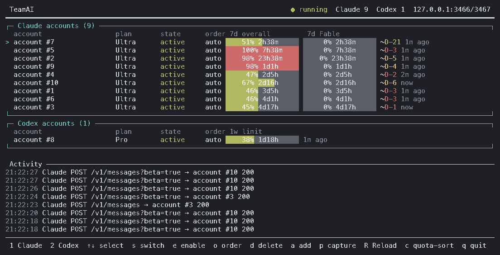

# TeamAI

[English](README.md) · [한국어](README.ko.md) · [日本語](README.ja.md) · [中文](README.zh-CN.md) · **Español**

TeamAI es un relé local multicuenta para **Claude Code**, la CLI oficial de **Codex** y la CLI oficial de **Grok**. Mantiene un grupo de cuentas independiente para cada proveedor y reintenta la solicitud con otra cuenta cuando la suscripción seleccionada no está disponible o se quedó sin cuota.



<sub>El panel de arriba es una captura real hecha con <code>teamai capture --redact full</code>: cuota y actividad reales, sin direcciones de cuentas.</sub>

> TeamAI es un proyecto de código abierto independiente. No está afiliado a Anthropic, a OpenAI, a xAI ni al servicio no relacionado de teamai.com.

## Requisitos

- Node.js 20 o superior
- macOS, Linux o Windows
- `claude` y/o `codex` instalados por separado
- Tus propias cuentas de suscripción Claude Pro/Max/Ultra, ChatGPT Codex o SuperGrok

## Instalación

```bash
git clone https://github.com/soulduse/team-ai.git
cd team-ai
./scripts/install.sh
```

`install.sh` instala las dependencias, compila, enlaza los comandos
`teamai`/`tai`/`tac`/`tax` y ofrece agregar el bloque de shell. Es idempotente:
vuelve a ejecutarlo para actualizar. Usa `--no-shell` para omitir el bloque de
shell, o `--dry-run` para ver qué haría sin aplicar cambios.

Para hacer lo mismo a mano:

```bash
npm install
npm run build          # obligatorio: dist/ no está versionado
npm link
```

En Windows, `install.sh` necesita un shell bash, así que usa los pasos manuales de arriba.
`npm link` crea los comandos `teamai`/`tai`/`tac`/`tax` para `cmd.exe` y
PowerShell, y los lanzadores ejecutan los `claude.cmd`/`codex.cmd` instalados con
npm escapando cada argumento para `cmd.exe`. Las secciones de configuración del
shell y de elemento de inicio de sesión son para macOS y Linux.

¿Quieres automatizar esto desde un agente de IA? Consulta [AGENTS.md](AGENTS.md),
que expone los mismos pasos como comandos deterministas con verificación y
ramas de error.

## Inicio rápido

```bash
teamai login
tai
```

`login` pregunta si quieres agregar `[1] Claude`, `[2] Codex` o `[3] Grok`. Repítelo para sumar más cuentas. `tai` es el comando corto de sesión y equivale a `teamai start`: levanta el relé local y abre el panel. Desde la TUI, pulsa `1` para lanzar Claude Code, `2` para lanzar Codex o `3` para lanzar Grok. Cuando el cliente termina, vuelves al panel.

Para iniciar una sesión directa con un proveedor, usa los lanzadores dedicados. Inician el relé de TeamAI automáticamente cuando hace falta y pasan todos los argumentos finales al cliente oficial:

```bash
tac                   # Claude Code a través del grupo de cuentas de TeamAI
tac --resume          # equivale a: teamai claude --resume
tax                   # Codex a través del grupo de cuentas de TeamAI
tax resume            # equivale a: teamai codex resume
tag                   # Grok CLI a través del grupo de cuentas de TeamAI
teamai claude         # forma larga de tac
teamai codex          # forma larga de tax
teamai grok           # forma larga de tag
teamai session        # elige [1] Claude, [2] Codex o [3] Grok de forma interactiva
```

Los nombres evitan deliberadamente reemplazar una función de shell `tc` existente de TeamClaude. `tc` puede seguir apuntando a TeamClaude mientras `tac` y `tax` apuntan a TeamAI.

## Configuración del shell

```bash
./scripts/install-shell.sh            # agrega un bloque delimitado a ~/.zshrc
./scripts/install-shell.sh --dry-run  # muestra el diff, no escribe nada
./scripts/install-shell.sh --uninstall
```

Define `cl` (Claude Code) y `co` (Codex) a través del grupo, además de `tai`,
`tais` y `taistart`/`tairestart`/`taistop` para el LaunchAgent, y desactiva
cualquier `ANTHROPIC_BASE_URL` fijada globalmente: TeamAI apunta cada sesión a
su propio puerto, así que un valor global obsoleto solo enruta el tráfico hacia
un proxy que quizá ya no esté en ejecución. El bloque está delimitado por
marcadores y se reescribe en su lugar, de modo que volver a ejecutarlo actualiza
en vez de acumular; cada escritura deja una copia de seguridad con marca de
tiempo, y los ciclos de instalación/desinstalación restauran el archivo byte a
byte.

El supervisor es opcional: `cl`, `co`, `tai` y `teamai run` levantan el relé por
su cuenta cuando no hay nada escuchando, así que siguen funcionando aunque el
LaunchAgent esté descargado, falle o nunca se haya instalado. Un `server.json`
obsoleto dejado por un proceso terminado se ignora y se reemplaza. Cuando el
arranque sí falla, se informa el motivo que devuelve el servidor (un puerto ya
en uso, un archivo de credenciales ilegible) en lugar de un escueto "did not
start", y la salida completa queda en
`~/.config/teamai/server-start.log`.

### Ejecutar el relé como elemento de inicio de sesión

Esto es opcional. Los alias `taistart`/`tairestart`/`taistop` instalados arriba
controlan un LaunchAgent con la etiqueta `com.teamai.proxy`, así que usa
exactamente esa etiqueta:

```xml
<!-- ~/Library/LaunchAgents/com.teamai.proxy.plist -->
<?xml version="1.0" encoding="UTF-8"?>
<!DOCTYPE plist PUBLIC "-//Apple//DTD PLIST 1.0//EN" "http://www.apple.com/DTDs/PropertyList-1.0.dtd">
<plist version="1.0">
<dict>
  <key>Label</key>          <string>com.teamai.proxy</string>
  <key>ProgramArguments</key>
  <array>
    <string>/usr/local/bin/node</string>
    <string>/ABSOLUTE/PATH/TO/team-ai/dist/src/cli.js</string>
    <string>server</string>
  </array>
  <key>RunAtLoad</key>      <true/>
  <key>KeepAlive</key>      <true/>
  <key>StandardErrorPath</key> <string>/tmp/teamai.err.log</string>
</dict>
</plist>
```

```bash
launchctl bootstrap gui/$(id -u) ~/Library/LaunchAgents/com.teamai.proxy.plist
```

Usa `command -v node` para obtener la ruta real de Node; un LaunchAgent no
hereda el PATH de tu shell.

## Cuentas

Codex usa su flujo habitual de inicio de sesión por navegador. TeamAI no requiere que esté habilitada la opción de autenticación por código de dispositivo de ChatGPT.

El inicio de sesión de Claude abre la página de autorización en el navegador predeterminado (`open` en macOS, `xdg-open` en Linux, `rundll32` en Windows). La URL también se imprime siempre, así que en una máquina sin interfaz ni navegador el inicio de sesión sigue adelante: ábrela en cualquier equipo y termina allí.

Importar credenciales es opcional y solo funciona cuando existe un archivo de credenciales exportable:

```bash
# Importa todas las cuentas desde una configuración existente de TeamClaude.
teamai import claude --from ~/.config/teamclaude.json

# Importa el inicio de sesión actual basado en archivos de la CLI de Codex, si existe.
teamai import codex
```

Las versiones recientes de Claude Code pueden guardar las credenciales en el Llavero de macOS en lugar de en `~/.claude/.credentials.json`; en ese caso usa `teamai login`. `import` nunca modifica los archivos originales de TeamClaude, Claude Code ni Codex. TeamAI usa un directorio de Codex aislado y persistente para las sesiones que pasan por el relé, de modo que el `~/.codex` original del usuario queda intacto.

**Grok.** `teamai login grok` ejecuta `grok login` en un `GROK_HOME` desechable, así que cada cuenta tiene su propio inicio de sesión y tu sesión de `~/.grok` no se reemplaza ni se comparte. Solo se puede agrupar el inicio de sesión propio de xAI (`auth.x.ai`); una clave de API o un inicio de sesión SSO de empresa no. `teamai import grok` lee `~/.grok/auth.json` sin modificarlo, pero la cuenta importada pasa a compartir un único token de actualización con tu propio `grok`: el que lo actualice primero puede cerrar la sesión del otro, así que es preferible usar `login` para una cuenta que también usas directamente. Una sesión a través del relé (`tag`) se ejecuta en `$TEAMAI_HOME/grok-home` con el token de cliente del relé como clave de API —tu `config.toml` se copia y `skills`, `installed-plugins` y `hooks` se enlazan, pero ningún inicio de sesión—, de modo que cada solicitud de modelo llega al relé, que la reenvía con una cuenta del grupo. El límite semanal de Grok se lee del mismo endpoint que usa su pantalla `/usage`, lo que no gasta cuota.

## Operación

```bash
teamai status                                  # estado del servidor + tabla de cuentas
teamai accounts [claude|codex]                 # solo la tabla de cuentas
teamai start                                   # inicia el relé y abre el panel
teamai stop                                    # detiene el relé
teamai restart                                 # detiene, inicia y abre el panel
teamai server                                  # ejecuta el relé en primer plano
teamai tui                                     # solo el panel, sin inicio automático
teamai disable codex user@example.com
teamai enable codex user@example.com
teamai priority claude user@example.com 1      # o bien: auto
teamai fable-only claude user@example.com on  # o bien: off
teamai capture [--redact partial|full|none] [--out DIR]   # guarda el panel como .txt y .png (sin TTY)
teamai usage [--json] [--redact partial|full|none]       # cuota por cuenta y ventana, en tabla o JSON
```

Las cuentas se ordenan según la cuota que les queda, de menor consumo a mayor,
tanto en el panel como en la propia selección del grupo, así que la fila
superior es la cuenta a la que iría la siguiente solicitud. Claude se evalúa por
su ventana semanal por modelo (Fable) en vez de la general, porque es esa la que
en la práctica rechaza primero el modelo superior. Cuando todas las cuentas
están agotadas, quedan empatadas y el orden pasa a depender de cuál se libera
antes: en una flota donde hoy nadie puede atender una solicitud, el tiempo hasta
el reinicio es lo único que las diferencia (Claude por su ventana Fable, Codex
por la semanal). Una cuenta sin medir se ordena al final (desconocido no es lo
mismo que vacío), una prioridad fijada sigue teniendo precedencia, y `c` alterna
de vuelta al orden configurado.

**Enrutamiento según el modelo.** Solo el modelo superior (el nivel Fable de
Claude) consume la ventana semanal por modelo, así que una solicitud que no lo
necesita —Opus, Sonnet, Haiku— se desvía de las cuentas que todavía tienen
presupuesto Fable hacia las cuentas cuya ventana Fable ya está agotada (en
`fableReserveThreshold` o por encima), ordenadas dentro de ese grupo por su
ventana semanal general. Así se reserva el escaso presupuesto Fable de cada
cuenta para las solicitudes que de verdad lo necesitan y se aprovecha el margen
semanal que de otro modo quedaría ocioso. Cuando no hay ninguna cuenta agotada
disponible, la solicitud recae en una reservada en lugar de fallar. Una
solicitud Fable conserva el orden normal de menor consumo; pon
`fableReserveThreshold` en `1` para desactivar la separación.

Un 429 de nivel Fable (`7d_oi` rechazada mientras la ventana compartida
`7d` sigue permitida) solo limita la ventana Fable de esa cuenta, no la
cuenta: todos los demás modelos se siguen atendiendo desde ella, en vez de que
la cuenta entera quede inactiva hasta una semana por un presupuesto que solo
consume el modelo superior. Un 429 que rechaza una ventana compartida limita la
cuenta como de costumbre.

**Cuentas solo Fable.** Desactivado por defecto en todas las cuentas: `teamai fable-only claude <cuenta> on` convierte una cuenta de Claude en la casa de Fable. Mientras su ventana semanal por modelo (Fable) tenga presupuesto, toda solicitud Fable va primero a ella —por delante de cualquier otra cuenta, incluso de una prioridad fijada— y no se le enruta ninguna solicitud de otro modelo (Opus, Sonnet, Haiku); solo los sondeos de cuota en segundo plano del propio relay pueden tocarla. La asignación de Fable es como mucho la mitad del límite semanal, así que cuando esa ventana se agota el resto de la semana de la cuenta quedaría ocioso: desde entonces Fable pasa a las demás cuentas y la cuenta solo Fable atiende los demás modelos como cualquier otra. El panel muestra su estado como `fable` mientras está reservada. Un relay en marcha aplica el cambio con `R` en el panel o con `teamai restart`.

**Tickets de reinicio de límite.** Claude puede otorgar a una cuenta tickets de reinicio de límite. La columna `resets` y `teamai accounts` muestran cuántos tiene cada cuenta: `R<n>` reinicia todo el límite semanal y `F<n>` solo la ventana Fable. Se leen de la misma solicitud de uso que el relay ya hace (`?cedar_ember=1`); TeamAI solo los muestra y nunca canjea ninguno: úsalos desde Claude. La columna solo aparece cuando alguna cuenta tiene tickets y la fila todavía cabe en el ancho del terminal. Un recuento que nadie ha vuelto a leer en un día puede estar ya gastado, así que se atenúa (`, stale` en `teamai accounts`). Si el servidor rechaza la solicitud de tickets de una cuenta pero la lectura normal funciona, el relay lee la cuota de esa cuenta de la forma normal y deja de pedirle tickets durante seis horas.

La TUI a pantalla completa agrupa las cuentas de Claude y de Codex, y mantiene anclada la cuenta seleccionada aunque cambie el uso. Las filas de Claude muestran de forma independiente la ventana `7d overall` y la ventana por modelo `7d Fable` (Claude integró su límite de sesión de 5 horas en el semanal en noviembre de 2026, así que la columna `5h session` solo aparece mientras alguna cuenta siga reportando una ventana de 5 horas activa); las filas de Codex muestran su ventana primaria y secundaria, cada una titulada con el periodo que esa cuenta realmente reporta (`1w limit`); las filas de Grok muestran el límite semanal del plan, la cifra que muestra su pantalla `/usage`. Las cuotas se aprenden de las respuestas del cliente oficial y se conservan entre reinicios.

El pie de página ofrece el mismo flujo de trabajo de cuentas que TeamClaude: lanzar Claude/Codex/Grok, seleccionar, cambiar, habilitar/deshabilitar, ordenar, eliminar, agregar/iniciar sesión, volver a medir (`R`) y salir. `switch` fija la cuenta seleccionada al frente del grupo de su proveedor; el modo de orden permite asignar un puesto o devolver una cuenta a la programación automática. Al actualizar el perfil de Claude se muestra el nivel del plan (`Ultra` (antes Max 20x), `Max 5x`, `Pro`; un nivel que TeamAI no reconoce se muestra con el nombre reportado en lugar de `OAuth`) y, en rojo, los estados de suscripción problemáticos como `past_due`.

`v` abre un menú para mostrar u ocultar: cada sección de cuentas (Claude, Codex, Grok), cada indicador (Claude 5h session, 7d overall, 7d Fable, tickets de reinicio; primer y segundo límite de Codex; límite semanal de Grok), las columnas de plan, estado, orden, renovación y hora de medición, y el registro de actividad se pueden apagar y volver a encender con Espacio o Enter. La elección se guarda en `config.json` como `display.hidden`, así que se mantiene tras reiniciar y en `teamai capture`; solo cambia lo que se dibuja, nunca el enrutamiento, y el cursor salta las secciones ocultas. En el pie, `s` (fijar al frente) aparece como `pin` y `d` como `del`; cuando las indicaciones no caben en el ancho de la terminal, se quitan las menos necesarias (primero `↑↓ move`), mientras que salir y las teclas de lanzamiento siempre se quedan.

`p` guarda una captura del panel, y `teamai capture` hace lo mismo desde un script o un agente sin necesidad de terminal. Cada captura es un par de archivos bajo `~/.config/teamai/captures/` (o `--out DIR`): el cuadro como texto con sus colores intactos, y el mismo cuadro como PNG dibujado con una fuente de mapa de bits integrada, así que no hace falta nada más que Node. Las direcciones de las cuentas se enmascaran antes de dibujar el cuadro —en la columna de cuentas, en el pie y en el registro de actividad por igual— como `de•••••••••w@gm•••.com` de forma predeterminada; `--redact full` las reemplaza por `account #N`, y `--redact none` las conserva para una captura que se quede en privado. Desde el panel, `p` toma la captura predeterminada y `P` (shift) la de `account #N`; ambas además muestran el PNG en el administrador de archivos y copian la imagen al portapapeles —en macOS sin configurar nada, en Linux si están instalados `xdg-open` y `wl-copy` o `xclip`, y en Windows solo se guardan los archivos— y el pie indica cuáles de esas acciones ocurrieron. La imagen al comienzo de este README es una de esas capturas.

`R` vuelve a medir la cuota de toda la flota. La cuota nunca se consulta desde un endpoint aparte: se aprende de los encabezados de límite de tasa que devuelve el upstream, así que una cuenta que no ha atendido tráfico muestra `-` hasta que algo la mida. `R` reproduce en paralelo una forma de solicitud que ya se sabe aceptada contra cada cuenta inactiva (incluidas las ya medidas y las limitadas, cuyos 429 igualmente traen encabezados autoritativos) e informa un recuento honesto de `measured/targets`. Esa forma de solicitud solo se fija a partir de un 2xx real que haya pasado por el proxy, de modo que hasta que una solicitud no haya tenido éxito, `R` informa que todavía no existe una plantilla de sondeo en lugar de adivinar una carga útil. Las cuentas a las que les falta la ventana semanal por modelo (Fable) reciben un sondeo complementario adicional, porque esa ventana solo aparece en las respuestas a solicitudes de nivel Fable.

El servidor además hace un calentamiento por su cuenta cada cinco minutos (`warmupIntervalMs`, `0` para desactivarlo): limpia las ventanas de cuota que el upstream ya reinició y mide únicamente las cuentas sin medir, de modo que una flota estable no cuesta nada por ciclo y una ventana que se renueva se rellena sin que nadie pulse `R`. Una cuenta cuyo upstream nunca reporta cuota se descarta tras tres intentos infructuosos, y ese presupuesto se renueva cada vez que su ventana se reinicia o pulsas `R`.

Las cuentas inactivas se mantienen vivas en el mismo ciclo de cinco minutos: cualquier cuenta cuyo token esté por vencer o cuyo último intento haya dado error se refresca, de a una por vez. El tráfico normal se concentra en unas pocas cuentas y el calentamiento a propósito nunca refresca, así que sin esto una cuenta que nadie usa podría dejar caducar su cadena de refresh-token y que el upstream la invalide. El barrido es secuencial a propósito: refrescar toda la flota de golpe tras una caída prolongada dispararía el endpoint de tokens contra un límite de tasa.

La cuota aprendida (uso, ventanas, tiempos de reinicio, perfil de suscripción) se escribe en disco y se restaura en el siguiente arranque, de modo que el panel y el orden sobreviven a un reinicio sin volver a medir; la forma de sondeo que reproduce `R` se persiste igual. Las señales por respuesta no: un enfriamiento o un error se descartan a propósito al reiniciar, así una cuenta nunca vuelve a quedar limitada por el retry-after de un 429 obsoleto; si de verdad está agotada, la siguiente solicitud vuelve a deducir el estado correcto.

Si llegan a la vez más solicitudes de las que puede atender la concurrencia combinada por cuenta de la flota, el relé rechaza el excedente con `429` (`x-teamai-429-reason: concurrency_saturated`) antes de leer el cuerpo de la solicitud, en lugar de almacenar cuerpos sin límite. Ese mismo encabezado distingue una flota ocupada de una agotada (`quota_exhausted`) en el 429 de "no hay cuenta disponible".

El valor de suscripción `~D-N` es una estimación, no una fecha de vencimiento autoritativa: el endpoint de perfil de Anthropic expone el estado de la suscripción y la fecha de creación, pero no el fin del periodo de facturación actual. Por eso TeamAI estima el siguiente aniversario mensual de facturación y lo marca con `~`. El estado del perfil se actualiza al arrancar el servidor y cada seis horas.

## Consultar el uso desde otras sesiones y scripts

El panel es para ti; `teamai usage` ofrece los mismos datos a todo lo demás: otra sesión de Claude Code o Codex, un script de shell, una línea de estado o un agente que decide si empezar un trabajo largo.

```bash
teamai usage                    # tabla: cada cuenta, cada ventana, tiempo hasta el reinicio
teamai usage --json             # lo mismo en JSON
teamai usage --json --redact full   # cuentas como "account #N"
```

```text
TeamAI usage (live from the server, 2026-11-17T02:17:41.007Z)

claude: 3/9 available, next reset 9h43m
  ○ account #1  7d 98% (2d15h)  7d_oi 100% (2d15h)
  ● account #5  7d 5% (6d17h)  7d_oi 8% (6d17h)
  ● account #6  7d 35% (3d11h)  7d_oi 69% (3d11h)  [2 in flight]

codex: 1/1 available, next reset 1d5h
  ● account #8  primary 37% (1d5h)  secondary 0%
```

Con el relay en marcha, el informe sale en vivo de sus pools, con las peticiones en curso y el motivo de cada cooldown. Si no está en marcha (o es una versión anterior sin el endpoint), el mismo informe se construye desde `state.json`, y `source` indica cuál recibiste. No se mide nada para responder: no gasta cuota, así que puedes llamarlo tantas veces como quieras.

El JSON, abreviado:

```json
{
  "source": "live",
  "generatedAt": "2026-11-17T02:17:41.007Z",
  "providers": {
    "claude": {
      "summary": { "accounts": 9, "enabled": 9, "available": 3, "nextResetAt": "2026-11-17T12:00:00.475Z" },
      "accounts": [{
        "id": "…", "label": "de•••••••••w@gm•••.com", "enabled": true, "priority": null,
        "plan": "default_claude_max_20x", "usage": 0.05,
        "windows": { "7d": { "usage": 0.05, "resetsAt": "…", "resetsInMs": 579600000 },
                     "7d_oi": { "usage": 0.08, "resetsAt": "…", "resetsInMs": 579600000 } },
        "measuredAt": "…", "resetTickets": null, "cooldownUntil": null, "cooldownReason": null,
        "error": null, "inflight": 0, "available": true
      }]
    },
    "codex": { "summary": { "…": "…" }, "accounts": [] }
  }
}
```

`usage` es una fracción entre 0 y 1. Los nombres de ventana son los que reporta upstream: en Claude `7d` (semanal general), `7d_oi` (semanal del modelo superior) y `5h` mientras exista; en Codex `primary` y `secondary`; en Grok `weekly`. `available` significa habilitada, sin error, sin cooldown y por debajo de `switchThreshold`. `inflight` es `null` cuando el informe viene de `state.json`. `resetTickets` es `null` en Codex y en una cuenta de Claude cuyos tickets nunca se han leído; si no, es `{ general, fable, nextExpiry, readAt, stale }`, donde `stale` indica que el recuento tiene más de un día. Las direcciones se enmascaran como en las capturas (`--redact`); los tokens y credenciales nunca forman parte del informe.

### El endpoint HTTP

El mismo informe se sirve en el puerto de control, ligado a `127.0.0.1` y protegido por el token de cliente del relay como todo lo demás allí:

```bash
curl -s -H "Authorization: Bearer $TOKEN" "http://127.0.0.1:3556/usage?redact=partial"
```

`3556` es el valor por defecto de `proxy.controlPort`; si lo cambiaste, usa el tuyo (`jq .proxy.controlPort ~/.config/teamai/config.json`). Dentro de una sesión iniciada con `tac`, `$ANTHROPIC_AUTH_TOKEN` ya contiene ese token. En cualquier otro sitio, `teamai usage --json` es más sencillo: lee el token de tu configuración por sí mismo.

### Formas de usarlo

**Comprobar antes de un trabajo largo.** Un agente o un script puede mirar el margen antes de empezar algo que consumirá mucha cuota:

```bash
available=$(teamai usage --json | jq '.providers.claude.summary.available')
[ "$available" -gt 0 ] || { echo "No Claude account free right now"; exit 1; }
```

**Esperar al reinicio en lugar de fallar.** Un trabajo por lotes puede dormir hasta que la ventana más próxima se renueve:

```bash
until [ "$(teamai usage --json | jq '.providers.claude.summary.available')" -gt 0 ]; do
  sleep 600
done
```

**Mostrarlo en la línea de estado de Claude Code.** Apunta `statusLine` en `~/.claude/settings.json` a un script pequeño; lee el endpoint directamente, así que es rápido:

```bash
#!/bin/sh
# ~/.claude/teamai-statusline.sh
config="${TEAMAI_HOME:-${XDG_CONFIG_HOME:-$HOME/.config}/teamai}/config.json"
port=$(jq -r '.proxy.controlPort // 3556' "$config")
curl -s -m 1 -H "Authorization: Bearer $ANTHROPIC_AUTH_TOKEN" "http://127.0.0.1:$port/usage" |
  jq -r '.providers.claude.summary |
    "TeamAI \(.available)/\(.enabled) free" +
    (if .nextResetAt then " · reset in \(((.nextResetAt | sub("\\.[0-9]+Z$";"Z") | fromdate) - now) / 3600 | floor)h" else "" end)'
```

```json
{ "statusLine": { "type": "command", "command": "~/.claude/teamai-statusline.sh" } }
```

**Contárselo a un agente.** Añade una línea al `CLAUDE.md` o `AGENTS.md` de tu proyecto — "Antes de un trabajo largo o en paralelo, ejecuta `teamai usage --json` y revisa `providers.claude.summary.available`" — y cada sesión de ese proyecto sabrá cuánto margen queda sin abrir el panel.

**Avisar cuando se agote.** Un cron o un LaunchAgent puede consultar el resumen y enviar una notificación cuando `available` llegue a 0, o listar las cuentas con `error` para saber cuáles necesitan `teamai login` de nuevo.

## Configuración

La configuración y las credenciales viven en `$TEAMAI_HOME`, con respaldo en
`$XDG_CONFIG_HOME/teamai` y luego en `~/.config/teamai`. Los proxies se enlazan
a `127.0.0.1` y exigen un token de cliente local generado.

`config.json` se crea en la primera ejecución con estos valores por defecto:

| Clave | Valor por defecto | Significado |
| --- | --- | --- |
| `proxy.host` | `127.0.0.1` | Dirección de enlace. Solo loopback, por diseño. |
| `proxy.claudePort` | `3456` | Puerto del relé de Claude. |
| `proxy.codexPort` | `3457` | Puerto del relé de Codex. |
| `proxy.grokPort` | `3458` | Puerto del relé de Grok. Opcional; una configuración antigua sin esta clave usa el valor predeterminado. |
| `proxy.controlPort` | `3556` | Canal de control con el que hablan la TUI y `teamai usage` (`/probe`, `GET /usage`). |
| `proxy.clientToken` | generado | Token local que debe enviar todo cliente que pase por el relé. |
| `switchThreshold` | `0.98` | Proporción de uso por encima de la cual una cuenta deja de seleccionarse. |
| `warmupIntervalMs` | `300000` | Intervalo de remedición en segundo plano. `0` lo desactiva. |
| `maxConcurrentPerAccount` | `16` | Solicitudes en curso permitidas por cuenta. `0` significa sin límite. |
| `fableReserveThreshold` | `0.8` | Uso de la ventana Fable a partir del cual la cuenta se prefiere para solicitudes que no son Fable. `1` desactiva el enrutamiento según el modelo. |
| `display.hidden` | — | Opcional. Partes del panel desactivadas desde el menú `v`, p. ej. `["section:codex", "activity"]`. Solo visual. |
| `proxy.legacyPorts` | — | Opcional. Puertos adicionales en los que seguir respondiendo, por proveedor — p. ej. `{ "claude": [3400] }`. |

Cambia un puerto si otro proceso ya lo ocupa: esa es la causa habitual de un
arranque fallido, y el motivo aparece en `server-start.log`.

Al cliente se le entrega su URL base al arrancar y ya no se puede redirigir
después, así que mover un puerto en `config.json` dejaría, de otro modo, sin
conexión a toda sesión ya abierta con «connection refused». Por eso el relé
también responde en el puerto por defecto integrado y en cualquier
`proxy.legacyPorts` que indiques, manteniendo vivas las sesiones abiertas al
cambiar de puerto. Un puerto heredado que ya esté ocupado por otro proceso se
omite sin afectar al puerto principal, y un error de socket posterior al
arranque se registra en lugar de dejar que tumbe el relé.

## Alcance y cumplimiento

La versión 0.1 apunta a cuentas OAuth de suscripción y a sesiones de CLI lanzadas mediante un wrapper. No expone una API pública compatible con OpenAI, no convierte solicitudes de Claude en solicitudes de Codex, no da soporte a Codex Desktop ni agrupa credenciales de personas distintas. La responsabilidad de cumplir los términos y las políticas de los proveedores es tuya. Las cargas de trabajo de API en producción o con fines comerciales deberían usar los mecanismos oficiales de facturación de API de los proveedores.

**Gemini / Antigravity no está soportado, a propósito.** Los términos de todos los proveedores consideran fuera del uso normal rotar varias cuentas de suscripción para esquivar los límites de uso, pero quien lo hace cumplir es Google: la FAQ de Antigravity declara que "automatizar la rotación de cuentas" no está soportado en los planes de consumo, sus términos convierten el acceso a Antigravity mediante software de terceros en motivo de suspensión, y las herramientas de código abierto que agrupan inicios de sesión de Antigravity o Gemini CLI han informado de cuentas desactivadas en oleadas a lo largo de 2026, con suspensión permanente en caso de reincidencia. Además, la CLI de Antigravity no tiene ninguna forma documentada de cambiar el endpoint y guarda el inicio de sesión de cuentas personales solo en el llavero del sistema, así que agruparla obligaría a TeamAI a custodiar tokens de Google. Lo que Google recomienda para herramientas de terceros es una clave de API de AI Studio o Vertex, que es facturación por uso y no un grupo de suscripciones, así que queda fuera de lo que hace TeamAI.

## Desarrollo

```bash
npm run typecheck
npm test
npm run lint
```

Consulta [NOTICE](NOTICE) para lo relativo a obra derivada y [SECURITY.md](SECURITY.md) para el modelo de seguridad local.

> Translation update pending: see the canonical English README for nested Codex relay configuration inheritance.

<!-- transient-recovery-2026-09-22 -->
Los errores transitorios conservan el estado HTTP, el cuerpo y Retry-After originales. Tras cambiar de cuenta, el relay permite hasta dos rondas de reintento, con un máximo de 10 segundos de espera por ronda y 20 en total. Las esperas mayores se devuelven al cliente; los streams exitosos no se repiten. Los reintentos HTTP de Codex siguen desactivados para evitar duplicarlos. Reinicia el relay después de compilar para aplicar los cambios.
