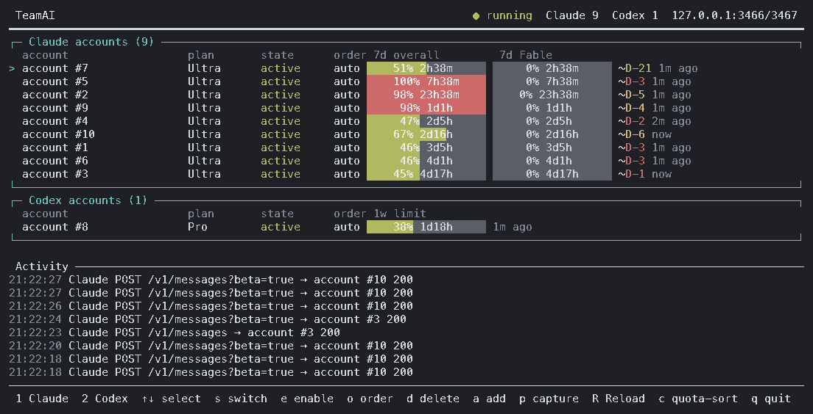

# TeamAI

[English](README.md) · [한국어](README.ko.md) · **日本語** · [中文](README.zh-CN.md) · [Español](README.es.md)

TeamAI は **Claude Code**、公式 **Codex CLI**、公式 **Grok CLI** のためのローカル多アカウントリレーです。プロバイダーごとに独立したアカウントプールを保持し、選ばれたサブスクリプションが利用できない、またはクォータを使い切っている場合は別のアカウントでリクエストを再試行します。



<sub>上のダッシュボードは <code>teamai capture --redact full</code> で作った実際のキャプチャです。実際のクォータとアクティビティログで、アカウントのアドレスは含まれていません。</sub>

> TeamAI は独立したオープンソースプロジェクトです。Anthropic、OpenAI、xAI、および無関係なサービスである teamai.com とは一切関係ありません。

## 必要環境

- Node.js 20 以上
- macOS、Linux、または Windows
- `claude` および／または `codex` を別途インストール済みであること
- ご自身の Claude Pro/Max/Ultra、ChatGPT Codex または SuperGrok のサブスクリプションアカウント

## インストール

```bash
git clone https://github.com/soulduse/team-ai.git
cd team-ai
./scripts/install.sh
```

`install.sh` は依存関係のインストール、ビルド、`teamai`/`tai`/`tac`/`tax` コマンドのリンクを行い、シェルブロックを追加するかどうかを尋ねます。冪等なので、アップグレードする際は再実行するだけで済みます。シェルブロックを省略するには `--no-shell`、実際には変更せず何が行われるかを確認するには `--dry-run` を渡してください。

手動で同じことを行う場合:

```bash
npm install
npm run build          # 必須: dist/ はコミットされていません
npm link
```

Windows では `install.sh` に bash シェルが必要なため、上の手動手順を使ってください。`npm link` が `cmd.exe`・PowerShell 用の `teamai`/`tai`/`tac`/`tax` コマンドを作成し、ランチャーは npm でインストールされた `claude.cmd`/`codex.cmd` を、すべての引数を `cmd.exe` 向けにエスケープして起動します。以下のシェル設定とログイン項目の節は macOS・Linux 向けです。

AI エージェントからこれを自動化しますか？ [AGENTS.md](AGENTS.md) に、同じ手順が検証と失敗時の分岐を備えた決定的なコマンドとしてまとめられています。

## クイックスタート

```bash
teamai login
tai
```

`login` は `[1] Claude`、`[2] Codex`、`[3] Grok` のどれを追加するかを尋ねます。アカウントを追加するには繰り返し実行してください。`tai` は短いセッションコマンドで、`teamai start` と同等です。ローカルリレーを起動してダッシュボードを開きます。TUI で `1` を押すと Claude Code が、`2` を押すと Codex が、`3` を押すと Grok が起動します。クライアントを終了するとダッシュボードに戻ります。

特定のプロバイダーで直接セッションを開始するには、専用のランチャーを使います。必要に応じて TeamAI リレーを自動的に起動し、後続の引数はすべて公式クライアントにそのまま渡します。

```bash
tac                   # TeamAI のアカウントプール経由の Claude Code
tac --resume          # teamai claude --resume と同じ
tax                   # TeamAI のアカウントプール経由の Codex
tax resume            # teamai codex resume と同じ
tag                   # TeamAI のアカウントプール経由の Grok CLI
teamai claude         # tac の長い形式
teamai codex          # tax の長い形式
teamai grok           # tag の長い形式
teamai session        # [1] Claude、[2] Codex、[3] Grok を対話的に選択
```

これらの名前は、既存の TeamClaude の `tc` シェル関数を置き換えないよう意図的に選ばれています。`tc` は引き続き TeamClaude を、`tac` と `tax` は TeamAI を対象にできます。

## シェル設定

```bash
./scripts/install-shell.sh            # ~/.zshrc にマーカー付きのブロックを追加
./scripts/install-shell.sh --dry-run  # 差分を表示するだけで、書き込みは行わない
./scripts/install-shell.sh --uninstall
```

プールを経由する `cl`（Claude Code）と `co`（Codex）、さらに `tai`、`tais`、LaunchAgent 用の `taistart`/`tairestart`/`taistop` を定義し、グローバルに固定された `ANTHROPIC_BASE_URL` を解除します。TeamAI はセッションごとに独自のポートを指すため、古いグローバル値が残っていると、すでに動いていないかもしれないプロキシへトラフィックを送るだけになるからです。このブロックはマーカーで区切られ、その場で書き換えられるので、再実行しても追記されるのではなく更新されます。書き込みのたびにタイムスタンプ付きのバックアップが残り、インストールとアンインストールを繰り返してもファイルはバイト単位で復元されます。

スーパーバイザーは任意です。`cl`、`co`、`tai`、`teamai run` はいずれも、何もリッスンしていなければ自分でリレーを起動するため、LaunchAgent がアンロードされていても、失敗していても、そもそもインストールされていなくても動作し続けます。強制終了されたプロセスが残した古い `server.json` は無視されて置き換えられます。起動に失敗した場合は、素っ気ない「did not start」ではなく、サーバーから返された理由（ポートがすでに使用中、資格情報ファイルが読み取れない、など）が報告され、完全な出力は `~/.config/teamai/server-start.log` に保存されます。

### リレーをログイン項目として実行する

これは任意です。上でインストールされる `taistart`/`tairestart`/`taistop` エイリアスは `com.teamai.proxy` というラベルの LaunchAgent を操作するため、このラベルを正確にそのまま使ってください。

```xml
<!-- ~/Library/LaunchAgents/com.teamai.proxy.plist -->
<?xml version="1.0" encoding="UTF-8"?>
<!DOCTYPE plist PUBLIC "-//Apple//DTD PLIST 1.0//EN" "http://www.apple.com/DTDs/PropertyList-1.0.dtd">
<plist version="1.0">
<dict>
  <key>Label</key>          <string>com.teamai.proxy</string>
  <key>ProgramArguments</key>
  <array>
    <string>/usr/local/bin/node</string>
    <string>/ABSOLUTE/PATH/TO/team-ai/dist/src/cli.js</string>
    <string>server</string>
  </array>
  <key>RunAtLoad</key>      <true/>
  <key>KeepAlive</key>      <true/>
  <key>StandardErrorPath</key> <string>/tmp/teamai.err.log</string>
</dict>
</plist>
```

```bash
launchctl bootstrap gui/$(id -u) ~/Library/LaunchAgents/com.teamai.proxy.plist
```

Node の実際のパスは `command -v node` で確認したものを使ってください。LaunchAgent はシェルの PATH を引き継ぎません。

## アカウント

Codex は通常のブラウザログインフローをそのまま使います。TeamAI は、ChatGPT の任意設定であるデバイスコード認証を有効にしておくことを要求しません。

Claude のログインは既定のブラウザで認可ページを開きます（macOS は `open`、Linux は `xdg-open`、Windows は `rundll32`）。URL は常にあわせて表示されるので、ブラウザを開けないヘッドレス環境でもログインは止まりません。任意のマシンでその URL を開いて完了してください。

資格情報のインポートは任意で、エクスポート可能な資格情報ファイルが存在する場合にのみ動作します。

```bash
# 既存の TeamClaude 設定からすべてのアカウントをインポートする
teamai import claude --from ~/.config/teamclaude.json

# Codex CLI の現在のファイルベースのログインをインポートする（存在する場合）
teamai import codex
```

最近のバージョンの Claude Code は、資格情報を `~/.claude/.credentials.json` ではなく macOS キーチェーンに保存することがあります。その場合は `teamai login` を使ってください。`import` は元の TeamClaude、Claude Code、Codex のファイルを一切変更しません。TeamAI はリレーされるセッション用に隔離された永続的な Codex ホームを使うため、ユーザー本来の `~/.codex` はそのまま残ります。

**Grok.** `teamai login grok` は使い捨ての `GROK_HOME` で `grok login` を実行するため、アカウントごとに独立したサインインが得られ、ご自身の `~/.grok` のセッションが置き換えられたり共有されたりすることはありません。プールに入れられるのは xAI 自身のサインイン（`auth.x.ai`）だけで、API キーや企業の SSO ログインは入れられません。`teamai import grok` は `~/.grok/auth.json` を変更せずに読み込みますが、インポートしたアカウントはご自身の `grok` と 1 つのリフレッシュトークンを共有することになります。先に更新した側がもう一方をサインアウトさせることがあるため、直接も使うアカウントには `login` を使うことをおすすめします。リレーされるセッション（`tag`）は `$TEAMAI_HOME/grok-home` で、リレーのクライアントトークンを API キーとして実行されます。`config.toml` はコピーされ、`skills`・`installed-plugins`・`hooks` はリンクされますが、サインイン情報は引き継がれません。そのため、すべてのモデルリクエストはリレーに届き、リレーがプールのアカウントで送り出します。Grok の週間制限は `/usage` 画面と同じエンドポイントから読み取るため、クォータを消費しません。

## 運用

```bash
teamai status                                  # サーバー状態 + アカウント表 + 最近の通知
teamai accounts [claude|codex]                 # アカウント表のみ
teamai start                                   # リレーを起動し、ダッシュボードを開く
teamai stop                                    # リレーを停止
teamai restart                                 # 停止、起動、ダッシュボードを開く
teamai server                                  # リレーをフォアグラウンドで実行
teamai tui                                     # ダッシュボードのみ、自動起動なし
teamai disable codex user@example.com
teamai enable codex user@example.com
teamai priority claude user@example.com 1      # または: auto
teamai fable-only claude user@example.com on  # または: off
teamai capture [--redact partial|full|none] [--out DIR]   # ダッシュボードを .txt と .png に保存（TTY 不要）
teamai usage [--json] [--redact partial|full|none]       # アカウント・ウィンドウ別の使用量を表または JSON で
```

アカウントはクォータの残りが多い順、つまり消費が少ない順に並びます。これはダッシュボードでもプール自身の選択でも同じなので、一番上の行が次のリクエストの送り先になるアカウントです。Claude は全体の週次ウィンドウではなくモデル別週次（Fable）ウィンドウで判定します。最上位モデルを最初に拒否するのが実際にはそのウィンドウだからです。すべてのアカウントを使い切ると全員が同点になり、順序は最も早く空くものが先という基準に引き継がれます。今日どのアカウントもリクエストを処理できない状況では、リセットまでの時間だけが区別する唯一の手がかりになります（Claude は Fable ウィンドウ、Codex は週次ウィンドウを基準とします）。未計測のアカウントは最後に並び（不明は空であることと同じではありません）、ピン留めされた優先度は依然として優先され、`c` で設定された順序に戻せます。

**モデル対応ルーティング.** モデル別週次ウィンドウを消費するのは最上位モデル（Claude の Fable ティア）だけなので、それを必要としないリクエスト（Opus、Sonnet、Haiku）は、まだ Fable の残量があるアカウントを避け、Fable ウィンドウをすでに使い切った（`fableReserveThreshold` 以上の）アカウントへ振り分けられ、そのグループ内では全体の週次ウィンドウの残量順に並べられます。こうすることで、各アカウントの希少な Fable の残量を本当にそれを必要とするリクエストのために取っておき、遊んでいる週次の余力を活かせます。使い切ったアカウントに空きがないときは、失敗させるのではなく、取っておいたアカウントにフォールバックします。Fable リクエストは通常どおり消費の少ない順を保ちます。`fableReserveThreshold` を `1` にするとこの振り分けを無効化できます。

Fable ティアの 429（共有の `7d` ウィンドウはまだ許可されている一方で `7d_oi` が拒否された場合）は、アカウント全体ではなくそのアカウントの Fable ウィンドウだけをベンチに下げます。最上位モデルしか消費しない予算のためにアカウント全体が最大 1 週間眠ってしまうのではなく、他のすべてのモデルは引き続きそのアカウントから提供されます。共有ウィンドウを拒否する 429 は、これまでどおりアカウントをベンチに下げます。

**Fable 専用アカウント.** 既定ではすべてのアカウントで無効です。`teamai fable-only claude <アカウント> on` で Claude アカウントを 1 つ Fable 専用にします。そのアカウントのモデル別週次（Fable）ウィンドウに予算が残っている間は、すべての Fable リクエストが他のどのアカウント（固定優先度を含む）よりも先にそこへ送られ、他のモデル（Opus、Sonnet、Haiku）のリクエストは送られません（リレー自身のバックグラウンドのクォータ計測のみ例外）。Fable の枠は最大で週次上限の半分なので、そのウィンドウを使い切ると残りの週次枠が遊んでしまいます。そのため以降は Fable が他のアカウントへ流れ、Fable 専用アカウントは他のモデルを通常どおり処理します。予約中はダッシュボードの状態が `fable` と表示されます。実行中のリレーはダッシュボードの `R` または `teamai restart` で変更を反映します。

**上限リセットチケット.** Claude はアカウントに上限リセットチケットを付与することがあります。`resets` 列と `teamai accounts` に各アカウントの保有数を表示します: `R<n>` は週次上限全体、`F<n>` は Fable ウィンドウのみをリセットします。リレーが既に送っている使用量リクエスト（`?cedar_ember=1`）から読み取り、TeamAI は表示するだけでチケットを使いません — 使用は Claude 側で行ってください。この列はチケットを持つアカウントがあり、行が端末幅に収まるときだけ表示されます。1 日以上読み直せていない数はすでに使われている可能性があるため薄く表示します（`teamai accounts` では `, stale`）。あるアカウントでチケットのリクエストだけが拒否され通常の読み取りは通る場合、そのアカウントは通常の方法でクォータだけを読み、6 時間はチケットを問い合わせません。

フルスクリーンの TUI は Claude と Codex のアカウントをグループ分けし、使用量が変化しても現在選択中のアカウントを固定したままにします。Claude の行は `7d overall` とモデル単位の `7d Fable` の各ウィンドウを個別に表示します（Claude は 2026 年 11 月に 5 時間のセッション制限を週間制限へ統合したため、`5h session` 列は有効な 5 時間ウィンドウを報告するアカウントがある間だけ表示されます）。Codex の行は主・副のウィンドウを表示し、それぞれにそのアカウントが実際に報告した期間（`1w limit`）を見出しとして付けます。Grok の行はプランの週間制限（`/usage` 画面に表示される値）を表示します。クォータは公式クライアントの応答から学習され、再起動後も保持されます。

フッターは TeamClaude と同じアカウントワークフローを提供します。Claude/Codex/Grok の起動、選択、切り替え、有効化／無効化、並び替え、削除、追加／ログイン、再計測（`R`）、終了です。`switch` は選択したアカウントをそのプロバイダーのプールの先頭にピン留めします。並び替えモードでは順位を割り当てたり、アカウントを自動スケジューリングに戻したりできます。Claude のプロフィールを更新すると、プランのティア（`Ultra`（旧 Max 20x）、`Max 5x`、`Pro`。TeamAI が知らないティアは `OAuth` ではなく報告された名前のまま）と `past_due` のような不健全なサブスクリプション状態が赤色で表示されます。サブスクリプションが延滞しているアカウント（`past_due`、`unpaid`）は最後に使われます。アップストリームがセッションの途中で止める可能性があるため、引き続き使いはしますが、正常なアカウントがリクエストを受けられないときだけです。 Grok のトークンはプランを数値でしか持たないため、`7` は `Super`、それ以外は `tier N` と表示します。数値はトークン発行時に固定されるため、プラン変更は次のトークン更新後に反映されます。

`v` で表示設定メニューが開きます。アカウントセクション（Claude、Codex、Grok）、各ゲージ（Claude の 5h session・7d overall・7d Fable・リセットチケット、Codex の第 1・第 2 リミット、Grok の週間リミット）、plan・state・order・更新日・計測時刻の列、Activity ログを Space または Enter でオン／オフできます。選択は `config.json` の `display.hidden` に保存され、再起動後や `teamai capture` でも維持されます。変わるのは表示だけでルーティングには影響せず、非表示のセクションにはカーソルが移動しません。フッターでは `s`（先頭に固定）を `pin`、`d` を `del` と短く表示します。ヒントが端末の幅に収まらないときは、必要性の低いもの（まず `↑↓ move`）から省きますが、終了と起動のキーは常に残ります。

`p` はダッシュボードをキャプチャして保存し、`teamai capture` は端末なしでスクリプトやエージェントから同じことを行います。キャプチャは `~/.config/teamai/captures/`（または `--out DIR`）配下にファイル一組として残ります。色をそのまま保ったテキストのフレームと、内蔵のビットマップフォントで描いた同じフレームの PNG で、Node 以外に必要なものはありません。アカウントのアドレスはフレームを描く前にマスクされるため、アカウント列・フッター・アクティビティログのどこにも残りません。既定は `de•••••••••w@gm•••.com` 形式の部分マスクで、`--redact full` は `account #N` に置き換え、`--redact none` は自分だけで見るキャプチャのためにアドレスをそのまま残します。ダッシュボードでは `p` が既定のマスク、`P`（shift）が `account #N` でのキャプチャで、どちらも保存に加えてファイルマネージャーでその PNG を選択した状態で開き、画像をクリップボードにコピーします。macOS ではそのまま動作し、Linux では `xdg-open` と `wl-copy` または `xclip` があれば動作し、Windows ではファイルの保存だけを行い、どちらの動作も行いません。実際にどれが行われたかはフッターに表示されます。この README 冒頭の画像もそのようにして作ったキャプチャです。

`R` はすべてのアカウントのクォータを再計測します。クォータは専用のエンドポイントをポーリングして取得するものではなく、アップストリームが返す rate-limit ヘッダーから学習されます。そのため、まだ一度もトラフィックを処理していないアカウントは、何かが計測するまで `-` と表示されます。`R` は受理されることが分かっているリクエスト形式を、アイドル状態のすべてのアカウントに対して並列で再送し（すでに計測済みのアカウントやスロットルされているアカウントも含みます。それらの 429 応答にも信頼できるヘッダーが含まれているためです）、`measured/targets` を正直に報告します。このリクエスト形式は、実際にプロキシを通過した 2xx 応答からのみ確定されるため、リクエストが一度も成功していないうちは、`R` はペイロードを推測するのではなく、まだプローブのテンプレートが存在しないと報告します。モデル単位の週次（Fable）ウィンドウが欠けているアカウントには、追加の補充プローブを 1 回だけ送ります。このウィンドウは Fable ティアのリクエストへの応答にしか現れないからです。`R` はすべてのアカウントのサブスクリプション状態も読み直すため、支払いを済ませたばかりのアカウントは 6 時間ごとの更新を待たずに `past_due` 表示が消えます。計測中はフッターに黄色のスピナーと、読み取り済みのアカウント数、経過時間が表示され、各行の計測時刻列にはそのアカウントを読み取るまでスピナー、読み取ると緑の `✓ updated` が表示されます。終了すると、読み取れなかったアカウントは数秒間、赤い `✗` と理由（`blocked`、`re-login`、`retrying`、または `403` などの読み取り失敗のステータス）を表示し、フッターは結果を緑・黄・赤で要約して、そうしたアカウントを最大 3 つまで名前で示します。

サーバーは 5 分ごとに自律的なウォームアップも行います（`warmupIntervalMs`、`0` で無効化）。アップストリーム側ですでにリセットされたクォータウィンドウを消去し、未計測のアカウントだけを計測するため、落ち着いた状態の構成では 1 ティアあたりのコストがかからず、ウィンドウが切り替われば誰も `R` を押さなくても補充されます。アップストリームがクォータを一向に報告しないアカウントは、3 回無駄な試行をした時点で対象から外され、その予算はウィンドウがリセットされるか `R` を押したときに再び与えられます。

アイドル状態のアカウントも同じ 5 分周期で生かし続けます。トークンの有効期限が近い、または前回の試行がエラーになったアカウントは、1 つずつ順番にリフレッシュされます。通常のトラフィックは一部のアカウントに偏り、ウォームアップはあえてトークンをリフレッシュしないため、これがないと誰も使っていないアカウントはリフレッシュトークンのチェーンが途切れ、アップストリームに無効化されてしまう恐れがあります。このスイープを逐次にしているのは意図的です。長いダウンタイムのあとに構成全体を一度にリフレッシュすると、トークンエンドポイントへのバーストがレート制限を招くからです。

リフレッシュの失敗は原因ごとに区別され、ダッシュボードの `state` 列にどちらかが表示されます。トークンエンドポイントが応答しなかった場合（タイムアウト、接続切断）や過負荷・障害を返した場合（429、5xx）は黄色の `retrying` と表示されます。トークンが失効したわけではなくアカウントが一時的に外れているだけで、リレーが 30 秒後から最大 4 分まで間隔を倍にしながら応答があるまで再試行するため、再ログインは不要です。トークンエンドポイントに拒否された場合（リフレッシュトークンの失効・期限切れ）だけが赤い `error` と表示され、このときだけ `teamai login` が必要です。赤い `blocked` はトークンの問題ではありません。Claude が `403 oauth_not_allowed_for_organization` を返した場合で、Anthropic はサブスクリプションの延滞中にこう拒否します。そのアカウントは 30 分ごとに再試行される代わりに即座に外され、クォータを消費しない使用量エンドポイントをウォームアップのたびに読み直し、応答が戻れば（支払いが済めば）自動で復帰します。使用量の読み取りに失敗すると計測時刻列が赤くなり、理由を表示します（`3h ago (403)`）。数値は最後に分かっていた値ですが、今は何も更新していないという意味です。失敗と復旧はアカウントのラベルとともにリクエストログとは別の通知ログに残り、`teamai status` がアカウント表の下に直近 10 件を表示します。

学習したクォータ（使用量、ウィンドウ、リセット時刻、サブスクリプションのプロフィール）はディスクに書き込まれ、次回の起動時に復元されます。そのため、再起動しても再計測なしでダッシュボードと並び順が維持されます。`R` が再送するプローブ形式も同じように永続化されます。応答ごとのシグナルはそうではありません。クールダウンやエラーは再起動時にあえて破棄されるので、古い 429 の retry-after によってアカウントが再びベンチに下げられることはありません。本当に使い切っているなら、次のリクエストで正しい状態が改めて導き出されます。

構成全体のアカウントごとの同時実行数の合計で処理できる以上のリクエストが一度に届いた場合、リレーはリクエストボディを読み込む前に、あふれた分を `429`（`x-teamai-429-reason: concurrency_saturated`）で拒否します。ボディを無制限にバッファリングすることはありません。この同じヘッダーは、「利用可能なアカウントがない」ときの 429 において、混雑している構成と使い切った構成（`quota_exhausted`）を区別します。

`~D-N` というサブスクリプションの値は推定値であり、確定した有効期限ではありません。Anthropic のプロフィールエンドポイントはサブスクリプションの状態と作成時刻を公開していますが、現在の請求期間の終了日は公開していません。そのため TeamAI は次の月次請求応当日を推定し、`~` を付けて示します。プロフィールの状態はサーバー起動時、その後 6 時間ごと、そして `R` を押したときに更新されます。

## 他のセッションやスクリプトから使用量を確認する

ダッシュボードは人のためのもので、`teamai usage` は同じデータをそれ以外のすべてに渡します。別の Claude Code・Codex セッション、シェルスクリプト、ステータスライン、長いジョブを始めるか判断するエージェントなどです。

```bash
teamai usage                    # 表：アカウントごとの全ウィンドウとリセットまでの時間
teamai usage --json             # 同じ内容を JSON で
teamai usage --json --redact full   # アカウントを「account #N」で表示
```

```text
TeamAI usage (live from the server, 2026-11-17T02:17:41.007Z)

claude: 3/9 available, next reset 9h43m
  ○ account #1  7d 98% (2d15h)  7d_oi 100% (2d15h)
  ● account #5  7d 5% (6d17h)  7d_oi 8% (6d17h)
  ● account #6  7d 35% (3d11h)  7d_oi 69% (3d11h)  [2 in flight]

codex: 1/1 available, next reset 1d5h
  ● account #8  primary 37% (1d5h)  secondary 0%
```

リレーが動いていれば、サーバーのメモリからリアルタイムに返します。処理中のリクエスト数やクールダウンの理由も含まれます。サーバーが止まっているか、このエンドポイントのない古いバージョンなら、`state.json` から同じレポートを作り、どちらかは `source` に示されます。回答のために計測はしないのでクォータを消費せず、何度呼んでも安全です。

JSON（一部省略）：

```json
{
  "source": "live",
  "generatedAt": "2026-11-17T02:17:41.007Z",
  "providers": {
    "claude": {
      "summary": { "accounts": 9, "enabled": 9, "available": 3, "nextResetAt": "2026-11-17T12:00:00.475Z" },
      "accounts": [{
        "id": "…", "label": "de•••••••••w@gm•••.com", "enabled": true, "priority": null,
        "plan": "default_claude_max_20x", "usage": 0.05,
        "windows": { "7d": { "usage": 0.05, "resetsAt": "…", "resetsInMs": 579600000 },
                     "7d_oi": { "usage": 0.08, "resetsAt": "…", "resetsInMs": 579600000 } },
        "measuredAt": "…", "resetTickets": null, "cooldownUntil": null, "cooldownReason": null,
        "error": null, "errorKind": null, "measureError": null, "inflight": 0, "available": true
      }]
    },
    "codex": { "summary": { "…": "…" }, "accounts": [] }
  }
}
```

`usage` は 0〜1 の割合です。ウィンドウ名はアップストリームが報告するままで、Claude は `7d`（全体の週次）、`7d_oi`（最上位モデルの週次）、残っている間の `5h`、Codex は `primary`・`secondary`、Grok は `weekly` です。`available` は有効・エラーなし・クールダウン中でない・`switchThreshold` 未満を意味します。`state.json` から作ったレポートでは `inflight` は `null` です。`resetTickets` は Codex アカウントと、チケットを一度も読めていない Claude アカウントでは `null`、それ以外は `{ general, fable, nextExpiry, readAt, stale }` で、`stale` はその数が 1 日以上前の値であることを示します。アカウントのアドレスはキャプチャと同じ方式で伏せられ（`--redact`）、トークンや認証情報がレポートに含まれることはありません。

### HTTP エンドポイント

同じレポートを制御ポートでも返します。`127.0.0.1` だけで待ち受け、他の経路と同じくリレーのクライアントトークンが必要です。

```bash
curl -s -H "Authorization: Bearer $TOKEN" "http://127.0.0.1:3556/usage?redact=partial"
```

`3556` は `proxy.controlPort` の既定値です。変更している場合はその値を使ってください（`jq .proxy.controlPort ~/.config/teamai/config.json`）。`tac` で起動したセッションの中では `$ANTHROPIC_AUTH_TOKEN` がそのトークンです。それ以外の場所では、トークンを設定から自分で読む `teamai usage --json` の方が簡単です。

### こんな使い方ができます

**長いジョブの前に確認する。** エージェントやスクリプトが、クォータを大きく使う作業の前に余裕を確かめます。

```bash
available=$(teamai usage --json | jq '.providers.claude.summary.available')
[ "$available" -gt 0 ] || { echo "No Claude account free right now"; exit 1; }
```

**失敗する代わりにリセットを待つ。** バッチジョブが、最も早いウィンドウが切り替わるまで待機します。

```bash
until [ "$(teamai usage --json | jq '.providers.claude.summary.available')" -gt 0 ]; do
  sleep 600
done
```

**Claude Code のステータスラインに表示する。** `~/.claude/settings.json` の `statusLine` を小さなスクリプトに向けます。エンドポイントを直接読むので高速です。

```bash
#!/bin/sh
# ~/.claude/teamai-statusline.sh
config="${TEAMAI_HOME:-${XDG_CONFIG_HOME:-$HOME/.config}/teamai}/config.json"
port=$(jq -r '.proxy.controlPort // 3556' "$config")
curl -s -m 1 -H "Authorization: Bearer $ANTHROPIC_AUTH_TOKEN" "http://127.0.0.1:$port/usage" |
  jq -r '.providers.claude.summary |
    "TeamAI \(.available)/\(.enabled) free" +
    (if .nextResetAt then " · reset in \(((.nextResetAt | sub("\\.[0-9]+Z$";"Z") | fromdate) - now) / 3600 | floor)h" else "" end)'
```

```json
{ "statusLine": { "type": "command", "command": "~/.claude/teamai-statusline.sh" } }
```

**エージェントに伝える。** プロジェクトの `CLAUDE.md` か `AGENTS.md` に「長い・並列のジョブの前に `teamai usage --json` を実行して `providers.claude.summary.available` を確認すること」と一行書けば、そのプロジェクトのすべてのセッションがダッシュボードを開かずに余裕を把握できます。

**枯渇したら通知する。** cron や LaunchAgent でサマリーを定期的に読み、`available` が 0 になったら通知を送れます。`errorKind` が `refused` のアカウントを一覧にすれば、`teamai login` のやり直しが必要なアカウントも分かります（`unreachable` はリレーが自動で再試行中という意味です。`blocked` は組織が OAuth を拒否しているという意味なので、そのアカウントの支払いを確認してください）。`measureError` は直近の使用量読み取りが失敗した理由（`403`、`timeout`）で、計測に成功すると `null` になります。

## 設定

設定と資格情報は `$TEAMAI_HOME` に置かれ、なければ `$XDG_CONFIG_HOME/teamai`、次に `~/.config/teamai` の順にフォールバックします。プロキシは `127.0.0.1` にバインドし、生成されたローカルクライアントトークンを要求します。

`config.json` は初回実行時に次の既定値で作成されます。

| キー | 既定値 | 意味 |
| --- | --- | --- |
| `proxy.host` | `127.0.0.1` | バインドアドレス。設計上ループバック専用です。 |
| `proxy.claudePort` | `3456` | Claude リレーのポート。 |
| `proxy.codexPort` | `3457` | Codex リレーのポート。 |
| `proxy.grokPort` | `3458` | Grok リレーのポート。任意で、このキーがない古い設定ではデフォルト値が使われます。 |
| `proxy.controlPort` | `3556` | TUI と `teamai usage` が通信する制御チャネル（`/probe`、`GET /usage`）。 |
| `proxy.clientToken` | 自動生成 | リレーされるすべてのクライアントが送る必要のあるローカルトークン。 |
| `switchThreshold` | `0.98` | この使用率を超えたアカウントは選択されなくなります。 |
| `warmupIntervalMs` | `300000` | バックグラウンド再計測の間隔。`0` で無効化。 |
| `maxConcurrentPerAccount` | `16` | 1 アカウントあたりに許可される同時実行リクエスト数。`0` で無制限。 |
| `fableReserveThreshold` | `0.8` | この値以上に Fable ウィンドウを消費したアカウントを非 Fable リクエストに優先します。`1` でモデル対応ルーティングを無効化。 |
| `display.hidden` | — | 任意。`v` メニューでオフにしたダッシュボード項目。例: `["section:codex", "activity"]`。表示専用。 |
| `proxy.legacyPorts` | — | 任意。プロバイダーごとに応答を継続する追加ポート。例: `{ "claude": [3400] }`。 |
| `sync.role` | — | 任意。`"follower"` にすると、このマシンが別マシンのログインに追従します（下記参照）。 |
| `sync.peer` | — | リーダーの ssh 接続先。`~/.ssh/config` のエイリアスも可。 |
| `sync.providers` | `["claude"]` | ログインを追従するプロバイダー。 |
| `sync.intervalMs` | `120000` | リーダーの credentials を読む間隔。 |
| `sync.failoverAfterMs` | `0` | リーダーにこの時間届かず、トークンが失効間近ならここで更新します。そのトークンはリーダー復帰時に返します。`0` で無効。 |
| `sync.node` | `node` | 返却時にリーダーで使う `node`（非ログイン ssh は `PATH` が短い）。 |
| `sync.path` | `~/.config/teamai/credentials.json` | リーダーの credentials ファイル。 |

他のプロセスがすでにポートを占有している場合は変更してください。起動失敗のよくある原因であり、その理由は `server-start.log` に記録されます。

クライアントは起動時にベース URL を渡され、あとから向き先を変えることはできません。そのため `config.json` でポートを変更すると、そのままでは、すでに開いているセッションがすべて接続拒否で取り残されてしまいます。そこでリレーは、組み込みの既定ポートと、`proxy.legacyPorts` に列挙したポートでも応答し続け、ポート変更をまたいで開いているセッションを生かし続けます。他のものがすでに占有しているレガシーポートは、メインのポートに影響を与えることなくスキップされ、起動後のソケットエラーはリレーを落とさずにログに記録されます。

### 2台のマシンで同じアカウントを使う

Claude のリフレッシュトークンは、それを置き換える更新1回で使い切られます。`credentials.json` を別マシンにコピーすると、2台が互いをログアウトさせます — 先に更新した側だけが残り、もう一方は "re-login needed" になります。マシンごとに別々にログインする（`teamai login` は毎回独立したログインを作ります）か、片方をもう片方に追従させます。

```json
"sync": { "role": "follower", "peer": "my-laptop", "failoverAfterMs": 1800000 }
```

フォロワーは、リーダーも持つアカウントを自分では更新しません。`sync.intervalMs` ごとに `ssh <peer>`（鍵認証・非対話）でリーダーの `credentials.json` を読み、自分より失効が遅いトークンを採用するので、リーダーで一度再ログインすれば両方が復旧します。フォロワーだけのアカウントは通常どおり更新し、直前に 401 を受けたトークンは未失効に見えても再利用しません。

`sync.failoverAfterMs` を設定すると、リーダーにその時間届かない（ssh の接続自体が失敗する）場合、フォロワーが失効間近のトークンを自分で更新し、再び届いたときに新しいトークンをリーダーの `credentials.json` に書き戻します。リーダーはそれを採用し、更新の直前に毎回自分のファイルを読み直すので、フォロワーが使ったリフレッシュトークンを再び使いません。リーダーに普段届く環境ではオフのままを推奨します — 起動中だがフォロワーとだけ切れたリーダーは同じトークンを取り合います。

## 適用範囲とコンプライアンス

バージョン 0.1 は、サブスクリプションの OAuth アカウントと、ラッパー経由で起動される CLI セッションを対象としています。公開の OpenAI 互換 API は提供せず、Claude のリクエストを Codex のリクエストに変換することも、Codex Desktop をサポートすることも、異なる人物の資格情報をプールすることもありません。プロバイダーの規約とポリシーを遵守する責任は利用者にあります。本番用・商用の API ワークロードには、各プロバイダーの公式な API 課金の仕組みを使ってください。

**Gemini / Antigravity は意図的にサポートしていません。** どのプロバイダーの規約も、複数のサブスクリプションアカウントを切り替えて利用上限を回避することを通常の利用の範囲外としていますが、実際に執行しているのは Google です。Antigravity の FAQ は「アカウントローテーションの自動化」を個人プランでは非対応と明記し、規約はサードパーティソフトウェア経由で Antigravity にアクセスすることを停止の理由としており、Antigravity や Gemini CLI のログインをまとめて使うオープンソースツールでは 2026 年を通じてアカウントが一斉に停止されたという報告が続いています(再違反は永久停止)。さらに Antigravity CLI には文書化されたエンドポイント変更の方法がなく、個人アカウントのサインインは OS のキーチェーンにのみ保存されるため、まとめて使うには TeamAI が Google のトークンを自ら保持するしかありません。Google がサードパーティツール向けに案内しているのは AI Studio または Vertex の API キーですが、これはサブスクリプションのプールではなく従量課金であり、TeamAI の対象外です。

## 開発

```bash
npm run typecheck
npm test
npm run lint
```

派生物については [NOTICE](NOTICE) を、ローカルのセキュリティモデルについては [SECURITY.md](SECURITY.md) を参照してください。

> Translation update pending: see the canonical English README for nested Codex relay configuration inheritance.

<!-- transient-recovery-2026-09-22 -->
一時的な上流エラーのHTTPステータス・本文・Retry-Afterを保持します。アカウント切替後の再試行は最大2ラウンド、待機は各10秒・合計20秒以内です。長い待機はクライアントへ返し、成功したストリームは再実行しません。二重再試行を避けるためCodexのHTTP再試行は無効のままです。ビルド後にリレーを再起動すると適用されます。
