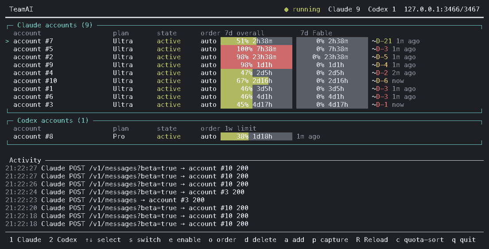

# TeamAI

[English](README.md) · [한국어](README.ko.md) · **日本語** · [中文](README.zh-CN.md) · [Español](README.es.md)

> **翻訳の遅れについて:** この翻訳は英語版 README の最近の変更（進行中の Activity 表示以降に追加された機能と設定キー）をまだ反映していません。動作と設定は[英語版 README](README.md) を基準にしてください。

> **追加の翻訳待ち:** Codex の上流容量エラー再試行と `codexCapacity*` 設定、Claude keep-warm と `warmup.claude` / `warmup.codex` 設定、および Claude セッション固定・自動ハンドオーバー遮断ポリシーは未翻訳です。[英語版](README.md)を参照してください。

TeamAI は **Claude Code** と公式 **Codex CLI** のためのローカル多アカウントリレーです。プロバイダーごとに独立したアカウントプールを保持します。Codex CLI の場合は、選ばれたサブスクリプションが利用できない、またはクォータを使い切っている場合に別のアカウントでリクエストを再試行します。Claude Code の場合は、会話履歴を保持するため各セッションが最初のアカウントに恒久的に固定（`sessions.json`）され、クォータ枯渇やエラー時の他アカウントへの自動ハンドオーバーは遮断されます。



<sub>上のダッシュボードは <code>teamai capture --redact full</code> で作った実際のキャプチャです。実際のクォータとアクティビティログで、アカウントのアドレスは含まれていません。</sub>

> TeamAI は独立したオープンソースプロジェクトです。Anthropic、OpenAI、および無関係なサービスである teamai.com とは一切関係ありません。

## Claude アカウントグループ

既存の `config.json` に `"groups": {"master": ["lead@example.test", "backup@example.test"], "worker": ["worker@example.test", "backup@example.test"]}` を追加します。メンバーは `teamai accounts claude` のラベルまたは id で、複数グループへの所属が可能です。`teamai claude --group master` または `TEAMAI_GROUP=worker tac` で指定し、明示オプションが優先されます。Claude にはこのオプションを渡さず、Codex では拒否します。不明なグループは起動前に、不明・曖昧なアカウント参照は起動または設定再読込時にエラーになります。名前は英数字で始まる最大64文字の英数字・`_`・`.`・`-`、メンバー一覧は空にできません。

新規セッションはグループ内で既存の優先順位とクォータ規則に従って最初のアカウントを選びます。クールダウン中のメンバーを飛ばし、全員が利用不可ならグループ外に移らず429です。モデルルートもこの範囲を越えません。未指定時は従来どおりです。グループは登録待ち状態と永続バインドに保存され、再起動・`--resume`・`--continue` で維持されます。**Claude の最初のアカウントへの永久固定は維持され、バインド済みセッションはクールダウンやエラーでもグループ内の別アカウントに移りません。** 再開時にグループ指定を省略すると保存済みの値を使い、異なるグループなら409です。グループ削除やバインド先の所属解除はバインドを変更せず503になります。アカウント名の変更・削除時は参照を有効に保ってください。

編集後はリレーの再起動、またはアカウントコマンド・ダッシュボードの設定再読込で反映します。不正な変更は再読込全体を拒否します。`teamai status` はグループの余裕と保存済みセッションのグループを、ダッシュボードは余裕と Activity の `[group:name]` を表示します。余裕は有効な各メンバーの最も使用率の高い既知の枠の残量をアカウント単位で合計し、未測定分は別表示します。所属は重複できるのでグループ合計同士を加算しないでください。詳細は [英語 README](README.md#claude-account-groups) を参照してください。

両方のダッシュボード表示で、Claude アカウント欄を設定順のグループに分け、見出しに利用可能数と余裕を表示します。各セクション内は現在のクォータ/設定順を維持し、未所属は最後の `그룹 없음` に表示します。共有アカウントは各グループに `↔` 付きで繰り返し表示されます。選択はすべての表示行に反映され、↑/↓ は最初の出現順で各アカウントを一度ずつ移動します。操作対象は同じ一つのアカウントです。優先順位の編集中はセクション内の順序を固定します。グループがなければ表示は変わりません。


## 必要環境

- Node.js 20 以上
- macOS または Linux
- `claude` および／または `codex` を別途インストール済みであること
- ご自身の Claude Pro/Max または ChatGPT Codex のサブスクリプションアカウント

## インストール

```bash
git clone https://github.com/soulduse/team-ai.git
cd team-ai
./scripts/install.sh
```

`install.sh` は依存関係のインストール、ビルド、`teamai`/`tai`/`tac`/`tax` コマンドのリンクを行い、シェルブロックを追加するかどうかを尋ねます。冪等なので、アップグレードする際は再実行するだけで済みます。シェルブロックを省略するには `--no-shell`、実際には変更せず何が行われるかを確認するには `--dry-run` を渡してください。

手動で同じことを行う場合:

```bash
npm install
npm run build          # 必須: dist/ はコミットされていません
npm link
```

AI エージェントからこれを自動化しますか？ [AGENTS.md](AGENTS.md) に、同じ手順が検証と失敗時の分岐を備えた決定的なコマンドとしてまとめられています。

## クイックスタート

```bash
teamai login
tai
```

`login` は `[1] Claude` と `[2] Codex` のどちらを追加するかを尋ねます。アカウントを追加するには繰り返し実行してください。`tai` は短いセッションコマンドで、`teamai start` と同等です。ローカルリレーを起動してダッシュボードを開きます。

特定のプロバイダーで直接セッションを開始するには、専用のランチャーを使います。必要に応じて TeamAI リレーを自動的に起動し、後続の引数はすべて公式クライアントにそのまま渡します。

```bash
tac                   # TeamAI のアカウントプール経由の Claude Code
tac --resume          # teamai claude --resume と同じ
tax                   # TeamAI のアカウントプール経由の Codex
tax resume            # teamai codex resume と同じ
teamai claude         # tac の長い形式
teamai codex          # tax の長い形式
teamai session        # [1] Claude か [2] Codex を対話的に選択
```

これらの名前は、既存の TeamClaude の `tc` シェル関数を置き換えないよう意図的に選ばれています。`tc` は引き続き TeamClaude を、`tac` と `tax` は TeamAI を対象にできます。

### Claude セッション固定と再開

Claude Code の各セッションは、会話履歴を保護するため `sessions.json` および永続台帳に記録された最初のアカウントに恒久的に固定されます：

- **新規セッション:** `tac` と `teamai claude` は起動前に認証済みローカル制御ポートからリレー発行の UUID を取得し、登録します。最初の会話要求で登録を消費し、初期アカウントに原子的に結合します。未登録 ID はメッセージ数・役割・アカウント情報に関係なく `409` で拒否します。利用者指定の `--session-id` と `--fork-session` は非対応です。
- **ターン・圧縮・子要求:** 同じ正規 ID（`x-claude-code-session-id` または一致するメタデータ）なら、モデル変更や圧縮後も最初の結合を維持します。サブエージェントやセッション内の `/resume`、`/clear`、fork が未登録 ID を使う場合は拒否します。本文から親子関係を推測したり ID を登録したりしません。互換性にはクライアントの ID 維持が必要です。検証は実アカウントではなく合成要求で行っています。
- **再開 (`--resume`, `--continue`):** 新規登録なしで引数を渡します。記録済みの結合を持つ ID のみ最初のアカウントで再開できます。未証明のセッションは `409`、保存情報の欠落・不整合は `500` です。選択画面や名前で再開しても、最終的な ID に既存の結合が必要です。
- **保存と移行:** 登録・台帳検証・結合は同じプロセス間ファイルロックを使います。欠落・読み取り不能・破損・不整合、エントリー削除後の再起動、書き込み中断は `500` で拒否します。完全な既存結合と整合する旧台帳は利用できますが、記録のない会話は自動では移行されません（下記の adopt を参照）。修復には削除ではなく整合したバックアップを復元してください。内部ウォームアップはプロセス専用トークンを使い、会話 ID を登録しません。
- **登録前から動いていたセッションの引き継ぎ (adopt):** アップグレード後、旧リレーで始まった Claude セッションには登録がなく `409` になります。管理者が明示的に記録できます: `teamai adopt claude <セッションID> --account <アカウント>`（`<アカウント>` は `teamai accounts` が表示するラベルまたは id）が、実行中のリレーの認証済み制御ポート（`POST /claude/sessions/adopt`、本文 `{"sessionId", "account"}`）に依頼します。リレーは自身のアカウントプールから資格情報と実際のアカウント ID を取り出し、結合と台帳記録をセッションロック内で一緒に書きます。資格情報は送ることも返されることもありません。**選んだアカウントがそのセッションの最初のアカウントになります**: 以後そのアカウントだけを使い、クォータ・無効化・エラーでも他のアカウントへ移らないため、セッションが実際に使っていたアカウントを選んでください。同じアカウントでの再実行は何も変えずに成功し、別のアカウント、まだ `pending` のリレー発行 ID、無効・削除済み・不明なアカウント、不正な ID は拒否され、破損した保存情報は何も書かずに `500` で拒否します。セッション ID は Claude Code が `x-claude-code-session-id` で送る完全な値（`~/.claude/projects/` 配下の会話記録ファイル名）です。

[Claude Code CLI リファレンス](https://code.claude.com/docs/en/cli-reference) は UUID、再開、fork による新規 ID を説明しています。[フック仕様](https://code.claude.com/docs/en/hooks#common-input-fields) はセッション ID と子エージェント ID を区別しますが、全機能・全バージョンの HTTP ヘッダー動作を保証しません。


## シェル設定

```bash
./scripts/install-shell.sh            # ~/.zshrc にマーカー付きのブロックを追加
./scripts/install-shell.sh --dry-run  # 差分を表示するだけで、書き込みは行わない
./scripts/install-shell.sh --uninstall
```

プールを経由する `cl`（Claude Code）と `co`（Codex）、さらに `tai`、`tais`、LaunchAgent 用の `taistart`/`tairestart`/`taistop` を定義し、グローバルに固定された `ANTHROPIC_BASE_URL` を解除します。TeamAI はセッションごとに独自のポートを指すため、古いグローバル値が残っていると、すでに動いていないかもしれないプロキシへトラフィックを送るだけになるからです。このブロックはマーカーで区切られ、その場で書き換えられるので、再実行しても追記されるのではなく更新されます。書き込みのたびにタイムスタンプ付きのバックアップが残り、インストールとアンインストールを繰り返してもファイルはバイト単位で復元されます。

スーパーバイザーは任意です。`cl`、`co`、`tai`、`teamai run` はいずれも、何もリッスンしていなければ自分でリレーを起動するため、LaunchAgent がアンロードされていても、失敗していても、そもそもインストールされていなくても動作し続けます。強制終了されたプロセスが残した古い `server.json` は無視されて置き換えられます。起動に失敗した場合は、素っ気ない「did not start」ではなく、サーバーから返された理由（ポートがすでに使用中、資格情報ファイルが読み取れない、など）が報告され、完全な出力は `~/.config/teamai/server-start.log` に保存されます。

### リレーをログイン項目として実行する

これは任意です。上でインストールされる `taistart`/`tairestart`/`taistop` エイリアスは `com.teamai.proxy` というラベルの LaunchAgent を操作するため、このラベルを正確にそのまま使ってください。

```xml
<!-- ~/Library/LaunchAgents/com.teamai.proxy.plist -->
<?xml version="1.0" encoding="UTF-8"?>
<!DOCTYPE plist PUBLIC "-//Apple//DTD PLIST 1.0//EN" "http://www.apple.com/DTDs/PropertyList-1.0.dtd">
<plist version="1.0">
<dict>
  <key>Label</key>          <string>com.teamai.proxy</string>
  <key>ProgramArguments</key>
  <array>
    <string>/usr/local/bin/node</string>
    <string>/ABSOLUTE/PATH/TO/team-ai/dist/src/cli.js</string>
    <string>server</string>
  </array>
  <key>RunAtLoad</key>      <true/>
  <key>KeepAlive</key>      <true/>
  <key>StandardErrorPath</key> <string>/tmp/teamai.err.log</string>
</dict>
</plist>
```

```bash
launchctl bootstrap gui/$(id -u) ~/Library/LaunchAgents/com.teamai.proxy.plist
```

Node の実際のパスは `command -v node` で確認したものを使ってください。LaunchAgent はシェルの PATH を引き継ぎません。

## アカウント

**別のマシンからのログイン。** `teamai login claude` はブラウザを開いて `localhost` へのコールバックを待つと同時に、ターミナルへの貼り付けも受け付けます。ブラウザが TeamAI と別のデバイスにある場合、承認後に読み込めない `localhost` ページで止まるので、そのアドレスバーの URL（またはその中のコードだけ）をコピーして貼り付けてください。先に届いた方でログインが完了し、もう一方は片付けられます。貼り付けた URL や `code#state` の `state` がこのログインのものでなければ拒否して再入力を求め、コールバックポートへの無関係なリクエストはログインを終わらせずに `400` を返すだけです。`teamai login claude --manual` はコールバックサーバーを一切起動しません。表示された URL を任意のデバイスで開いて承認し、ページに表示されたコードを貼り付けてください。ダッシュボードから始めたログイン（`a` → `1`）は、ダッシュボードのキー入力を守るためブラウザのコールバックだけを待ちます。stdin がターミナルでない場合も貼り付けは受け付けません。

Codex は通常のブラウザログインフロー（`codex login`）をそのまま使います。リモートマシンでは `teamai login codex --device-auth` が代わりに `codex login --device-auth` を実行し、任意のデバイスで入力するコードを表示します。この方法には ChatGPT の設定でデバイスコード認証を有効にしておく必要があります。このオプションを使わなければ、TeamAI はその設定を要求しません。

資格情報のインポートは任意で、エクスポート可能な資格情報ファイルが存在する場合にのみ動作します。

```bash
# 既存の TeamClaude 設定からすべてのアカウントをインポートする
teamai import claude --from ~/.config/teamclaude.json

# Codex CLI の現在のファイルベースのログインをインポートする（存在する場合）
teamai import codex
```

最近のバージョンの Claude Code は、資格情報を `~/.claude/.credentials.json` ではなく macOS キーチェーンに保存することがあります。その場合は `teamai login` を使ってください。`import` は元の TeamClaude、Claude Code、Codex のファイルを一切変更しません。TeamAI はリレーされるセッション用に隔離された永続的な Codex ホームを使うため、ユーザー本来の `~/.codex` はそのまま残ります。

## 運用

```bash
teamai status                                  # サーバー状態 + アカウント表
teamai accounts [claude|codex]                 # アカウント表のみ
teamai start                                   # リレーを起動し、ダッシュボードを開く
teamai stop                                    # リレーを停止
teamai restart                                 # 停止、起動、ダッシュボードを開く
teamai server                                  # リレーをフォアグラウンドで実行
teamai tui                                     # ダッシュボードのみ、自動起動なし
teamai disable codex user@example.com
teamai enable codex user@example.com
teamai priority claude user@example.com 1      # または: auto
teamai capture [--redact partial|full|none] [--out DIR]   # ダッシュボードを .txt と .png に保存（TTY 不要）
teamai adopt claude <セッションID> --account user@example.com   # 旧リレーのセッション: このアカウントを最初のアカウントとして記録
teamai route list                              # モデルルート（試される順）
teamai route add luna --provider codex --match 'gpt-6-luna*' --accounts a@x.com,b@y.com --mode prefer --color blue
teamai route rm luna
```

同じ優先度のアカウントは **週次ペース** の順に並び、ダッシュボードとプール自身の選択が同じ順序を使います — 一番上の行が次のリクエストの行き先です。週次の予算を、週の始まりに 0%、リセット時刻に 100% となる直線とみなし、週次使用率から経過した週の割合を引いた値をアカウントの偏差とします。直線より *遅れている*（負の）アカウントは、使わなければリセットで失われる予算を持っているので先に選ばれます。ブロックではなく順序にすぎず、すべてのアカウントが先行していれば最も先行の少ないアカウントを使います。予算を残したままリセット直前のアカウントはそれ自体が最も遅れているため、「リセット間近」用の別ルールはありません。週次ウィンドウはリクエストが実際に消費するものです：Claude は `7d`（Fable リクエストなら Fable の週次ウィンドウ）、Codex は名前に関係なく長さ 10080 分のウィンドウ。偏差の差が 5 ポイント以内なら同順位とみなしてリクエストごとの入れ替わりを防ぎ、同順位ならセッションがすでに使っているアカウント、残り週あたりの週次予算が多いアカウント、週次リセットが早いアカウント、5 時間ウィンドウのリセットが早く使用が少ないアカウントの順です。将来リセットされる週次ウィンドウがないアカウント（未計測、またはリセット済み）は、それを持つアカウントの後ろに回ります。明示的な優先度、切り替え閾値（5 時間ウィンドウが閾値に達したアカウントも週次ペースに関係なく除外）、セッション固定、同時リクエスト上限は従来どおり先に適用されます。各行に偏差が `+12%p` / `-30%p` で表示されます。`routing.balance: "level"` は Claude にのみ適用され、以前の方式（5 時間・週次のうち満杯に近い方を 10% 刻みで、処理中リクエストが少ない順）に戻ります。Codex は `routing.balance` の値に関係なく常に週次ペースを使い、5 時間ウィンドウは閾値と同順位の判断にのみ使います。`c` で設定順に切り替えられます。

**Fable とほかのモデル.** モデル別週次ウィンドウを消費するのは最上位モデル（Claude の Fable ティア）だけです。プールは Fable のためにアカウントを取っておきません。Fable かどうかにかかわらず、すべてのリクエストは優先度（明示値が先、小さい数字が先）に従い、その次に上記のバランス規則に従います — 非 Fable リクエストは共有の週次ウィンドウを、Fable リクエストは Fable ウィンドウを読みます。Codex のリクエストはこの段階で常に週次ウィンドウを読みます。Fable リクエストが飛ばすのは、それを受けられないアカウントだけです：Fable ウィンドウを使い切った（100%）アカウントと、計測済みなのに Fable ウィンドウをまったく報告しないアカウント（Pro のように Fable のないプラン）。まだ計測されていないアカウントは試します。そうしたアカウントもほかのモデルは引き続き受けます。Opus や Sonnet のリクエストを Fable 用に残したいアカウントから外すには、モデルルートを使ってください。以前の `fableReserveThreshold` キーはもう読まれず、残っていても `config.json` はそのまま起動します。

Fable ティアの 429（共有の `5h`/`7d` ウィンドウはまだ許可されている一方で `7d_oi` が拒否された場合）は、アカウント全体ではなくそのアカウントの Fable ウィンドウだけをベンチに下げます。最上位モデルしか消費しない予算のためにアカウント全体が最大 1 週間眠ってしまうのではなく、他のすべてのモデルは引き続きそのアカウントから提供されます。共有ウィンドウを拒否する 429 は、これまでどおりアカウントをベンチに下げます。

フルスクリーンの TUI は Claude と Codex のアカウントをグループ分けし、使用量が変化しても現在選択中のアカウントを固定したままにします。Claude の行は `5h session`、`7d`、そしてモデル単位の `7d Fable` の各ウィンドウを個別に表示します。Codex の行は各ウィンドウに、そのアカウントが実際に報告した期間（`5h`、`7d`）を見出しとして付けて表示します。ダッシュボードでは 1 週間を、他エージェントのボックスや狭い端末のレイアウトも含めてどこでも `7d` と表記します。アカウントのボックスもその下の他エージェントのボックスも、ゲージを同じ 3 つの列に同じ幅で描きます。1 列目はセッションウィンドウ（5h）、2 列目は週間ウィンドウ、3 列目はそれ以外（Claude の `7d Fable`、OpenCode Go の `30d`）です。ウィンドウは長さに応じた列に置かれるため、週間ウィンドウしかない Codex アカウントや Grok は週間ゲージを左に詰めず、1 列目を空けます。ゲージの前の列（account・plan・state・order、またはグループ名）はどのボックスでも同じ幅で、ゲージの後ろの情報（計測からの経過時間、進捗の偏差 `+12%p`、続いて Codex 行の `RC<n>`）も、項目ごとにすべてのボックスで同じ列から始まります。端末が狭くなると、すべてのボックスが同じ規則で縮みます。クォータは公式クライアントの応答から学習され、再起動後も保持されます。

**狭い端末。** ダッシュボードは端末の実際のサイズで描かれ、サイズが変わるとすぐに描き直されます（サイズ変更後の最初の画面はまず画面を消すので、前のフレームの欠片は残りません）。同じ端末をデスクトップとスマートフォンが交互に見るときのためです。80 桁未満、または広いボックスがゲージ 3 本を収められない幅（78 桁＋ルート表示列の数）では要約レイアウトに切り替わります。区画ごとのルール行がウィンドウ名（`5h`、`7d`、Claude の `F`、`30d` などの 3 本目）を列の上に一度だけ書き、下のアカウント行と使用量グループ行は値だけを持ちます。短い名前（`…` で省略）、カーソル `>` と次のリクエスト先 `►`、最大 3 本の短いゲージで、各列で右揃えになります。各行の 2 行目（淡色）には、各ウィンドウのリセット時刻をそのゲージの下に置き、値・上のウィンドウ名・リセット時刻が同じ列で終わるようにします。リセットのないウィンドウは空欄にし、リセットが一つもない行は 1 行のままです。この形では名前と右端のリセット列がなくなり、その幅がゲージと名前に回るので、40 桁でも 3 つの窓と窓ごとのリセット時刻がすべて見えます。2 行で描くとアカウント一覧全体とヘッダー・Activity のルール行・フッターが画面の高さに収まらないときは、以前のように 1 行に最も使った窓のリセットだけを示す右端のリセット列に戻ります。ごく狭い画面ではゲージではなく、ゲージと同じ色の数字だけを描きます。無効なアカウント名は灰色、エラーは赤、クールダウンは黄色です。plan・state・order・測定時刻・ペース偏差は広いレイアウトだけに出ます。Activity はリクエストごとに 1 行（時刻、セッション、`C`/`X`、ステータス（実行中は経過秒）、アカウント）で、右端で切るだけで折り返さず、残りの高さ分だけ表示します。アドレスが収まらないときは末尾を切る代わりにローカル部分を残します。フッターには 1 行に収まるキーを短縮形（`↑↓ sel`、`p shot`）で出し、`? help` を添えます。`?` でどちらのレイアウトでも全キーを元の名前で一覧できます。高さも足りなければ決まった順に行を落とします（Activity の残り、他エージェント、ヘッダー、現在・選択中以外のアカウント）。そのため各プロバイダーの現在のアカウントと使用率は最後まで残ります。どの行も端末の幅を超えず、全角文字は 2 桁と数えます。すべてのキーは従来どおり動きます。

**この PC の負荷。** ヘッダーにこの PC の CPU・RAM 使用率を表示します。ダッシュボード自身が Node の `os` モジュールで測り（サーバー API・追加依存なし）、描き直すたびに更新します：`CPU 12% · RAM 46% 7.3/16.0GB`。CPU% は前回の描画からの使用率なので最初の画面は `CPU –` で、70% から黄色、90% から赤になります。使用量/総量は広いレイアウトだけに出ます。ヘッダーにはタイトルの横にこれと、広いレイアウトではリレーのアドレス・ポートだけが出ます。幅が足りなければ、ポートより先に、まず量、次に CPU/RAM 全体を落とします。`teamai status` も同じ値を `Host:` 行で出力し、キャプチャにも含まれます。

フッターは TeamClaude と同じアカウントワークフローを提供します。選択、切り替え、有効化／無効化、並び替え、削除、追加／ログイン、再計測（`R`）、終了です。`switch` は選択したアカウントをそのプロバイダーのプールの先頭にピン留めします。並び替えモードでは順位を割り当てたり、アカウントを自動スケジューリングに戻したりできます。Claude のプロフィールを更新すると、プランのティアと `past_due` のような不健全なサブスクリプション状態が赤色で表示されます。

**アカウントの変更は再起動なしで反映されます。** ダッシュボードでの切り替え、有効化／無効化、優先度の変更、ログイン、削除はすべて `config.json` に保存されたあと、制御ポート（`POST /reload`、ループバック限定、同じクライアントトークン）経由で実行中のサーバーに送られ、サーバーはアカウント・モデルルート・`routing.balance` をその場で読み直します。処理中のリクエストは切れません。リクエストは開始時に割り当てられたアカウントで最後まで進みます — 直前に無効化や削除をされたアカウントでも同じです。削除されたアカウントは処理中のリクエストを終え、新しいリクエストは受けず、最後のリクエストが終わるとプールから外れます。次のリクエストからは新しい設定でアカウントが選ばれます。学習済みの状態（使用量、ウィンドウ、クールダウン、リセットクレジット、他エージェントの使用量）はそのまま残ります。ファイルは何かを変える前に丸ごと検査され（すべてのアカウント項目、プロバイダーごとのルート、balance 設定）、サーバーが使えないファイルは理由とともに拒否されてダッシュボードに表示され、サーバーは元の設定を保ちます。`proxy`、`switchThreshold`、`maxConcurrentPerAccount` は実行中のプロセスに差し替えられないため、変更されていれば reload がそれを伝え、次の `teamai restart` で反映されます。ダッシュボードはサーバーが動いていないときだけサーバーを起動します。`teamai login`、`import`、`enable`、`disable`、`priority` も同じ方法で実行中のサーバーを reload します（停止中のサーバーは停止したままです）。TeamAI 自体を更新したあとは一度 `teamai restart` してください。古いビルドで起動したサーバーには reload の経路がなく、ダッシュボードがその旨を表示します。

**モデルルート.** `routes.claude` / `routes.codex` で、指定したモデルのリクエストを指定したアカウントに送れます（最初に一致したルートが適用）。ダッシュボードで `g` を押すと選択行のプロバイダーのルートを一覧・追加（`a`）・編集（`e`）・削除（`d`、`y` で確認）・並べ替え（`[` `]`）できます（`Tab` で Claude/Codex 切替、`Esc` は保存せずに戻る）。保存前にサーバー起動時と同じパーサーで検証し、失敗すれば何も書かずに理由を表示します。保存は `config.json` の `routes` だけを原子的に書き換え、起動中のサーバーには control ポートで再読み込みさせます（再起動不要）。`teamai route list|add|rm` も同じ経路です。各項目の意味（`match`、`accounts`、`prefer` / `exclusive`、`color`）の詳細は英語版 README の Model routes / Editing routes を参照してください。

ダッシュボードは保存直前に、編集開始時に読んだルート一覧とファイルを比較します。CLI などが変更していた場合は上書きせず、再読み込みを促して保存を拒否します。`exclusive` ルートにはそのプロバイダーで設定されたアカウントを少なくとも 1 つ指定する必要があります。control reload は loopback からだけ受け付け、すべてのプロバイダーを先に解析してから交換するため、1 つが不正でも実行中のルートは変わりません。

`p` はダッシュボードをキャプチャして保存し、`teamai capture` は端末なしでスクリプトやエージェントから同じことを行います。キャプチャは `~/.config/teamai/captures/`（または `--out DIR`）配下にファイル一組として残ります。色をそのまま保ったテキストのフレームと、内蔵のビットマップフォントで描いた同じフレームの PNG で、Node 以外に必要なものはありません。アカウントのアドレスはフレームを描く前にマスクされるため、アカウント列・フッター・アクティビティログのどこにも残りません。既定は `de•••••••••w@gm•••.com` 形式の部分マスクで、`--redact full` は `account #N` に置き換え、`--redact none` は自分だけで見るキャプチャのためにアドレスをそのまま残します。ダッシュボードで `p` を押すと、保存に加えてファイルマネージャーでその PNG を選択した状態で開き、画像をクリップボードにコピーします。macOS ではそのまま動作し、Linux では `xdg-open` と `wl-copy` または `xclip` があれば動作します。実際にどれが行われたかはフッターに表示されます。この README 冒頭の画像もそのようにして作ったキャプチャです。キャプチャの幅は撮った端末の幅（最小 40 桁、端末がなければ 120 桁）なので、スマートフォンから撮ると狭いレイアウトになります。

有効なアカウントは、各プロバイダーのクォータを消費しない使用量エンドポイント（Claude は `/api/oauth/usage`、Codex は `/wham/usage`）からバックグラウンドで 5 分ごと（アカウントごとに最大 30 秒のジッター、同時読み取り上限 2、失敗時は 30 秒から最大 15 分までの指数バックオフ）にクォータを更新します。期限切れ間近のトークンは先に更新され、無効（`disabled`）なアカウントは除外され、`POST /reload` で対象アカウントも即座に反映されます。`R` はすべてのアカウントのクォータを即座に再計測します。まず使用量エンドポイントを読み取り、そこで読み取れなかったアイドル状態のアカウントに対してのみ、受理されることが分かっているリクエスト形式を並列で再送し（すでに計測済みのアカウントやスロットルされているアカウントも含みます。それらの 429 応答にも信頼できるヘッダーが含まれているためです）、`measured/targets` を正直に報告します。このリクエスト形式は、実際にプロキシを通過した 2xx 応答からのみ確定されるため、リクエストが一度も成功していないうちは、`R` はペイロードを推測するのではなく、まだプローブのテンプレートが存在しないと報告します。モデル単位の週次（Fable）ウィンドウが欠けているアカウントには、追加の補充プローブを 1 回だけ送ります。このウィンドウは Fable ティアのリクエストへの応答にしか現れないからです。

Codex の keep-warm はイベント駆動です。計測済みの 5 時間ウィンドウがリセットして 10 秒後、そのアカウントの usage を再読し、広告されたウィンドウが空（`0%`）だと新しい読み取りで確認できた場合だけ、最小モデルと `hi` を使う実際の `codex exec` を固定ローカルパス `/tc-acct/<account>/codex` 経由で 1 回実行します。アカウントは同時に 1 つだけ処理し、恒久的な失敗は 10 分後に 1 回再試行して `gave-up` と表示し、1 時間後の期限と次の確認時刻を status に残します。リレーが capacity・過負荷と分類した失敗、終端イベントなしで切れたストリーム、warm の timeout・signal 終了は一時的な失敗として恒久失敗数に入れず、最大 1 時間に制限した指数バックオフで再試行します。usage は応答到着時刻ではなく読み取り送信時刻で判定するため、warm 前の遅延応答で二重実行されません。warm の 6 分後（空のウィンドウと開いたばかりのウィンドウを区別する 5 分の許容幅を過ぎた時点）に usage をもう一度読み、まだ空なら失敗として数えます。失敗した warm の再試行タイマーは確認読み取りを 2 回目の失敗にせず、実際の warm をもう一度送ります。開いたウィンドウは `0%` と読めてもリセットまで再び warm しません。設定にないアカウントを指す固定パスは、別のアカウントで処理せず 404 で拒否します。warmer の判断が変わるたびと warm の結果ごとに、アカウント番号だけを含む 1 行をサーバー出力に書きます。オンデマンドで起動したリレーなら `$TEAMAI_HOME/server-start.log` に残ります。

アイドル状態のアカウントは別の 5 分スイープで生かし続けます。トークンの有効期限が近い、または前回の試行がエラーになったアカウントは、1 つずつ順番にリフレッシュされます。通常のトラフィックは一部のアカウントに偏り、ウォームアップはあえてトークンをリフレッシュしないため、これがないと誰も使っていないアカウントはリフレッシュトークンのチェーンが途切れ、アップストリームに無効化されてしまう恐れがあります。このスイープを逐次にしているのは意図的です。長いダウンタイムのあとに構成全体を一度にリフレッシュすると、トークンエンドポイントへのバーストがレート制限を招くからです。

学習したクォータ（使用量、ウィンドウ、リセット時刻、サブスクリプションのプロフィール）はディスクに書き込まれ、次回の起動時に復元されます。そのため、再起動しても再計測なしでダッシュボードと並び順が維持されます。`R` が再送するプローブ形式も同じように永続化されます。応答ごとのシグナルはそうではありません。クールダウンやエラーは再起動時にあえて破棄されるので、古い 429 の retry-after によってアカウントが再びベンチに下げられることはありません。本当に使い切っているなら、次のリクエストで正しい状態が改めて導き出されます。

構成全体のアカウントごとの同時実行数の合計で処理できる以上のリクエストが一度に届いた場合、リレーはリクエストボディを読み込む前に、あふれた分を `429`（`x-teamai-429-reason: concurrency_saturated`）で拒否します。ボディを無制限にバッファリングすることはありません。この同じヘッダーは、「利用可能なアカウントがない」ときの 429 において、混雑している構成と使い切った構成（`quota_exhausted`）を区別します。

Anthropic のプロフィールエンドポイントはサブスクリプションの状態とプランを公開していますが、現在の請求期間の終了日は公開していません。プロフィールの状態はサーバー起動時と、その後 6 時間ごとに更新されます。

**リセットクレジット (Codex および Claude)。** ChatGPT および Anthropic (Claude) アカウントは、利用制限ウィンドウをリセットするチケット（リセットクレジット。Codex CLI の `/usage`「Full reset」または Claude の制限リセット）を保持している場合があります。`codexResetCredits`（Codex 用）または `claudeResetCredits`（Claude 用、既定では無効）を有効にすると、そのプロバイダーのすべてのアカウントが利用枠を使い果たし（単に処理中というわけではなく）リクエストを処理できなくなったクォータの行き詰まり時に、リレーが自動でチケットを 1 枚消費します。条件を満たす最適なアカウント（チケット数が多い順、同数なら週次リセットが最も遅い順）でチケットを適用し、そのアカウントで同じリクエストを処理します。アカウントが対象となるのは、週次ウィンドウが満杯と測定され（`codexResetCreditsSessionWindow` / `claudeResetCreditsSessionWindow` で 5 時間ウィンドウのみの枯渇も対象可）、利用状況エンドポイントから取得されたチケット数が保持用上限（`codexResetCreditsReserve` / `claudeResetCreditsReserve`）を超えており、直近の試行からクールダウン（`codexResetCreditsCooldownMs` / `claudeResetCreditsCooldownMs`）以上経過している場合のみです。1 リクエストにつき最大 1 枚のみ消費されます。チケットは取り戻せないため、リレーが推測で消費することはありません。Codex 行・Claude 行のいずれも手持ちチケット数を `RC<n>` として表示し、`teamai status` でアカウントごとに一覧表示され、行で `t` を押すと手動でチケットを消費するピッカーが開きます（`y` で確認）。両プロバイダーとも既定値は無効（`false`）であり、無効時は自動的なリセットクレジット呼び出しは一切行われません。

## 設定

設定と資格情報は `$TEAMAI_HOME` に置かれ、なければ `$XDG_CONFIG_HOME/teamai`、次に `~/.config/teamai` の順にフォールバックします。プロキシは `127.0.0.1` にバインドし、生成されたローカルクライアントトークンを要求します。

`config.json` と `credentials.json` の変更は、`<ファイル>.lock` を一度に 1 プロセス（サーバー、ダッシュボード、コマンド）だけが保持した状態でファイルを読み直し、書き込みごとの専用一時ファイルを rename して置き換えます。保存が重なってもファイルが壊れたり互いを巻き戻したりしません — サーバーの保存でログインが失われたり、削除したアカウントが書き戻されたりしません。終了したプロセスが残した lock は引き継ぎます。

`config.json` は初回実行時に次の既定値で作成されます。

| キー | 既定値 | 意味 |
| --- | --- | --- |
| `proxy.host` | `127.0.0.1` | バインドアドレス。設計上ループバック専用です。 |
| `proxy.claudePort` | `3456` | Claude リレーのポート。 |
| `proxy.codexPort` | `3457` | Codex リレーのポート。 |
| `proxy.controlPort` | `3556` | TUI が通信する制御チャネル。 |
| `proxy.clientToken` | 自動生成 | リレーされるすべてのクライアントが送る必要のあるローカルトークン。 |
| `switchThreshold` | `0.98` | この使用率を超えたアカウントは選択されなくなります。 |
| `warmup.enabled` | `true` | Codex および Claude のイベント駆動 keep-warm。`false` で両方を無効化。 |
| `warmup.claude` | `true` | Claude アカウントの keep-warm（未翻訳・英語版参照）。`false` で無効化。 |
| `warmup.codex` | `true` | Codex アカウントの keep-warm。`false` で無効化。 |
| `maxConcurrentPerAccount` | `16` | 1 アカウントあたりに許可される同時実行リクエスト数。`0` で無制限。 |
| `routing.balance` | `"pacing"` | 同じ優先度の Claude アカウントの並べ方：`pacing`（週次ペース、上記）または `level`（空いているウィンドウ順、10% 刻み）。Codex は常に週次ペースを使います。 |
| `codexResetCredits` | `false` | Codex リセットクレジットの自動消費。 |
| `codexResetCreditsPolicy` | `"fleet"` | `fleet`: 全 Codex アカウントが枯渇時。`account`: アカウント自身の 429 枯渇時にも即時消費。 |
| `codexResetCreditsCooldownMs` | `1800000` | 同一アカウントでの再試行間隔の最小値(ms)。 |
| `codexResetCreditsReserve` | `0` | 自動消費で残しておくアカウントごとの最小チケット数。 |
| `codexResetCreditsTimeoutMs` | `10000` | チケット消費呼び出しの制限時間(ms)。超えた場合は成否不明として処理。 |
| `codexResetCreditsListRefreshMs` | `600000` | `t` に表示するチケット一覧のキャッシュ時間(ms)。`0` は初回のみ取得。 |
| `codexResetCreditsSessionWindow` | `false` | 5 時間ウィンドウの枯渇のみでもチケットを消費。 |
| `claudeResetCredits` | `false` | Claude リセットクレジットの自動消費（既定値は無効）。 |
| `claudeResetCreditsCooldownMs` | `1800000` | 同一 Claude アカウントでの再試行間隔の最小値(ms)。 |
| `claudeResetCreditsReserve` | `0` | 自動消費で残しておく Claude アカウントごとの最小チケット数。 |
| `claudeResetCreditsTimeoutMs` | `10000` | Claude チケット消費呼び出しの制限時間(ms)。超えた場合は成否不明として処理。 |
| `claudeResetCreditsListRefreshMs` | `600000` | `t` に表示する Claude チケット一覧のキャッシュ時間(ms)。`0` は初回のみ取得。 |
| `claudeResetCreditsSessionWindow` | `false` | 5 時間ウィンドウの枯渇のみでも Claude チケットを消費。 |
| `routes` | — | 任意。プロバイダーごとのモデルルート `{ "claude": [...], "codex": [...] }`。ダッシュボードの `g` か `teamai route` で編集。 |
| `proxy.legacyPorts` | — | 任意。プロバイダーごとに応答を継続する追加ポート。例: `{ "claude": [3400] }`。 |
| `proxy.maxBodyMb` | `512` | 任意。リレーが受け付けるリクエスト本文の最大サイズ(MB)。`0` より大きく `4096` 以下の数値。それ以外の値では理由を示して起動を止めます。超えた本文はアップストリームに送らず `413` を返し、サイズと上限だけを記録します。アップストリーム自身の `413` はそのまま返します。 |
| `proxy.maxInflightBodyMb` | `1024` | 任意。同時にメモリに保持するリクエスト本文の合計(両プロバイダ合算)の上限(MB)。未設定なら `proxy.maxBodyMb` を下回りません。`proxy.maxBodyMb` より小さい値、または `0` より大きく `65536` 以下の数値以外では理由を示して起動を止めます。超えたリクエストは `429`(`x-teamai-429-reason: body_budget`)で断られます。 |
| `proxy.bodyTimeoutMs` | `300000` | 任意。リクエスト本文を受け取り終えるまで待つ時間(ms)。`0` で無制限。超えると `408`(`x-teamai-408-reason: body_timeout`)を返し、`proxy.maxInflightBodyMb` の分を返却します。`0` から `86400000` の整数以外では理由を示して起動を止めます。 |

他のプロセスがすでにポートを占有している場合は変更してください。起動失敗のよくある原因であり、その理由は `server-start.log` に記録されます。

クライアントは起動時にベース URL を渡され、あとから向き先を変えることはできません。そのため `config.json` でポートを変更すると、そのままでは、すでに開いているセッションがすべて接続拒否で取り残されてしまいます。そこでリレーは、組み込みの既定ポートと、`proxy.legacyPorts` に列挙したポートでも応答し続け、ポート変更をまたいで開いているセッションを生かし続けます。他のものがすでに占有しているレガシーポートは、メインのポートに影響を与えることなくスキップされ、起動後のソケットエラーはリレーを落とさずにログに記録されます。

## 適用範囲とコンプライアンス

バージョン 0.1 は、サブスクリプションの OAuth アカウントと、ラッパー経由で起動される CLI セッションを対象としています。公開の OpenAI 互換 API は提供せず、Claude のリクエストを Codex のリクエストに変換することも、Codex Desktop をサポートすることも、異なる人物の資格情報をプールすることもありません。プロバイダーの規約とポリシーを遵守する責任は利用者にあります。本番用・商用の API ワークロードには、各プロバイダーの公式な API 課金の仕組みを使ってください。

## 開発

```bash
npm run typecheck
npm test
npm run lint
```

`npm test` はすべてのファイルの前に `test/isolation.ts` を読み込みます。テストごとに専用の一時 `TEAMAI_HOME` とホームディレクトリを使い、テストサーバーはポート 0 で待ち受け、実際の TeamAI・Codex・Claude のディレクトリ、リレーのポート（3456/3457/3556 と 3466/3467/3566）、このマシン外のホストに触れるテストは、テスト対象のコードがエラーを握りつぶしても失敗します。

派生物については [NOTICE](NOTICE) を、ローカルのセキュリティモデルについては [SECURITY.md](SECURITY.md) を参照してください。

> Translation update pending: see the canonical English README for nested Codex relay configuration inheritance.

<!-- transient-recovery-2026-09-22 -->
一時的な上流エラーのHTTPステータス・本文・Retry-Afterを保持します。アカウント切替後の再試行は最大2ラウンド、待機は各10秒・合計20秒以内です。長い待機はクライアントへ返し、成功したストリームは再実行しません。二重再試行を避けるためCodexのHTTP再試行は無効のままです。ビルド後にリレーを再起動すると適用されます。
