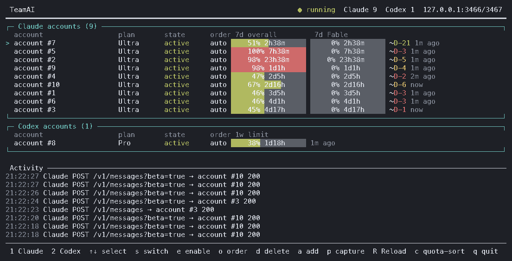

# TeamAI

[English](README.md) · **한국어** · [日本語](README.ja.md) · [中文](README.zh-CN.md) · [Español](README.es.md)

> **번역 지연 안내:** 이 번역은 영어 README 의 최근 변경(Activity 진행 중 표시 이후 추가된 기능과 설정 키)을 아직 반영하지 않았습니다. 동작과 설정은 [영어 README](README.md) 를 기준으로 하세요.

> **추가 번역 지연:** Codex 업스트림 용량 재시도와 `codexCapacity*` 설정, Claude 세션 고정 및 타 계정 자동 핸드오버 차단 정책은 아직 번역하지 않았습니다. [영어 설명](README.md)을 확인하세요.

TeamAI는 **Claude Code**와 공식 **Codex CLI**를 위한 로컬 다중 계정 릴레이입니다. 제공자별로 별도의 계정 풀을 유지합니다. Codex CLI는 선택된 구독 계정을 쓸 수 없거나 할당량이 소진되면 다른 계정으로 요청을 재시도합니다. Claude Code는 대화 기록을 보존하기 위해 각 세션이 최초 계정에 영구 고정(`sessions.json`)되며, 할당량 소진 또는 오류 시 다른 계정으로의 자동 핸드오버가 차단됩니다.



<sub>위 대시보드는 <code>teamai capture --redact full</code>로 만든 실제 캡처입니다 — 실제 할당량과 활동 로그이며 계정 주소는 없습니다.</sub>

> TeamAI는 독립적인 오픈소스 프로젝트입니다. Anthropic, OpenAI, 그리고 이와 무관한 teamai.com 서비스와 아무런 관련이 없습니다.

## Claude 계정 그룹

기존 `config.json`에 `"groups": {"master": ["lead@example.test", "backup@example.test"], "worker": ["worker@example.test", "backup@example.test"]}`를 설정합니다. 구성원은 `teamai accounts claude`의 계정 라벨 또는 id이며 한 계정이 여러 그룹에 속할 수 있습니다. `teamai claude --group master` 또는 `TEAMAI_GROUP=worker tac`로 선택하며 명시적 옵션이 환경변수보다 우선합니다. 옵션은 Claude에 전달되지 않고 Codex에서는 거부됩니다. 알 수 없는 그룹은 클라이언트 실행 전에, 알 수 없거나 모호한 계정 참조는 시작 또는 설정 재적재 때 오류로 거부됩니다. 그룹명은 영문자·숫자로 시작하는 최대 64자의 영문자·숫자·`_`·`.`·`-`이며 계정 목록은 비어 있을 수 없습니다.

새 세션은 그룹 안에서 기존 우선순위·쿼터 규칙으로 최초 계정을 고릅니다. 쿨다운 계정은 새 세션 선택에서 건너뛰며 모두 사용할 수 없으면 그룹 밖으로 나가지 않고 429를 반환합니다. 모델 라우트도 그룹 범위를 벗어날 수 없습니다. 그룹 미지정 시 기존과 같습니다. 그룹은 발급 대기와 결합 기록에 저장되어 재시작·`--resume`·`--continue`에도 유지됩니다. **Claude의 최초 계정 영구 고정은 유지되어 이미 결합한 세션은 쿨다운·오류 때 그룹 안에서도 다른 계정으로 옮기지 않습니다.** 재개 때 그룹 옵션을 생략하면 저장된 그룹을 사용하고 다른 그룹을 지정하면 409입니다. 그룹 삭제 또는 결합 계정의 소속 제거는 결합을 바꾸지 않고 503입니다. 계정 삭제·이름 변경 전에 그룹 참조도 유효하게 유지하세요.

편집 후 릴레이 재시작 또는 계정 명령·대시보드의 설정 재적재로 적용합니다. 잘못된 변경은 재적재 전체를 거부합니다. `teamai status`는 그룹 헤드룸과 저장된 세션 그룹을, 대시보드는 그룹 헤드룸과 Activity의 `[group:name]`을 표시합니다. 헤드룸은 활성 구성원의 가장 많이 사용한 알려진 쿼터 창 기준 잔여량을 계정 단위로 합산하며 미측정 계정은 별도로 표시합니다. 중복 소속이 있으므로 그룹 합계를 서로 더하면 안 됩니다. 자세한 설정은 [영어 README](README.md#claude-account-groups)를 기준으로 합니다.

두 대시보드 레이아웃 모두 Claude 계정 상자를 설정된 그룹 순서대로 나누고 각 소제목에 준비 계정 수와 헤드룸을 표시합니다. 섹션 안에서는 현재 쿼터/설정 정렬을 유지하며, 미소속 계정은 마지막 `그룹 없음`에 표시합니다. 여러 그룹에 속한 계정은 각 섹션에 `↔`와 함께 반복됩니다. 선택 표시는 모든 복사 행에 반영되고 ↑/↓는 계정의 첫 등장 순서로 각 계정을 한 번씩 방문합니다. 작업은 같은 단일 계정에 적용되며 순서 편집 중에는 섹션 안 정렬을 고정합니다. 그룹이 없으면 기존 화면을 유지합니다.

**대시보드에서 그룹 편집.** `G`로 Claude 그룹 편집기를 엽니다. `a`는 `config.json`과 같은 이름·비어 있지 않은 구성원 규칙으로 그룹을 만들고, `e`/`Enter`는 선택한 그룹 이름을 바꾸며, `d`는 `y`/`Enter` 확인 뒤 삭제합니다. `m`/`Space`로 구성원 목록을 열고 ↑/↓와 `Space`로 계정을 넣거나 뺀 뒤 `Enter`로 끝냅니다. 그룹을 빈 상태로 만들 수 없으며 Codex 계정은 목록에 보이지만 이유와 함께 거부됩니다. 기록된 Claude 세션이 그 그룹의 계정에 고정되어 있으면 영구 계정 결합을 유지하도록 해당 계정 빼기를 거부하며, 세션의 그룹 범위를 없애려면 그룹 삭제를 사용합니다. 그룹 삭제와 이름 변경은 잠금 안에서 저장된 세션 기록도 함께 갱신합니다. 현재 편집은 `Esc`로 취소합니다. 승인한 변경은 `config.json`의 `groups`만 바꾸고 다른 대시보드 설정과 같은 실시간 재적재 경로로 적용합니다.


## 요구 사항

- Node.js 20 이상
- macOS 또는 Linux
- `claude` 및/또는 `codex` 별도 설치
- 본인 소유의 Claude Pro/Max 또는 ChatGPT Codex 구독 계정

## 설치

```bash
git clone https://github.com/soulduse/team-ai.git
cd team-ai
./scripts/install.sh
```

`install.sh`는 의존성 설치, 빌드, `teamai`/`tai`/`tac`/`tax` 명령 링크를 수행하고 셸 블록 추가 여부를 묻습니다. 멱등적이므로 업그레이드할 때 다시 실행하면 됩니다. 셸 블록을 건너뛰려면 `--no-shell`, 실제 변경 없이 계획만 보려면 `--dry-run`을 씁니다.

수동으로 하려면:

```bash
npm install
npm run build          # 필수: dist/는 저장소에 포함되지 않습니다
npm link
```

AI 에이전트로 설치를 자동화하시나요? [AGENTS.md](AGENTS.md)에 같은 절차가 검증 단계와 실패 분기를 갖춘 결정적 명령으로 정리돼 있습니다.

## 빠른 시작

```bash
teamai login
tai
```

`login`은 `[1] Claude` 또는 `[2] Codex` 중 무엇을 추가할지 묻습니다. 계정을 더 넣으려면 반복 실행하세요. `tai`는 짧은 세션 명령이며 `teamai start`와 동일합니다 — 로컬 릴레이를 띄우고 대시보드를 엽니다.

특정 제공자로 바로 세션을 시작하려면 전용 런처를 씁니다. 필요하면 릴레이를 자동으로 띄우고, 뒤에 붙인 인자를 모두 공식 클라이언트에 그대로 전달합니다.

```bash
tac                   # TeamAI 계정 풀을 통한 Claude Code
tac --resume          # teamai claude --resume 와 동일
tax                   # TeamAI 계정 풀을 통한 Codex
tax resume            # teamai codex resume 와 동일
teamai claude         # tac의 긴 형태
teamai codex          # tax의 긴 형태
teamai session        # [1] Claude / [2] Codex 대화식 선택
```

이름은 기존 TeamClaude의 `tc` 셸 함수를 덮어쓰지 않도록 의도적으로 피했습니다. `tc`는 계속 TeamClaude를, `tac`과 `tax`는 TeamAI를 가리킵니다.

### Claude 세션 고정 및 재개

Claude Code의 각 세션은 대화 기록 보존을 위해 `sessions.json` 및 영속 원장에 기록된 최초 계정에 영구 고정됩니다.

- **신규 세션:** `tac`와 `teamai claude`는 Claude Code 실행 전에 인증된 로컬 제어 포트에서 relay가 발급한 UUID를 받아 등록합니다. 첫 대화 요청의 초기 계정 결합과 등록 소비는 원자적으로 처리됩니다. 미등록 ID는 메시지 수·역할·계정 메타데이터와 무관하게 `409`로 거부합니다. 사용자가 지정하는 `--session-id`와 `--fork-session`은 지원하지 않습니다.
- **턴·압축·하위 요청:** 동일한 정규 ID(`x-claude-code-session-id` 또는 일치하는 메타데이터)를 유지하면 모델 전환·압축에도 최초 계정이 유지됩니다. 하위 에이전트나 세션 내 `/resume`, `/clear`, fork가 미등록 ID를 만들면 거부합니다. 본문으로 부모 세션을 추측하거나 ID를 등록하지 않습니다. 클라이언트가 ID를 유지해야 하며, 이 경계는 실계정 대신 합성 요청으로 검증했습니다.
- **재개 (`--resume`, `--continue`):** 신규 등록 없이 인자를 전달합니다. 기존 결합이 기록된 ID만 최초 계정으로 재개할 수 있습니다. 미입증 세션은 `409`, 저장소 누락·불일치는 `500`입니다. 선택기·이름으로 재개해도 최종 ID에 기존 결합이 있어야 합니다.
- **저장소·이전:** 등록·원장 확인·결합은 같은 프로세스 간 파일 잠금을 사용합니다. 파일 누락·읽기 오류·손상·기록 불일치, 항목 삭제 후 재시작, 결합 쓰기 중단은 `500`으로 안전하게 거부합니다. 완전한 기존 결합과 일치하는 구형 원장은 유지되지만 기록 없는 대화는 자동으로 이전되지 않습니다(아래 adopt 참고). 복구 시 파일 삭제 대신 일관된 백업을 복원해야 합니다. 내부 계정 예열은 프로세스 전용 토큰을 사용하며 대화 ID를 등록할 수 없습니다.
- **등록 전부터 돌던 세션 넘겨받기(adopt):** 업그레이드 뒤에는 옛 relay에서 시작한 Claude 세션에 등록이 없어 `409`가 됩니다. 관리자가 명시적으로 기록할 수 있습니다: `teamai adopt claude <세션-ID> --account <계정>`(`<계정>`은 `teamai accounts`가 보여 주는 라벨 또는 id)이 실행 중인 relay의 인증된 제어 포트(`POST /claude/sessions/adopt`, 본문 `{"sessionId", "account"}`)에 요청합니다. relay는 자기 계정 풀에서 자격 증명과 실제 계정 ID를 꺼내 결합과 원장 기록을 세션 잠금 안에서 함께 씁니다. 자격 증명은 보내지도 돌려받지도 않습니다. **고른 계정이 그 세션의 최초 계정이 됩니다**: 이후 그 계정으로만 가고 quota·비활성·오류에도 다른 계정으로 넘어가지 않으므로, 세션이 실제로 쓰던 계정을 고르십시오. 같은 계정으로 다시 하면 바뀌는 것 없이 성공하고, 다른 계정, 아직 `pending`인 relay 발급 ID, 비활성·삭제·없는 계정, 잘못된 ID는 거부하며, 손상된 저장소는 아무것도 쓰지 않고 `500`으로 거부합니다. 세션 ID는 Claude Code가 `x-claude-code-session-id`로 보내는 전체 값(`~/.claude/projects/` 아래 대화 기록 파일 이름)입니다.

[Claude Code CLI 문서](https://code.claude.com/docs/en/cli-reference)는 UUID 지정·재개·fork의 신규 ID를 설명합니다. [훅 문서](https://code.claude.com/docs/en/hooks#common-input-fields)는 세션 ID와 하위 에이전트 ID를 구분하지만 모든 기능·버전의 HTTP 헤더 동작을 보장하지는 않습니다.


## 셸 설정

```bash
./scripts/install-shell.sh            # ~/.zshrc에 마커로 감싼 블록 추가
./scripts/install-shell.sh --dry-run  # diff만 출력, 파일은 쓰지 않음
./scripts/install-shell.sh --uninstall
```

풀을 경유하는 `cl`(Claude Code)과 `co`(Codex), 그리고 `tai`, `tais`, LaunchAgent용 `taistart`/`tairestart`/`taistop`을 정의하고, 전역으로 고정된 `ANTHROPIC_BASE_URL`을 해제합니다 — TeamAI는 세션마다 자체 포트를 가리키므로, 남아 있는 전역 값은 이미 죽었을 수도 있는 프록시로 트래픽을 보낼 뿐입니다. 블록은 마커로 구분되어 제자리에서 다시 쓰이므로, 재실행하면 덧붙지 않고 갱신됩니다. 쓸 때마다 타임스탬프가 붙은 백업이 남고, 설치/제거를 반복해도 파일이 바이트 단위로 복원됩니다.

수퍼바이저는 선택 사항입니다. `cl`, `co`, `tai`, `teamai run` 모두 아무것도 리스닝하고 있지 않으면 스스로 릴레이를 띄우므로, LaunchAgent가 내려갔거나 실패했거나 애초에 설치되지 않았어도 계속 동작합니다. 죽은 프로세스가 남긴 오래된 `server.json`은 무시하고 교체합니다. 기동이 실패하면 "did not start"라는 맨 문장 대신 서버가 알려준 이유(포트 사용 중, 읽을 수 없는 자격증명 파일 등)를 보고하며, 전체 출력은 `~/.config/teamai/server-start.log`에 남습니다.

### 릴레이를 로그인 항목으로 실행하기

선택 사항입니다. 위에서 설치된 `taistart`/`tairestart`/`taistop` 별칭은 `com.teamai.proxy` 라벨의 LaunchAgent를 제어하므로, 라벨을 정확히 그대로 써야 합니다.

```xml
<!-- ~/Library/LaunchAgents/com.teamai.proxy.plist -->
<?xml version="1.0" encoding="UTF-8"?>
<!DOCTYPE plist PUBLIC "-//Apple//DTD PLIST 1.0//EN" "http://www.apple.com/DTDs/PropertyList-1.0.dtd">
<plist version="1.0">
<dict>
  <key>Label</key>          <string>com.teamai.proxy</string>
  <key>ProgramArguments</key>
  <array>
    <string>/usr/local/bin/node</string>
    <string>/ABSOLUTE/PATH/TO/team-ai/dist/src/cli.js</string>
    <string>server</string>
  </array>
  <key>RunAtLoad</key>      <true/>
  <key>KeepAlive</key>      <true/>
  <key>StandardErrorPath</key> <string>/tmp/teamai.err.log</string>
</dict>
</plist>
```

```bash
launchctl bootstrap gui/$(id -u) ~/Library/LaunchAgents/com.teamai.proxy.plist
```

Node 경로는 `command -v node`로 확인한 실제 경로를 넣으세요. LaunchAgent는 셸의 PATH를 물려받지 않습니다.

## 계정

**다른 기기에서 로그인하기.** `teamai login claude`는 브라우저를 열고 `localhost` 콜백을 기다리는 동시에 터미널 붙여넣기도 받습니다. 브라우저가 TeamAI와 다른 기기에 있으면 승인 뒤 열리지 않는 `localhost` 페이지에서 멈추는데, 그 주소창의 URL(또는 그 안의 코드만)을 복사해 붙여넣으면 됩니다. 먼저 도착한 쪽으로 로그인이 끝나고 다른 쪽은 정리됩니다. 붙여넣은 URL이나 `code#state`의 `state`가 이번 로그인의 것이 아니면 거부하고 다시 받으며, 콜백 포트로 온 엉뚱한 요청은 로그인을 끝내지 않고 `400`으로만 답합니다. `teamai login claude --manual`은 콜백 서버를 아예 띄우지 않습니다. 출력된 URL을 아무 기기에서나 열어 승인한 뒤 페이지에 나온 코드를 붙여넣으세요. 대시보드에서 시작한 로그인(`a` → `1`)은 대시보드 키 입력을 지키기 위해 브라우저 콜백만 기다리며, stdin이 터미널이 아닐 때도 붙여넣기는 받지 않습니다.

Codex는 평소의 브라우저 로그인 절차(`codex login`)를 그대로 씁니다. 원격 기기에서는 `teamai login codex --device-auth`가 대신 `codex login --device-auth`를 실행해 아무 기기에서나 입력할 코드를 보여 줍니다. 이 방식은 ChatGPT 설정에서 기기 코드 인증을 켜 두어야 합니다. 이 옵션을 쓰지 않으면 TeamAI는 그 설정을 요구하지 않습니다.

자격증명 가져오기는 선택 사항이며, 내보내기 가능한 자격증명 파일이 있을 때만 동작합니다.

```bash
# 기존 TeamClaude 설정에서 모든 계정 가져오기
teamai import claude --from ~/.config/teamclaude.json

# Codex CLI의 현재 파일 기반 로그인 가져오기 (존재할 경우)
teamai import codex
```

최근 버전의 Claude Code는 자격증명을 `~/.claude/.credentials.json` 대신 macOS 키체인에 저장할 수 있습니다. 그 경우에는 `teamai login`을 쓰세요. `import`는 원본 TeamClaude·Claude Code·Codex 파일을 절대 수정하지 않습니다. TeamAI는 릴레이 세션용으로 격리된 Codex 홈을 따로 유지하므로 사용자의 원래 `~/.codex`는 그대로 남습니다.

## 운영

```bash
teamai status                                  # 서버 상태 + 계정 표
teamai accounts [claude|codex]                 # 계정 표만
teamai start                                   # 릴레이 기동 후 대시보드
teamai stop                                    # 릴레이 중지
teamai restart                                 # 중지 후 재기동, 대시보드
teamai server                                  # 릴레이를 포그라운드로 실행
teamai tui                                     # 대시보드만 (자동 기동 없음)
teamai disable codex user@example.com
teamai enable codex user@example.com
teamai priority claude user@example.com 1      # 또는: auto
teamai capture [--redact partial|full|none] [--out DIR]   # 대시보드를 .txt + .png로 저장 (TTY 불필요)
teamai adopt claude <세션-ID> --account user@example.com   # 옛 relay 시절 세션: 이 계정을 최초 계정으로 기록
teamai route list                              # 모델 라우트 (시도되는 순서대로)
teamai route add luna --provider codex --match 'gpt-6-luna*' --accounts a@x.com,b@y.com --mode prefer --color blue
teamai route rm luna                           # 두 제공자에 같은 이름이 있으면 --provider
```

같은 우선순위의 계정은 **주간 진도** 순으로 정렬되며, 대시보드와 풀의 실제 선택 로직이 같은 순서를 씁니다 — 맨 윗줄이 다음 요청이 나갈 계정입니다. 주간 예산을 주가 시작될 때 0%, 리셋 시각에 100%인 직선으로 보고, 계정의 편차를 주간 사용률에서 지난 주의 비율을 뺀 값으로 잡습니다. 직선보다 *뒤처진*(음수) 계정은 쓰지 않으면 리셋 때 사라질 예산을 가진 것이므로 먼저 갑니다. 막는 규칙이 아니라 순서일 뿐이어서, 모든 계정이 앞서 있으면 가장 덜 앞선 계정을 씁니다. 예산이 남은 채 리셋을 앞둔 계정은 그 자체로 가장 뒤처진 계정이므로 별도의 '리셋 임박' 규칙은 없습니다. 주간 창은 요청이 실제로 쓰는 창입니다: Claude는 `7d`(Fable 요청이면 Fable 주간 창), Codex는 이름과 관계없이 길이가 10080분인 창입니다. 편차가 5%p 이내면 동률로 보아 요청마다 계정이 뒤바뀌지 않게 하고, 동률이면 세션이 이미 쓰고 있는 계정, 남은 주 대비 남은 주간 예산이 많은 계정, 주간 리셋이 이른 계정, 5시간 창 리셋이 이르고 덜 쓴 계정 순입니다. 미래에 리셋되는 주간 창이 없는 계정(미측정이거나 리셋이 이미 지난 계정)은 주간 창이 있는 계정 뒤로 갑니다. 명시 우선순위, 전환 문턱(5시간 창이 문턱에 닿은 계정도 주간 진도와 관계없이 빠짐), 세션 고정, 동시 요청 상한은 전처럼 먼저 적용됩니다. 각 행에 편차가 `+12%p` / `-30%p`로 표시됩니다. `routing.balance: "level"`은 Claude에만 적용되며 이전 방식(5시간·주간 창 중 더 찬 쪽을 10% 단위로, 진행 중 요청이 적은 순, 대시보드도 같은 순서)으로 돌아갑니다. Codex는 `routing.balance` 값과 관계없이 항상 주간 pacing을 사용하고, 5시간 창은 문턱과 동률 판단에만 씁니다. `c`로 설정된 순서로 되돌릴 수 있습니다.

**Fable과 다른 모델.** 모델별 주간 창을 소비하는 것은 최상위 모델(Claude의 Fable 등급)뿐입니다. 풀은 Fable을 위해 계정을 아껴 두지 않습니다: 같은 라우트 안에서는 Fable이든 아니든 모든 요청이 우선순위(명시 값 먼저, 작은 숫자 먼저)를 따르고, 그다음 위의 균형 규칙을 따릅니다 — 비-Fable 요청은 공유 주간 창을, Fable 요청은 Fable 창을 읽습니다. Codex 요청은 이 단계에서 항상 주간 창을 읽습니다. Fable 요청이 건너뛰는 것은 그 요청을 받을 수 없는 계정뿐입니다: Fable 창을 다 쓴(100%) 계정, 그리고 측정은 됐지만 Fable 창이 아예 없는 계정(Pro처럼 Fable이 없는 요금제). 아직 측정되지 않은 계정은 시도합니다. 그런 계정도 다른 모델은 계속 받습니다. Opus나 Sonnet 요청을 Fable용으로 남겨 둘 계정에서 떼어 놓으려면 모델 라우트(아래)를 쓰세요. 예전 `fableReserveThreshold` 키는 더 이상 읽지 않으며, 그 키가 남은 `config.json`도 그대로 시작합니다.

**모델 라우트.** `routes.claude`와 `routes.codex`는 고른 모델의 요청을 고른 계정으로 보냅니다. 라우트 하나는 `{ "name", "match", "accounts", "mode", "color" }`입니다. `match`는 요청의 `model`에 대조할 패턴 목록이고(`*`는 아무 문자열, 나머지는 글자 그대로, 대소문자 무시, 모델 이름 전체가 맞아야 함 — `claude-opus-*`, `*fable*`, `gpt-6-astra`), `accounts`는 그 제공자 계정의 라벨·id·0부터 센 위치 목록이며, 처음 맞는 라우트 하나가 적용됩니다. 기본값 `"mode": "prefer"`는 라우트 계정을 먼저 쓰고, 그중 아무도 받을 수 없으면 곧바로 다른 계정으로 보냅니다(벗어날 때와 돌아올 때 한 번씩 로그). `"mode": "exclusive"`는 라우트 계정만 그 모델을 처리합니다 — 페일오버도 라우트 안에서만 하고, 모두 소진되면 라우트 이름이 적힌 429를 돌려줍니다. 라우트는 우선순위와 균형보다 우선하고, 라우트된 요청은 세션 고정을 따로 가지며, `model`이 없는 요청은 어떤 라우트에도 맞지 않습니다. `config.json`을 손으로 고쳐 라우트가 잘못되면 릴레이가 기동하지 않습니다(`server-start.log`에 이유) — 아래의 대시보드 편집기와 `teamai route`는 저장 전에 같은 파서로 검사하므로 이런 일을 일으키지 않습니다. 어떤 계정과도 맞지 않는 참조는 로그를 남기고 건너뜁니다. 대시보드는 라우트마다 커서 왼쪽에 표시 열을 하나 더해, 라우트 계정에 라우트 색의 `▸`(지금 처리할 수 없으면 회색)를 그리고, 요청 줄에는 `[route:이름]`(prefer 라우트가 밖으로 나갔으면 `→fallback`)이 붙으며, `teamai status`가 라우트를 나열합니다.

```json
"routes": {
  "claude": [{ "name": "opus", "match": ["claude-opus-*"], "accounts": ["work@example.com"], "color": "magenta" }],
  "codex": [{ "name": "mini", "match": ["*-mini"], "accounts": [0, 1], "mode": "exclusive" }]
}
```

**라우트 편집.** 대시보드에서 `g`를 누르면 선택한 행의 제공자 라우트를 관리하는 화면이 열립니다(`Tab`으로 Claude/Codex 전환). 목록은 라우트가 시도되는 순서이고 — 처음 맞는 것이 이깁니다 — `a` 추가, `e`/`Enter` 편집, `d` 삭제(`y`로 확인), `[`/`]`(또는 `K`/`J`)로 선택한 라우트를 위·아래로 옮깁니다. 편집기는 이름, match(모델 글롭, 쉼표로 여러 개), 계정(`Space`로 그 제공자의 계정을 하나씩 켜고 끔; 라벨로 저장), mode(`prefer`와 `exclusive`의 뜻이 화면에 한 줄씩 나옴), 색을 차례로 묻습니다. `Enter`는 다음 칸으로, 마지막 칸에서는 저장, `Shift-Tab`은 이전 칸, `Esc`는 아무것도 저장하지 않고 나갑니다. 저장 전에 서버가 기동할 때 쓰는 것과 같은 파서로 검사하고, 실패하면 아무것도 쓰지 않고 이유를 화면에 남깁니다. 저장은 `config.json`의 `routes.<제공자>`만 바꾸고(0600 임시 파일을 rename, 다른 키는 그대로), 실행 중인 서버에 control 포트로 라우트를 다시 읽게 합니다(`POST /routes/reload`, 같은 클라이언트 토큰) — 재시작이 없고, 이미 진행 중인 요청은 처음 맞은 라우트를 그대로 씁니다. 다시 읽기가 실패하거나 서버가 꺼져 있으면 화면에 그렇게 알리고, 저장된 파일은 다음 기동 때 적용됩니다. 셸에서는 `teamai route list`, `teamai route add <이름> [--provider claude|codex] --match a,b --accounts x,y [--mode prefer|exclusive] [--color 색]`, `teamai route rm <이름> [--provider …]`가 같은 검사·저장·반영 경로로 같은 일을 합니다. `--provider` 기본값은 `claude`이고, 이미 있는 이름으로 `add`하면 그 자리에서 바꾸며, id로 준 계정은 라벨로 저장됩니다.

대시보드는 저장 직전에 편집을 시작할 때 읽은 라우트 목록과 파일을 비교합니다. CLI나 다른 편집기가 바꿨다면 그 변경을 덮어쓰지 않고 다시 읽으라는 메시지와 함께 저장을 거부합니다. `exclusive` 라우트는 해당 제공자에 설정된 계정을 하나 이상 포함해야 합니다. control reload는 loopback에서만 허용하고 모든 제공자를 먼저 파싱한 뒤 풀을 교체하므로, 한 제공자가 잘못되면 실행 중인 라우트는 모두 그대로입니다.

Fable 등급 429(`7d_oi`는 거절됐지만 공유 `5h`/`7d` 창은 아직 허용된 경우)는 계정 전체가 아니라 그 계정의 Fable 창만 벤치합니다 — 최상위 모델만 소비하는 예산 때문에 계정 전체를 최대 일주일 놀리는 대신, 다른 모델은 그 계정에서 계속 처리됩니다. 공유 창을 거절하는 429는 평소대로 계정 전체를 벤치합니다.

전체 화면 TUI는 Claude와 Codex 계정을 그룹으로 묶고, 사용량이 바뀌어도 현재 선택된 계정을 고정해 둡니다. Claude 행은 `5h session`, `7d`, 모델 범위의 `7d Fable` 창을 각각 보여주고, Codex 행은 창마다 해당 계정이 실제로 보고한 기간을 제목으로 달아(`5h`, `7d`) 보여줍니다. 대시보드에서 1주는 다른 에이전트 상자와 좁은 화면을 포함해 어디서나 `7d`로 씁니다. 계정 상자와 그 아래 다른 에이전트 상자는 모두 같은 세 열에 같은 폭으로 막대를 그립니다. 첫째 열은 세션 창(5h), 둘째 열은 주간 창, 셋째 열은 그 밖의 창(Claude의 `7d Fable`, OpenCode Go의 `30d`)입니다. 창은 길이에 맞는 열로 가므로, 주간 창만 있는 Codex 계정이나 Grok은 주간 막대를 앞으로 당기지 않고 첫째 열을 비워 둡니다. 막대 앞 열(account·plan·state·order 또는 group 이름)은 모든 상자에서 폭이 같고, 막대 뒤 정보(측정 시각, 진도 편차 `+12%p`, 그다음 Codex 행의 `RC<n>`)도 항목마다 모든 상자에서 같은 열에서 시작합니다. 터미널이 좁아지면 모든 상자가 같은 규칙으로 함께 줄어듭니다. 할당량은 공식 클라이언트 응답에서 학습하며 재시작해도 유지됩니다.

**좁은 화면.** 대시보드는 터미널의 실제 크기로 그리고, 크기가 바뀌면 곧바로 다시 그립니다(크기가 바뀐 뒤 첫 화면은 먼저 화면을 지우므로 이전 프레임의 조각이 남지 않습니다). 같은 터미널을 데스크톱과 휴대폰이 번갈아 볼 때를 위한 것입니다. 80칸 미만이거나 넓은 상자가 막대 세 개를 담지 못하는 폭(78칸 + 라우트 표시 열 수)에서는 '한눈 요약' 배치로 바뀝니다: 계정과 다른 에이전트의 사용량 그룹마다 한 줄로, 짧은 이름(`…`로 말줄임), 커서 `>`와 다음 요청 계정 표시 `►`, 세션·주간 사용률 `5h 62%  7d 84%`(자리가 있으면 Claude의 Fable 주간이나 `30d` 같은 셋째 창도), 그리고 그중 가장 많이 쓴 창이 리셋될 때까지 남은 시간을 보여줍니다. 폭에 여유가 있으면 숫자를 짧은 막대 안에, 없으면 막대와 같은 색의 숫자만 그립니다. 꺼진 계정 이름은 회색, 오류는 빨강, 쿨다운은 노랑입니다. plan·state·order·측정 시각·진도 편차는 넓은 배치에서만 보입니다. Activity는 요청마다 한 줄 — 시각, 세션, `C`/`X`, 상태(진행 중이면 지난 초), 계정 — 이고 오른쪽 끝에서 잘릴 뿐 줄바꿈하지 않으며, 남은 높이만큼 보여줍니다. 하단에는 한 줄에 들어가는 단축키와 `? help`만 나오고, `?`를 누르면 (어느 배치에서든) 모든 키가 나옵니다. 높이도 모자라면 정해진 순서로 줄을 뺍니다 — 활동 로그의 나머지, 다른 에이전트, 머리줄, 지금 계정과 선택한 계정이 아닌 계정 순 — 그래서 제공자마다 지금 계정과 그 사용률은 끝까지 남습니다. 어떤 줄도 터미널 폭을 넘지 않으며 넓은 문자는 2칸으로 셉니다. 모든 키는 전과 같이 동작합니다.

**이 PC 의 부하.** 머리줄에 이 PC 의 CPU·RAM 사용률을 표시합니다. 대시보드가 Node `os` 모듈로 직접 재며(서버 API·추가 의존성 없음) 다시 그릴 때마다 갱신합니다: `CPU 12% · RAM 46% 7.3/16.0GB`. CPU% 는 직전 화면 이후의 바쁜 비율이라 첫 화면은 `CPU –` 이고, 70% 부터 노랑, 90% 부터 빨강입니다. 사용/전체 용량은 넓은 배치에서만 보입니다. 머리줄에는 제목 옆에 이것과, 넓은 배치에서는 relay 의 주소·포트만 나옵니다. 폭이 모자라면 용량, 그다음 CPU/RAM 전체를 포트보다 먼저 뺍니다. `teamai status` 도 같은 값을 `Host:` 한 줄로 출력하고, 캡처에도 들어갑니다.

푸터는 TeamClaude와 동일한 계정 워크플로를 제공합니다 — 선택, 전환, 활성/비활성, 순서, 삭제, 추가/로그인, 재측정(`R`), 모델 라우트(`g`), 종료. `switch`는 선택한 계정을 해당 제공자 풀의 맨 앞에 고정합니다. 순서 모드에서는 순위를 지정하거나 계정을 자동 스케줄링으로 되돌릴 수 있습니다. Claude 프로필을 갱신하면 요금제 등급과 `past_due` 같은 비정상 구독 상태가 빨간색으로 표시됩니다.

**계정 변경은 재시작 없이 반영됩니다.** 대시보드에서 하는 전환, 활성/비활성, 순서 변경, 로그인, 삭제는 모두 `config.json`에 저장된 뒤 제어 포트(`POST /reload`, 루프백 전용, 같은 클라이언트 토큰)로 실행 중인 서버에 전달되고, 서버는 계정·모델 라우트·`routing.balance`를 그 자리에서 다시 읽습니다. 진행 중인 요청은 끊기지 않습니다. 요청은 시작할 때 받은 계정으로 끝까지 갑니다 — 방금 꺼지거나 삭제된 계정이라도 그렇습니다. 삭제된 계정은 처리 중인 요청을 마치고, 새 요청은 받지 않으며, 마지막 요청이 끝나면 풀에서 빠집니다. 다음 요청부터 새 설정으로 계정을 고릅니다. 학습된 상태(사용량, 창, 쿨다운, 리셋 크레딧, 다른 에이전트 사용량)는 그대로 유지됩니다. 파일은 무엇이든 바꾸기 전에 통째로 검사되며(모든 계정 항목, 제공자별 라우트, balance 설정), 서버가 쓸 수 없는 파일은 이유와 함께 거부되어 대시보드에 표시되고 서버는 기존 설정을 유지합니다. `proxy`, `switchThreshold`, `maxConcurrentPerAccount`는 실행 중인 프로세스에 바꿔 넣을 수 없어, 바뀌었으면 reload가 이를 알리고 다음 `teamai restart`에 적용됩니다. 대시보드는 서버가 떠 있지 않을 때만 서버를 시작합니다. `teamai login`, `import`, `enable`, `disable`, `priority`도 같은 방식으로 실행 중인 서버를 reload합니다(멈춘 서버는 그대로 둡니다). TeamAI 자체를 업데이트한 뒤에는 `teamai restart`를 한 번 하세요. 이전 빌드로 시작된 서버에는 reload 경로가 없으며, 대시보드가 그렇게 알려 줍니다.

`p`는 대시보드를 캡처해 저장하고, `teamai capture`는 터미널 없이 스크립트나 에이전트에서 같은 일을 합니다. 캡처는 `~/.config/teamai/captures/`(또는 `--out DIR`) 아래 파일 한 쌍으로 남습니다 — 색상을 그대로 담은 텍스트 프레임과, 내장 비트맵 폰트로 그린 같은 프레임의 PNG. Node 외에 필요한 것이 없습니다. 계정 주소는 프레임을 그리기 전에 마스킹되므로 계정 열·푸터·활동 로그 어디에도 남지 않습니다. 기본은 `de•••••••••w@gm•••.com` 형태의 부분 마스킹이고, `--redact full`은 `account #N`으로 바꾸며, `--redact none`은 혼자 볼 캡처를 위해 주소를 그대로 둡니다. 대시보드에서 `p`를 누르면 저장에 더해 파일 관리자에서 그 PNG를 선택한 채로 열고 이미지를 클립보드에 복사합니다 — macOS는 바로 되고, Linux는 `xdg-open`과 `wl-copy` 또는 `xclip`이 있을 때 됩니다. 어느 것이 실제로 됐는지는 푸터에 표시됩니다. 이 README 상단의 이미지도 그렇게 만든 캡처입니다. 캡처의 폭은 찍은 터미널의 폭(최소 40칸, 터미널이 없으면 120칸)이므로 휴대폰에서 찍으면 좁은 배치가 담깁니다.

활성화된 계정은 제공자별 무과금 사용량 엔드포인트(Claude `/api/oauth/usage`, Codex `/wham/usage`)를 통해 백그라운드에서 5분 주기(계정별 최대 30초 지터, 동시 요청 상한 2개, 실패 시 30초~15분 지수 백오프)로 할당량을 새로 고치며, 만료 임박 토큰은 먼저 갱신하고 비활성(`disabled`) 계정은 제외합니다(`POST /reload` 시 대상 계정도 즉시 반영). `R`은 전체 계정의 할당량을 즉시 다시 측정합니다 — 사용량 엔드포인트를 먼저 읽고, 거기서 읽지 못한 유휴 계정에만 이미 수용된 것으로 확인된 요청 형태를 병렬로 재생하여(이미 측정된 계정과 스로틀된 계정도 포함 — 그쪽 429 응답도 신뢰할 수 있는 헤더를 담고 있습니다) `measured/targets` 개수를 정직하게 보고합니다. 그 요청 형태는 프록시를 실제로 통과한 2xx 응답에서만 확정되므로, 요청이 한 번도 성공하지 않았다면 `R`은 페이로드를 추측하는 대신 아직 프로브 템플릿이 없다고 알립니다. 모델 범위 주간(Fable) 창이 없는 계정에는 보충 프로브를 한 번 더 보냅니다 — 그 창은 Fable 등급 요청에 대한 응답에만 나타나기 때문입니다.

### Codex·Claude keep-warm

Codex·Claude keep-warm은 이벤트 기반입니다. 측정된 5시간 창이 리셋된 뒤 10초 후 해당 계정의 사용량을 다시 읽고, 최신 결과가 광고된 창이 비어 있음(`0%`)을 확인할 때만 가장 작은 모델과 `hi` 프롬프트를 쓰는 실제 요청(Codex는 고정된 로컬 `/tc-acct/<계정>/codex` 경로의 `codex exec`, Claude는 `/tc-acct/<계정>/claude` 경로의 HTTP 메시지 요청)을 한 번 보냅니다. 계정은 한 번에 하나씩 처리하며, 영구 실패는 10분 뒤 한 번 재시도하고 `gave-up`으로 표시한 뒤 1시간 만료 시각과 다음 확인을 상태에 남깁니다. 릴레이가 capacity·과부하로 분류한 실패, 끝 이벤트 없이 끝난 스트림, warm timeout·signal은 일시 실패로 보아 영구 실패 횟수에 넣지 않고 최대 1시간으로 제한한 지수 백오프로 재시도합니다. 사용량은 응답이 도착한 시각이 아니라 읽기를 보낸 시각으로 판단하므로, warm 전에 보낸 늦은 응답이 중복 warm을 만들지 않습니다. warm 6분 뒤(빈 창과 막 열린 창을 가르는 5분 오차를 지난 시점) 사용량을 한 번 더 읽어 여전히 빈 창이면 실패로 셉니다. 실패한 warm의 재시도 타이머는 확인 읽기를 두 번째 실패로 세지 않고 실제 warm을 다시 보냅니다. 열린 창은 `0%`로 읽히더라도 리셋될 때까지 다시 warm하지 않습니다. 설정에 없는 계정을 가리키는 고정 경로는 다른 계정으로 보내지 않고 404로 거절합니다. warmer의 판단이 바뀔 때와 warm 결과마다 계정 번호만 담은 한 줄을 서버 출력에 남기며, 필요할 때 자동으로 띄운 릴레이라면 `$TEAMAI_HOME/server-start.log`에 기록됩니다.

유휴 계정은 별도의 5분 스윕으로 살아 있게 유지됩니다. 토큰이 만료되어 가거나 마지막 시도가 실패한 계정은 한 번에 하나씩 갱신됩니다. 평소 트래픽은 일부 계정에만 몰리고 워밍업은 일부러 토큰을 갱신하지 않으므로, 이 처리가 없으면 아무도 쓰지 않는 계정의 리프레시 토큰 체인이 만료되어 업스트림에서 무효화될 수 있습니다. 이 스윕은 의도적으로 순차 실행합니다 — 오랜 다운타임 뒤에 전체 계정을 한꺼번에 갱신하면 토큰 엔드포인트가 순간적으로 몰려 rate limit에 걸리기 때문입니다.

학습된 할당량(사용량, 창, 리셋 시각, 구독 프로필)은 디스크에 기록되어 다음 기동 시 복원되므로, 대시보드와 정렬은 재측정 없이 재시작을 넘어 유지됩니다. `R`이 재생하는 프로브 형태도 같은 방식으로 유지됩니다. 다만 응답 단위 신호는 유지하지 않습니다 — 쿨다운이나 오류는 재시작 시 의도적으로 버리므로, 오래된 429의 retry-after 때문에 계정이 다시 벤치되는 일이 없습니다. 정말로 소진된 계정이라면 다음 요청이 올바른 상태를 다시 도출합니다.

계정당 동시 처리 한도를 합친 것보다 많은 요청이 한꺼번에 도착하면, 릴레이는 요청 본문을 읽기도 전에 초과분을 `429`(`x-teamai-429-reason: concurrency_saturated`)로 거절합니다 — 무제한으로 본문을 버퍼링하지 않기 위함입니다. "사용 가능한 계정 없음" 429에서도 같은 헤더로 바쁜 상태(`concurrency_saturated`)와 소진된 상태(`quota_exhausted`)를 구분합니다.

Anthropic의 프로필 엔드포인트는 구독 상태와 등급은 주지만 현재 청구 주기의 종료일은 주지 않습니다. 프로필 상태는 서버 기동 시와 이후 6시간마다 갱신됩니다.

## 설정

설정과 자격증명은 `$TEAMAI_HOME`에 저장되며, 없으면 `$XDG_CONFIG_HOME/teamai`, 그다음 `~/.config/teamai` 순으로 결정됩니다. 프록시는 `127.0.0.1`에 바인딩하며 생성된 로컬 클라이언트 토큰을 요구합니다.

`config.json`·`credentials.json`을 바꿀 때는 `<파일>.lock`을 한 번에 한 프로세스(서버, 대시보드, 명령)만 잡은 채 파일을 다시 읽고, 쓰기마다 따로 만든 임시 파일을 제자리로 rename합니다. 그래서 저장이 겹쳐도 파일이 깨지거나 서로를 되돌리지 않습니다 — 서버 저장 때문에 로그인이 사라지거나 지운 계정이 되살아나지 않습니다. 죽은 프로세스가 남긴 lock은 넘겨받습니다.

`config.json`은 첫 실행 시 다음 기본값으로 생성됩니다.

| 키 | 기본값 | 의미 |
| --- | --- | --- |
| `proxy.host` | `127.0.0.1` | 바인드 주소. 설계상 루프백 전용. |
| `proxy.claudePort` | `3456` | Claude 릴레이 포트. |
| `proxy.codexPort` | `3457` | Codex 릴레이 포트. |
| `proxy.controlPort` | `3556` | TUI가 통신하는 제어 채널. |
| `proxy.clientToken` | 자동 생성 | 릴레이되는 모든 클라이언트가 보내야 하는 로컬 토큰. |
| `switchThreshold` | `0.98` | 이 사용률을 넘으면 해당 계정을 더 이상 선택하지 않음. |
| `warmup.enabled` | `true` | 이벤트 기반 Codex 및 Claude keep-warm. `false`이면 둘 다 비활성화. |
| `warmup.claude` | `true` | Claude 계정 keep-warm 활성화 여부. `false`이면 Claude keep-warm 비활성화. |
| `warmup.codex` | `true` | Codex 계정 keep-warm 활성화 여부. `false`이면 Codex keep-warm 비활성화. |
| `maxConcurrentPerAccount` | `16` | 계정당 동시 처리 요청 수. `0`이면 무제한. |
| `routing.balance` | `"pacing"` | 같은 우선순위 Claude 계정의 정렬 방식: `pacing`(주간 진도, 위 설명) 또는 `level`(덜 찬 창 순, 10% 단위). Codex는 항상 주간 pacing을 사용합니다. 그 밖의 값이면 이유를 남기고 기동을 멈추며, 대시보드는 `pacing` 순서로 그립니다. |
| `routes` | — | 선택. 제공자별 모델 라우트 `{ "claude": [...], "codex": [...] }` (모델 라우트 참고). 대시보드 `g`나 `teamai route`로 편집. |
| `proxy.legacyPorts` | — | 선택. 프로바이더별로 계속 응답할 추가 포트 — 예: `{ "claude": [3400] }`. |
| `proxy.maxBodyMb` | `512` | 선택. 릴레이가 받는 요청 본문의 최대 크기(MB). `0`보다 크고 `4096` 이하인 수여야 하며, 그 밖의 값이면 이유를 남기고 기동을 멈춥니다. |
| `proxy.maxInflightBodyMb` | `1024` | 선택. 동시에 메모리에 들고 있는 요청 본문 전체(두 제공자 합계)의 상한(MB). 설정하지 않으면 `proxy.maxBodyMb`보다 작아지지 않습니다. `proxy.maxBodyMb`보다 작거나, `0`보다 크고 `65536` 이하인 수가 아니면 이유를 남기고 기동을 멈춥니다. |
| `proxy.bodyTimeoutMs` | `300000` | 선택. 요청 본문을 다 받기까지 기다리는 시간(ms), `0`이면 제한 없음. 넘기면 `408`(`x-teamai-408-reason: body_timeout`)으로 답하고 `proxy.maxInflightBodyMb`에서 차지한 몫을 돌려줍니다. `0`부터 `86400000`까지의 정수가 아니면 이유를 남기고 기동을 멈춥니다. |

다른 프로세스가 포트를 이미 점유하고 있다면 포트를 바꾸세요. 기동 실패의 가장 흔한 원인이며, 이유는 `server-start.log`에 남습니다.

클라이언트는 기동 시점에 베이스 URL을 전달받고 이후에는 재지정할 수 없으므로, `config.json`에서 포트를 옮기면 이미 열려 있던 모든 세션이 connection refused로 끊길 수 있습니다. 그래서 릴레이는 내장 기본 포트와 사용자가 나열한 `proxy.legacyPorts`에도 함께 응답해, 포트를 바꿔도 열린 세션이 살아 있게 합니다. 다른 프로세스가 이미 점유한 레거시 포트는 메인 포트에 영향을 주지 않고 건너뛰며, 기동 이후 발생한 소켓 오류는 릴레이를 죽이지 않고 로그로만 남깁니다.

`proxy.maxBodyMb`를 넘는 요청 본문은 상류로 보내지 않고 릴레이가 직접 `413`(`x-teamai-413-reason: body_limit`)으로 답하며, 활동 줄에는 실제 크기와 상한만 남깁니다(본문 내용은 남기지 않습니다). 기본값은 측정한 요청 크기가 아닙니다. 기록에 남은 큰 요청은 하나(2026-10-17)로, 스크린샷 여러 장을 base64로 담은 긴 Codex 세션이 예전 고정 상한 32 MB를 넘은 것이며 정확한 크기는 남지 않았습니다. 512 MB는 두 상류가 문서에 적은 단일 크기 중 가장 큰 값(OpenAI 파일 업로드 한도)입니다. OpenAI는 Responses API의 요청당 한도를 문서에 적지 않았고, Anthropic Messages API는 요청당 32 MB입니다. 그래서 실제 판단은 상류가 하고, 상류가 돌려준 `413`은 상태와 본문 그대로 클라이언트에 전달됩니다. 32 MB를 넘는 본문을 중계하면 크기만 담은 `large request body` 줄이 남아 실제 크기가 기록됩니다. 다른 계정으로 failover 할 때 본문을 다시 보내야 하므로 처리 중인 요청은 본문 전체를 메모리에 둡니다. 그 합계는 `proxy.maxInflightBodyMb`(기본 1024 MB, 두 제공자 합산, 업로드 중인 본문 포함)로 제한되며, 들어갈 자리가 없는 요청은 상류로 보내지 않고 `413`과 같은 형식의 오류로 `429`(`retry-after: 5`, `x-teamai-429-reason: body_budget`)를 받습니다. 이 상한이 없으면 최악의 경우가 `maxBodyMb` × `maxConcurrentPerAccount` × 계정 수였습니다. 보낼 때 본문이 복사되고 Claude 본문은 계정마다 다시 쓰이므로 최대 메모리는 상한의 세 배 가량까지 갈 수 있습니다. 본문은 `proxy.bodyTimeoutMs`(300초, Node가 이미 조용히 적용하던 값) 안에 다 와야 하며, 멈춘 업로드는 `408`(`x-teamai-408-reason: body_timeout`)을 받고 활동 줄에 남습니다. 클라이언트가 연결을 붙잡고 있는 동안 예산을 계속 차지하지 않게 하려는 것입니다.

## 범위와 준수 사항

0.1 버전은 구독 OAuth 계정과 래퍼로 실행하는 CLI 세션을 대상으로 합니다. 공개 OpenAI 호환 API를 제공하지 않고, Claude 요청을 Codex 요청으로 변환하지 않으며, Codex Desktop을 지원하지 않고, 서로 다른 사람의 자격증명을 함께 묶지 않습니다. 제공자의 약관과 정책 준수 책임은 사용자에게 있습니다. 프로덕션·상업용 API 워크로드에는 제공자의 공식 API 과금 체계를 쓰세요.

## 개발

```bash
npm run typecheck
npm test
npm run lint
```

`npm test`는 모든 파일 앞에 `test/isolation.ts`를 불러옵니다. 시험마다 임시 `TEAMAI_HOME`과 홈 폴더를 따로 쓰고, 시험 서버는 포트 0으로 열며, 실제 TeamAI·Codex·Claude 폴더나 릴레이 포트(3456/3457/3556, 3466/3467/3566), 이 기계 밖의 호스트에 닿는 시험은 시험 대상 코드가 오류를 삼켜도 실패합니다.

파생 저작물 관련은 [NOTICE](NOTICE), 로컬 보안 모델은 [SECURITY.md](SECURITY.md)를 참고하세요.

> Translation update pending: see the canonical English README for nested Codex relay configuration inheritance.

<!-- transient-recovery-2026-09-22 -->
일시적인 상위 서버 오류는 원래 HTTP 상태·본문·Retry-After를 유지합니다. 계정 전환 후 최대 2회 재시도하며, 대기는 회당 10초·합계 20초 이내입니다. 더 긴 대기는 클라이언트에 전달하고 성공한 스트림은 재실행하지 않습니다. 중복 재시도를 막기 위해 Codex HTTP 재시도는 계속 비활성화합니다. 빌드 후 릴레이를 재시작해야 적용됩니다.
