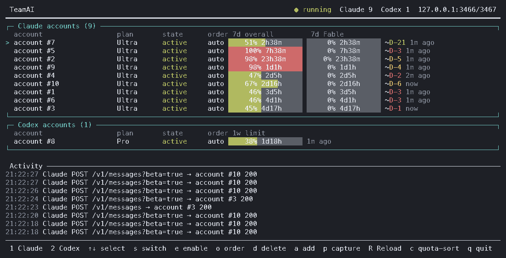

# TeamAI

**English** · [한국어](README.ko.md) · [日本語](README.ja.md) · [中文](README.zh-CN.md) · [Español](README.es.md)

TeamAI is a local multi-account relay for **Claude Code** and the official **Codex CLI**. It keeps a separate account pool for each provider. For Codex CLI, it retries a request with another account when the selected subscription is unavailable or out of quota. For Claude Code, each session is permanently pinned to its initial account (`sessions.json`) to preserve conversation history, blocking automatic handover to other accounts on quota exhaustion or error.



<sub>The dashboard above is a real capture, taken with <code>teamai capture --redact full</code>: real quota and activity, no account addresses.</sub>

> TeamAI is an independent open-source project. It is not affiliated with Anthropic, OpenAI, or the unrelated service at teamai.com.

## Requirements

- Node.js 20+
- macOS or Linux
- `claude` and/or `codex` installed separately
- Your own Claude Pro/Max or ChatGPT Codex subscription accounts

## Install

```bash
git clone https://github.com/soulduse/team-ai.git
cd team-ai
./scripts/install.sh
```

`install.sh` installs dependencies, builds, links the `teamai`/`tai`/`tac`/`tax`
commands, and offers to add the shell block. It is idempotent — re-run it to
upgrade. Pass `--no-shell` to skip the shell block, or `--dry-run` to see what it
would do.

To do the same by hand:

```bash
npm install
npm run build          # required: dist/ is not committed
npm link
```

Automating this from an AI agent? See [AGENTS.md](AGENTS.md), which states the
same steps as deterministic commands with verification and failure branches.

## Quick start

```bash
teamai login
tai
```

`login` asks whether to add `[1] Claude` or `[2] Codex`. Repeat it for additional accounts. `tai` is the short session command and is equivalent to `teamai start`: it launches the local relay and opens the dashboard.

For a direct provider session, use the dedicated launchers. They automatically start the TeamAI relay when necessary and pass every trailing argument to the official client:

```bash
tac                   # Claude Code through the TeamAI account pool
tac --resume          # same as: teamai claude --resume
tax                   # Codex through the TeamAI account pool
tax resume            # same as: teamai codex resume
teamai claude         # long form of tac
teamai codex          # long form of tax
teamai session        # choose [1] Claude or [2] Codex interactively
```

The names intentionally avoid replacing an existing TeamClaude `tc` shell function. `tc` can continue to target TeamClaude while `tac` and `tax` target TeamAI.

### Claude session pinning and resumption

Each Claude Code session is permanently pinned to its initial account in `sessions.json` and a persistent ledger to protect conversation history:

- **New sessions:** Before launching Claude Code, `tac` and `teamai claude` request a UUID from the relay's authenticated local control port. The relay persists its registration and atomically consumes it when binding the first conversation request. An unregistered ID is rejected with `409`, regardless of message count, role or client account metadata. User-supplied `--session-id` and `--fork-session` are rejected.
- **Turns, compaction and sub-requests:** Requests using the same canonical ID (`x-claude-code-session-id` or matching metadata) retain the initial binding across model changes and compaction. A subagent or in-session `/resume`, `/clear` or fork that introduces an unregistered ID is rejected; TeamAI does not infer parentage or register IDs from conversation bodies. Compatibility depends on the client preserving that ID; these boundaries are tested with synthetic requests, not live subscription sessions.
- **Resumed sessions (`--resume`, `--continue`):** These flags pass through without registering anything. Only a previously recorded binding can resume on its original account. Unproven sessions return `409`; missing or inconsistent storage returns `500`. Resume pickers and names work only if the resulting ID already has a binding.
- **Storage and migration:** Registration, ledger checks and binding use one cross-process file lock. Missing, unreadable, corrupt or inconsistent session files fail closed with `500`, including deletion of an entry followed by restart. An interrupted binding write also fails closed. Existing complete bindings with a consistent older ledger remain usable; conversations without those records are not adopted automatically (see below). Restore a consistent backup rather than deleting files to repair storage. Internal account warmups use a private process token and cannot register conversation IDs.
- **Adopting a session that predates registration:** After an upgrade, a Claude session started under an older relay has no registration and gets `409`. An administrator can record it explicitly: `teamai adopt claude <session-id> --account <account>` (`<account>` is the label or id `teamai accounts` prints) asks the running relay over its authenticated control port (`POST /claude/sessions/adopt`, body `{"sessionId", "account"}`). The relay takes the credential and actual account id from its own pool and writes the binding and its ledger record together under the session lock; no credential is sent or returned. **The chosen account becomes that session's first account**: from then on it is served only there, with no handover on quota, disable or error, so pick the account the session was actually using. Repeating it with the same account changes nothing; another account, a relay-issued ID that is still pending, a disabled, removed or unknown account, or an invalid ID is refused, and damaged storage fails closed with `500` without writing anything. The session ID is the full value Claude Code sends as `x-claude-code-session-id` (the name of its transcript file under `~/.claude/projects/`).

The [Claude Code CLI reference](https://code.claude.com/docs/en/cli-reference) documents UUID `--session-id`, resume/continue, and the new ID created by `--fork-session`. Its [hooks reference](https://code.claude.com/docs/en/hooks#common-input-fields) distinguishes the session ID from subagent IDs; it does not guarantee HTTP header behavior for every client feature or version.

## Shell setup

```bash
./scripts/install-shell.sh            # adds a marked block to ~/.zshrc
./scripts/install-shell.sh --dry-run  # show the diff, write nothing
./scripts/install-shell.sh --uninstall
```

It defines `cl` (Claude Code) and `co` (Codex) through the pool, plus `tai`,
`tais` and `taistart`/`tairestart`/`taistop` for the LaunchAgent, and unsets a
globally pinned `ANTHROPIC_BASE_URL` — TeamAI points each session at its own
port, so a stale global value only routes traffic to a proxy that may no longer
be running. The block is delimited by markers and rewritten in place, so
re-running it upgrades rather than appends; every write leaves a timestamped
backup, and install/uninstall cycles restore the file byte for byte.

A supervisor is optional: `cl`, `co`, `tai` and `teamai run` all start the relay
themselves when nothing is listening, so they keep working if the LaunchAgent is
unloaded, fails, or was never installed. A stale `server.json` left by a killed
process is ignored and replaced. When startup does fail, the reason from the
server (a port already in use, an unreadable credential file) is reported
instead of a bare "did not start", and the full output is kept at
`~/.config/teamai/server-start.log`.

### Running the relay as a login item

This is optional. The `taistart`/`tairestart`/`taistop` aliases installed above
drive a LaunchAgent labeled `com.teamai.proxy`, so use exactly that label:

```xml
<!-- ~/Library/LaunchAgents/com.teamai.proxy.plist -->
<?xml version="1.0" encoding="UTF-8"?>
<!DOCTYPE plist PUBLIC "-//Apple//DTD PLIST 1.0//EN" "http://www.apple.com/DTDs/PropertyList-1.0.dtd">
<plist version="1.0">
<dict>
  <key>Label</key>          <string>com.teamai.proxy</string>
  <key>ProgramArguments</key>
  <array>
    <string>/usr/local/bin/node</string>
    <string>/ABSOLUTE/PATH/TO/team-ai/dist/src/cli.js</string>
    <string>server</string>
  </array>
  <key>RunAtLoad</key>      <true/>
  <key>KeepAlive</key>      <true/>
  <key>StandardErrorPath</key> <string>/tmp/teamai.err.log</string>
</dict>
</plist>
```

```bash
launchctl bootstrap gui/$(id -u) ~/Library/LaunchAgents/com.teamai.proxy.plist
```

Use `command -v node` for the real Node path; a LaunchAgent does not inherit
your shell's PATH.

## Accounts

**Logging in on another machine.** `teamai login claude` opens the browser and waits for its callback on `localhost`, and at the same time reads a paste from the terminal. When the browser runs on a different device than TeamAI, the approval ends on a `localhost` page that cannot load there: copy that address-bar URL (or just the code in it) and paste it. Whichever arrives first finishes the login and the other is shut down; a pasted URL or `code#state` whose `state` is not this login's is refused and asked for again, and a stray request to the callback port is answered `400` without ending the login. `teamai login claude --manual` starts no callback server at all: open the printed URL on any device, approve, and paste the code the page shows. A login started from the dashboard (`a` → `1`) waits for the browser callback only, so the dashboard keeps its keys; the terminal paste is also skipped when stdin is not a terminal.

Codex uses its normal browser login flow (`codex login`). For a remote machine, `teamai login codex --device-auth` runs `codex login --device-auth` instead, which prints a code to enter on any device; that needs device-code authorization enabled in ChatGPT's settings. Without the flag TeamAI does not require that setting.

Credential import is optional and only works when an exportable credential file exists:

```bash
# Import every account from an existing TeamClaude config.
teamai import claude --from ~/.config/teamclaude.json

# Import Codex CLI's current file-based login, when present.
teamai import codex
```

Recent Claude Code versions may store credentials in the macOS Keychain rather than `~/.claude/.credentials.json`; use `teamai login` in that case. `import` never modifies the original TeamClaude, Claude Code, or Codex files. TeamAI uses a persistent isolated Codex home for relayed sessions, so the user's original `~/.codex` remains untouched.

## Operations

```bash
teamai status                                  # server state + account table
teamai accounts [claude|codex]                 # account table only
teamai start                                   # start relay, open dashboard
teamai stop                                    # stop the relay
teamai restart                                 # stop, start, open dashboard
teamai server                                  # run the relay in the foreground
teamai tui                                     # dashboard only, no auto-start
teamai disable codex user@example.com
teamai enable codex user@example.com
teamai priority claude user@example.com 1      # or: auto
teamai capture [--redact partial|full|none] [--out DIR]   # dashboard → .txt + .png, no TTY needed
teamai adopt claude <session-id> --account user@example.com   # a session from an older relay: make this its first account
teamai route list                              # model routes, in the order they are tried
teamai route add luna --provider codex --match 'gpt-6-luna*' --accounts a@x.com,b@y.com --mode prefer --color blue
teamai route rm luna                           # --provider when both providers have one by that name
```

Accounts of the same priority are ordered by **weekly pacing**, in both the
dashboard and the pool's own selection — so the top row is the account the next
request would go to. Each weekly budget is read as a straight line from 0% when
the week starts to 100% at its reset, and an account's deviation is its weekly
usage minus the share of the week already gone: an account *behind* its line
(negative) has budget it will lose at the reset unless it is spent, so it goes
first. It is an order, not a gate — when every account is ahead, the least-ahead
one is used — and an account about to reset with budget left is simply the
furthest behind, so there is no separate "resets soon" rule. The weekly window
is the one the request spends: Claude's `7d` (its Fable weekly window for a
Fable request), and on Codex the window whose length is 10080 minutes, whatever
it is called. Deviations within 5 points of each other count as equal, so two
accounts do not swap places on every request; a tie goes to the account the
session is already on, then to the most weekly budget left per remaining week,
then to the earliest weekly reset, then to the earliest and least-used 5-hour
window. An account with no weekly window that resets in the future (unmeasured,
or its reset already passed) sorts after those that have one. An explicit
priority, the switch threshold — which also sets aside
an account whose 5-hour window is at it, however far behind its week is — the
session pin and the concurrency cap all apply first, as before. Each row shows
its deviation as `+12%p` / `-30%p`. `routing.balance: "level"` restores the
older order for Claude (the fuller of the 5-hour and weekly windows, in 10%
steps, fewest requests in flight first; the dashboard draws that order too).
Codex always uses weekly pacing, regardless of `routing.balance`, so its
5-hour window is a threshold and tie-break signal rather than the ranking
budget. `c` toggles back to configured order.

A green `►` after the cursor marks the account a **new** request would go to right now, worked out by the server with the same ranking the pool itself uses — routes, priority, pacing, the switch threshold and the concurrency cap included — but without taking a slot, pinning a session or calling upstream. On Claude rows a magenta `►` before the `7d Fable` gauge marks where a new Fable request would go, and each model route's own target shows as a bold route marker. It is a preview, not a promise: an existing session keeps going to the account it is pinned to, and requests racing each other can land elsewhere. No arrow means no account could take a new request (all spent or all at their concurrency cap), and none is drawn while the server is stopped. The arrows are re-derived every 15 seconds, so a cooldown that runs out shows without any traffic.

**Fable and other models.** Only the top model (Claude's Fable tier) draws on
the model-weekly window. The pool holds nothing back for it: within a route,
every request — Fable or not — goes by priority (explicit ranks first, lowest
first), then by the balance above, which for a non-Fable request reads the
shared weekly window and for a Fable request the Fable one. Codex requests
always use the weekly window in this step. What a Fable
request does skip is an account that cannot serve it: one whose Fable window is
fully spent (100%), and a measured account that reports no Fable window at all
(a plan without Fable, such as Pro); an account not measured yet is still tried.
Such an account keeps serving every other model. To keep Opus or Sonnet traffic
off the accounts you want to save for Fable, write a model route (below). The
old `fableReserveThreshold` key is no longer read; a `config.json` that still
has it starts as before.

**Model routes.** `routes.claude` and `routes.codex` send requests for chosen models to chosen accounts. Each route is `{ "name", "match", "accounts", "mode", "color" }`: `match` is a list of patterns tested against the request's `model` (`*` matches anything, everything else is literal, case is ignored, the whole name must match — `claude-opus-*`, `*fable*`, `gpt-6-astra`), `accounts` lists account labels, ids or 0-based positions among that provider's accounts, and the first route that matches applies. In the default `"mode": "prefer"` the route's accounts are tried first and, when none of them can take the request, it goes to any other account at once; the switch and the return are each logged once. With `"mode": "exclusive"` only the route's accounts may serve the model — failover stays inside the route, and when they are all spent the request gets a 429 that names the route. A route outranks priority and the balance (a route is a rule you wrote), a routed request keeps a session pin of its own, and a request with no `model` matches no route. A malformed route written into `config.json` by hand stops the relay from starting (`server-start.log` says which) — the dashboard editor and `teamai route` below check a route with that same parser before saving, so they cannot cause this; an account reference that matches nothing is logged and skipped. The dashboard adds one marker column per route left of the cursor — `▸` in the route's colour on its accounts, grey where that account cannot serve right now — request lines carry `[route:name]` (`→fallback` when a prefer route had to leave), and `teamai status` lists the routes.

```json
"routes": {
  "claude": [{ "name": "opus", "match": ["claude-opus-*"], "accounts": ["work@example.com"], "color": "magenta" }],
  "codex": [{ "name": "mini", "match": ["*-mini"], "accounts": [0, 1], "mode": "exclusive" }]
}
```

**Editing routes.** Press `g` on the dashboard to manage the routes of the selected row's provider (`Tab` switches between Claude and Codex). The list is in the order routes are tried — the first match wins — and `a` adds, `e`/`Enter` edits, `d` deletes after a `y` confirmation, and `[`/`]` (or `K`/`J`) move the selected route up or down. The editor steps through name, match (model globs, comma-separated), accounts (`Space` toggles each of that provider's accounts; they are saved by label), mode (the screen spells out what `prefer` and `exclusive` do) and color; `Enter` moves on and saves on the last field, `Shift-Tab` goes back, and `Esc` leaves without saving anything. A route is checked by the same parser the server runs at startup before anything is written; when it fails, nothing is saved and the reason stays on screen. Saving rewrites only `routes.<provider>` in `config.json` (a 0600 temp file renamed into place, every other key as it was), then asks a running server to re-read its routes over the control port (`POST /routes/reload`, same client token): no restart, and requests already in flight keep the route they matched. If that reload fails — or the server is stopped — the screen says so and the saved file applies at the next start. From a shell, `teamai route list`, `teamai route add <name> [--provider claude|codex] --match a,b --accounts x,y [--mode prefer|exclusive] [--color c]` and `teamai route rm <name> [--provider …]` do the same through the same checks; `--provider` defaults to `claude`, `add` with an existing name replaces that route in place, and an account given by id is stored as its label.

When saving, the dashboard compares the route list it opened with the file immediately before writing; if a CLI or another editor changed it, the save is refused with a reload message instead of overwriting that change. An `exclusive` route must include at least one account configured for that provider. The control reload is loopback-only and parses every provider before swapping any pool, so a malformed provider leaves all active route lists unchanged.

A Fable-tier 429 (`7d_oi` rejected while the shared `5h`/`7d` windows are still
allowed) benches only that account's Fable window, not the account: every other
model keeps being served from it, instead of the whole account sitting idle for
up to a week over a budget only the top model spends. A 429 that rejects a
shared window benches the account as usual.

The full-screen TUI groups Claude and Codex accounts and keeps the currently selected account anchored even when usage changes. Claude rows show the `5h session`, `7d`, and model-scoped `7d Fable` windows independently; Codex rows show its windows, each titled with the span that account actually reports (`5h`, `7d`). A week is written `7d` everywhere on the dashboard, the other agents' boxes and the narrow layout included. Every box — both account boxes and the other agents' boxes below them — draws its gauges in the same three columns, with the same width: the session window (5h) first, the weekly window second, and whatever a provider has beyond those (Claude's `7d Fable`, OpenCode Go's `30d`) third. A window goes to the column its length says, so a Codex account or Grok with only a weekly window leaves the first column blank rather than shifting the weekly gauge left. The column before the gauges (account, plan, state and order, or the group name) is the same width in every box, and the fields after the gauges — the measurement age, the pacing deviation (`+12%p`), then `RC<n>` on Codex rows — each start in one column across all boxes; a narrower terminal narrows every box the same way. Quotas are learned from official-client responses and retained across restarts.

**Narrow terminals.** The dashboard is drawn at the terminal's real size and redrawn the moment that size changes (a resize clears the screen first, so nothing of the old frame is left), which matters when a phone and a desktop take turns looking at the same terminal. Below 80 columns — or wherever the wide boxes would not fit their three gauges (78 columns plus one per route marker) — it switches to a summary: one line per account and per other-agent usage group, with a short name (cut with `…`), the cursor `>` and the `►` next-account marker, the session and weekly figures as `5h 62%  7d 84%` (Claude's Fable week and other third windows such as `30d` when there is room), and how long until the most-spent of those windows resets. With room to spare the figures are short gauges, otherwise plain percentages coloured like the gauges; a disabled account's name is grey, one in error red, one cooling down yellow. Plan, state, order, measurement age and pacing are left to the wide layout. Activity becomes one line per request — time, session, `C`/`X`, status (or seconds so far while in flight) and the account, cut at the edge, never wrapped — and takes the rows that are left. The footer shows the keys that fit and `? help`; `?` lists every key in either layout. When the terminal is also short, lines give way in a fixed order — the rest of the activity log, the other agents, the header, accounts other than the current and selected ones — so each provider's current account and its figures stay on screen. No line is wider than the terminal, wide characters counted as two columns. Every key works as before.

**Host load.** The header shows this PC's own CPU and RAM use, measured by the dashboard itself with Node's `os` module (no server API, no extra dependency) and refreshed on every redraw: `CPU 12% · RAM 46% 7.3/16.0GB`. CPU% is the busy share since the previous redraw, so the first frame shows `CPU –`; a figure turns yellow from 70% and red from 90%. The used/total amount appears in the wide layout only. Beside the title the header shows only that and, in the wide layout, the relay's address and ports; when it is short of room the amount goes first, then CPU/RAM as a whole, before the ports. `teamai status` prints the same figures on a `Host:` line, and a capture includes them.

The footer exposes the same account workflow as TeamClaude: select, switch, enable/disable, order, delete, add/login, re-measure (`R`), model routes (`g`), and quit. `switch` pins the selected account to the front of its provider pool; order mode can assign a rank or return an account to automatic scheduling. Claude profile refreshes show the plan tier and unhealthy subscription states such as `past_due` in red.

**Account changes apply without a restart.** Every switch, enable/disable, priority change, login and deletion in the dashboard is saved to `config.json` and then sent to the running server over the control port (`POST /reload`, loopback only, same client token), which re-reads the accounts, the account groups, the model routes, `routing.balance` and the `codexCapacity*` settings in place. Nothing in flight is cut: a request keeps the account it started on to the end — even one that was just switched off or deleted; a deleted account finishes the requests it is serving, takes no new one, and leaves the pool when the last one ends — and the next request is chosen by the new settings. Learned state (usage, windows, cooldowns, reset credits, the other agents' readings) stays as it was. The file is checked whole before anything changes — every account entry, account group, provider's routes, the balance and capacity settings — and a file the server cannot use is refused with the reason on the dashboard while the server keeps the settings it had. `proxy`, `switchThreshold` and `maxConcurrentPerAccount` cannot be swapped into a running process: a reload names them when they changed, and they apply at the next `teamai restart`. The dashboard starts a server only when none is running. `teamai login`, `import`, `enable`, `disable` and `priority` reload a running server the same way (and leave a stopped one stopped). After updating TeamAI itself, `teamai restart` once: a server started from the old build has no reload route, and the dashboard says so.

`p` saves a capture of the dashboard, and `teamai capture` does the same from a script or an agent, no terminal required. Each capture is a pair of files under `~/.config/teamai/captures/` (or `--out DIR`): the frame as text with its colors intact, and the same frame as a PNG drawn with a built-in bitmap font, so nothing beyond Node is needed. Account addresses are masked before the frame is drawn — in the account column, the footer and the activity log alike — as `de•••••••••w@gm•••.com` by default; `--redact full` replaces them with `account #N`, and `--redact none` keeps them for a capture that stays private. From the dashboard, `p` also reveals the PNG in your file manager and puts the image on the clipboard — on macOS out of the box, on Linux where `xdg-open` and `wl-copy` or `xclip` are installed — and the footer says which of those happened. The image at the top of this README is one such capture. A capture is as wide as the terminal it is taken from (40 columns at the least, 120 without a terminal), so one taken from a phone shows the narrow layout.

The Activity pane lists a request the moment it starts, before its body is read: a spinner, its start time, the account it was routed to once one is chosen, and a running timer, with `N active` in the pane's title. A streaming response stays there until its last byte. When it ends the line becomes a finished entry with the status and total time — `499` when the client went away before the response finished (a client that hangs up right after the stream's terminal event — Codex's `response.completed`, Claude's `message_stop` — got the whole answer and keeps upstream's status), `cut` when upstream broke the stream mid-body, and the status followed by `failed` or `incomplete` in red when a Codex stream ended with `response.failed` or `response.incomplete` (the client got a 200, but not a whole answer) — and every request that opened a line closes it exactly once, refusals included. In-flight lines are drawn only while the server that recorded them is running, so a crashed relay cannot leave one spinning. Codex capacity waits remain active and show `capacity retry xN` (`retry xN` in the narrow layout); the total also stays on the finished line. Each capacity retry and each capacity cut is written to server output as well as Activity. Failover and retry notes still appear as lines of their own.

Each request line also names the client's own session — the first six characters of its id, in a colour fixed per session so one conversation can be followed down the log — and the model and reasoning effort the request asked for, as `(gpt-6-astra·high)`. The session comes only from what the client sends (Claude Code's `x-claude-code-session-id` or the `session_id` in its metadata; Codex's `session-id`/`thread-id` headers or `client_metadata`, UUIDs only), never from a connection id the relay made up; a request without one leaves the column blank. Only those three fields are read from the body. `activity.sessionIds` and `activity.models` turn either off, and `--redact full` drops session ids from a capture.

**Other agents' usage.** Below the account boxes the dashboard shows the subscription usage of other coding agents installed on the same machine — display only; TeamAI does not relay them. **Antigravity** is read by running `agy -p "/usage"` (no model call), one row per model group with its 5-hour and weekly windows; **OpenCode Go** with the key OpenCode keeps in `$XDG_DATA_HOME/opencode/auth.json` (or `OPENCODE_API_KEY`), showing its 5-hour, weekly and monthly windows; **Grok** with the sign-in in `$GROK_HOME/auth.json` (default `~/.grok/auth.json`), showing the weekly credit share and the monthly spend, with the plan and a masked address; **Command Code** with the credentials in `~/.commandcode/auth.json` (or `COMMAND_CODE_API_KEY`), reading its 5-hour and weekly windows (and monthly subscription period) from its billing endpoints, with the plan and a masked address. A tool that is not installed (no `agy`, no OpenCode key, no Grok sign-in file, no Command Code CLI or credentials) gets no box. These credentials belong to the other apps: they are only read, used in memory, and never written to `state.json`, a log or a child process. The one thing TeamAI writes back is Grok's own sign-in: when its access token is within five minutes of expiry (the grok CLI's own margin), TeamAI refreshes it with its refresh token so the box keeps working without opening grok. It does this the way the CLI does — under an exclusive `flock` on `auth.json.lock` (held by util-linux `flock(1)`, or perl where that is missing; waits at most 15 seconds), re-reading `auth.json` under the lock and doing nothing if another process already refreshed, asking the issuer's discovery document for the token endpoint (which must be on the issuer's own origin), and replacing `auth.json` atomically (a `0600` temporary file in the same directory, `fsync`, `rename`) with only `key`, `refresh_token` (when rotated) and `expires_at` changed. Any failure leaves the file untouched and shows `sign-in expired — <reason>` with no token sent; a rejected refresh token (`invalid_grant`) says `run grok login`, and a sign-in without a refresh token still says `run grok to refresh`. After a failed refresh the next attempt waits 10 minutes. Usage is read 5 seconds after start and then every `externalUsage.refreshMs` (15 minutes); a failed read is retried on a back-off from 30 seconds up to 15 minutes, keeps the last good gauges on screen for 30 minutes marked `refresh failed — showing cached data`, and `R` re-reads them too. A server restart (`teamai restart`) keeps the last readings on screen until its own first read replaces them; only a tool switched off in `externalUsage.providers` loses its box. The sources are undocumented endpoints, so an answer in an unexpected shape becomes an error row and never affects the relay. `externalUsage.source: "orca"` takes all three from `orca account list --json` instead, for people who run Orca.

Enabled accounts also have their quota refreshed in the background every five minutes (plus up to 30 seconds of per-account jitter, at most two concurrent reads, and exponential backoff from 30 seconds up to 15 minutes on failure) from each provider's zero-quota usage endpoint (`/api/oauth/usage` for Claude, `/wham/usage` for Codex), renewing an expiring token first and skipping disabled accounts; `POST /reload` updates the scheduled set in place. `R` forces an immediate re-measure across the whole fleet: it reads the usage endpoint first and, for any account that could not be read there, replays a known-accepted request shape against idle accounts in parallel (including already-measured and throttled ones, whose 429s still carry authoritative headers) and reports an honest `measured/targets` count. That shape is committed only from a real 2xx that flowed through the proxy, so until one request has succeeded `R` reports that no probe template exists yet rather than guessing a payload. Accounts missing the model-scoped weekly (Fable) window get one extra top-up probe, because that window only appears on responses to Fable-tier requests.

### Codex·Claude keep-warm

Codex and Claude keep-warm is event-driven. Ten seconds after a measured 5-hour window reset, TeamAI re-reads that account’s usage and, only when the fresh reading says the advertised window is empty (`0%`), runs one real, minimal request to that account (for Codex, `codex exec` with the smallest model and prompt `hi` through the fixed local `/tc-acct/<account>/codex` path; for Claude, an HTTP messages request with the smallest Haiku model and prompt `hi` through the fixed local `/tc-acct/<account>/claude` path). Accounts are warmed one at a time; a permanent failure is retried once after ten minutes, then marked `gave-up` with a one-hour expiry and its next check is shown in status. A relay-classified capacity or overload failure, a stream that ends without a terminal event, or a warm timeout or signal is transient: it does not consume the permanent-failure count and retries with exponential backoff capped at one hour. Usage is judged by when the read was sent, so a delayed response from before the warm cannot trigger a duplicate. Six minutes after a warm (past the five-minute slack that tells an empty window from one just opened) the usage is read once more: a window still reading empty counts as a failure, and a failed warm’s retry timer sends another warm rather than counting a confirmation read. An opened window is not warmed again until it resets, even while it still reads `0%`. A pinned path naming no configured account is refused with 404 rather than served by another account. Each change in the warmer’s decision and each warm outcome is written as one line, by account number only, to the server’s output — `$TEAMAI_HOME/server-start.log` when the relay was started on demand.

Idle accounts are kept alive by a separate five-minute sweep: any account whose token is expiring or whose last attempt errored is refreshed, one at a time. Ordinary traffic sticks to a few accounts and keep-warm deliberately never refreshes, so without this an account no one uses could let its refresh-token chain lapse and be invalidated upstream. The sweep is sequential on purpose — refreshing the whole fleet at once after a long downtime would burst the token endpoint into a rate limit.

Learned quota (usage, windows, reset times, subscription profile) is written to disk and restored on the next start, so the dashboard and ranking survive a restart without re-measuring; the probe shape `R` replays is persisted the same way. Per-response signals are not: a cooldown or an error is deliberately dropped on restart, so an account is never re-benched by a stale 429's retry-after — if it really is spent, the next request re-derives the right state.

If more requests arrive at once than the fleet's combined per-account concurrency can serve, the relay rejects the overflow with `429` (`x-teamai-429-reason: concurrency_saturated`) before reading the request body, rather than buffering unbounded bodies. The same header distinguishes a busy fleet from a spent one (`quota_exhausted`) on the "no account available" 429.

**Codex reset credits.** A ChatGPT account may hold reset credits — the tickets Codex CLI's `/usage` "Full reset" spends. With `codexResetCredits` on, the relay spends one by itself at the quota dead end: when no Codex account can take a request because every one is out of budget (not merely busy), it redeems a ticket on the best eligible account — most tickets first, then the weekly window that resets latest — and serves the same request there. An account qualifies only when its weekly window is measured full (`codexResetCreditsSessionWindow` lets a full 5-hour window qualify too), its ticket count has been read from the usage endpoint and exceeds `codexResetCreditsReserve`, and its last attempt is older than `codexResetCreditsCooldownMs`. With `codexResetCreditsPolicy: "account"` a ticket is also spent right after an account's own exhaustion 429, and the request goes back to that account once. A request spends at most one ticket. A ticket cannot be given back, so the relay never spends one on a guess: the attempt is recorded on disk as `pending` before the call, an answer it cannot read (a timeout, a 5xx, an unknown code) counts as possibly spent and stops the pass instead of trying the next account, a `pending` found after a restart blocks that account until a usage read has counted its tickets again or 15 minutes pass, and the usage is re-read 1.5 s after every attempt. For two minutes after a reset, figures from responses sent before it, and readings that would raise usage, are ignored; a fresh 429 is always believed. Codex rows show the tickets on hand as `RC<n>`, `teamai status` lists them per account, and `t` on a Codex row opens a picker to spend a chosen ticket by hand (`y` to confirm). Off by default; with it off, no reset-credit call is ever made.

Anthropic's profile endpoint exposes subscription status and tier, but no current billing-period end. Profile state is refreshed at server startup and every six hours.

## Claude account groups

Define optional groups in the existing `config.json`, using Claude account labels or ids from `teamai accounts claude`. An account may belong to several groups:

```json
"groups": {
  "master": ["lead@example.test", "backup@example.test"],
  "worker": ["worker@example.test", "backup@example.test"]
}
```

```bash
teamai claude --group master
TEAMAI_GROUP=worker tac
teamai claude --resume <session-id>
```

`--group NAME` (also `--group=NAME`) takes precedence over `TEAMAI_GROUP` and is consumed by TeamAI before launching Claude. Unknown groups fail before launch. Group names are case-sensitive, start with an ASCII letter or digit, and contain up to 64 letters, digits, `_`, `.` or `-`; account lists must be non-empty. Unknown or ambiguous account references and accounts from other providers refuse startup or the whole config reload. This option and environment variable are currently supported only for Claude; Codex rejects them.

A new session chooses its first account only among that group's members, using the existing priority and quota rules. A cooling member is skipped when choosing a **new** session's account; if all members are unavailable, the request gets the existing 429 response with retry information when known. Model routes further narrow or rank accounts within the group and never allow an outside account. Without a group, selection is unchanged.

The group is stored with the relay-issued session registration and durable account binding, so it survives a restart before the first request and `--resume` / `--continue` afterwards. **Claude's permanent first-account pin still applies:** a bound session returns the existing cooldown/error response instead of moving to another account, even within its group. Resume without a group option to use the stored group; supplying another group refuses the request with 409. Removing a group or its bound account's membership refuses that session with 503 and leaves its binding unchanged. Keep account references valid when renaming or deleting accounts.

After editing groups, restart the relay or apply a config reload through an account command or the dashboard. Valid group changes reload atomically with account settings. `teamai status` lists group headroom and stored session groups; dashboard Activity lines show `[group:name]`, and both dashboard layouts show per-group remaining quota. Headroom sums known remaining quota as account-equivalents across enabled members, using each member's fullest known quota window; unmeasured members are counted separately as unknown. Membership can overlap, so group totals must not be added together.

In both dashboard layouts, configured groups divide the Claude account box into sections in configuration order, with ready counts and headroom in each heading. Accounts keep the current quota/config sort within each section; accounts outside every group appear last under `그룹 없음` (Ungrouped). A shared account appears in every group with `↔` before its name. Selection highlights all copies, while ↑/↓ visits each account once in order of its first appearance; actions affect that single account. Priority mode freezes the order within each section until it closes. Without groups, the dashboard is unchanged.

## Configuration

Configuration and credentials live in `$TEAMAI_HOME`, falling back to
`$XDG_CONFIG_HOME/teamai` and then `~/.config/teamai`. The proxies bind to
`127.0.0.1` and require a generated local client token.

Every change to `config.json` or `credentials.json` re-reads the file and
writes it back while holding `<file>.lock`, one process at a time (the server,
the dashboard, a command), through a temporary file of its own that is renamed
into place. Overlapping saves therefore neither tear a file nor undo each
other — a login is not lost to a server save, and a deleted account is not
written back. A lock left by a process that died is taken over.

`config.json` is created on first run with these defaults:

| Key | Default | Meaning |
| --- | --- | --- |
| `proxy.host` | `127.0.0.1` | Bind address. Loopback only by design. |
| `proxy.claudePort` | `3456` | Claude relay port. |
| `proxy.codexPort` | `3457` | Codex relay port. |
| `proxy.controlPort` | `3556` | Control channel the TUI talks to. |
| `proxy.clientToken` | generated | Local token every relayed client must send. |
| `switchThreshold` | `0.98` | Usage ratio above which an account stops being selected. |
| `warmup.enabled` | `true` | Event-driven Codex and Claude keep-warm; `false` disables both. |
| `warmup.claude` | `true` | Enable keep-warm for Claude accounts; `false` disables Claude keep-warm. |
| `warmup.codex` | `true` | Enable keep-warm for Codex accounts; `false` disables Codex keep-warm. |
| `maxConcurrentPerAccount` | `16` | In-flight requests allowed per account. `0` means unlimited. |
| `routing.balance` | `"pacing"` | How equal-priority Claude accounts are ordered: `pacing` (weekly progress, see above) or `level` (least-full windows in 10% steps). Codex always uses weekly pacing. Anything else stops startup with the reason; the dashboard then draws the `pacing` order. |
| `codexCapacityEnabled` | `true` | Retry Codex upstream model-capacity failures transparently. |
| `codexCapacityRetryMs` | `500` | Fixed interval between capacity attempts, with no attempt or elapsed-time limit; whole milliseconds from `1` to `86400000`. |
| `codexCapacityPreambleHoldMs` | `500` | Maximum time to withhold received preamble before releasing it; `0` holds until output, capacity failure or EOF. Whole milliseconds from `0` to `86400000`. |
| `codexCapacityRotation` | `false` | Opt in to cycling eligible accounts for this request after capacity failures. Routes and pinned account paths still apply; no account-wide cooldown is set. |
| `codexResetCredits` | `false` | Spend Codex reset credits automatically (see above). |
| `codexResetCreditsPolicy` | `"fleet"` | `fleet`: only when no Codex account has budget. `account`: also on an account's own exhaustion 429. |
| `codexResetCreditsCooldownMs` | `1800000` | Minimum time between two attempts on one account, whatever the outcome. |
| `codexResetCreditsReserve` | `0` | Tickets per account that automatic use leaves alone. |
| `codexResetCreditsTimeoutMs` | `10000` | Time limit on one redemption call; past it the outcome counts as unknown. |
| `codexResetCreditsListRefreshMs` | `600000` | How long the ticket list shown by `t` is reused. `0` fetches it once. |
| `codexResetCreditsSessionWindow` | `false` | Also spend a ticket when only the 5-hour window is used up. |
| `activity` | `{ "sessionIds": true, "models": true }` | What request lines in the Activity pane show besides method and path. |
| `groups` | — | Optional Claude account groups, `{ "name": ["account label or id", ...] }`; no group keeps unrestricted selection. |
| `routes` | — | Optional. Model routes per provider, `{ "claude": [...], "codex": [...] }` (see Model routes). |
| `externalUsage` | `{ "enabled": true }` | Other agents' usage boxes. `providers.antigravity` / `providers.opencodeGo` / `providers.grok` / `providers.commandCode` (`false` hides one), `refreshMs` (default `900000`, minimum `30000`), `source` (`"direct"` or `"orca"`). |
| `proxy.legacyPorts` | — | Optional. Extra ports to keep answering on, per provider — e.g. `{ "claude": [3400] }`. |
| `proxy.maxBodyMb` | `512` | Optional. Largest request body the relay accepts, in MB. A number above `0` and at most `4096`; anything else stops startup with the reason. |
| `proxy.maxInflightBodyMb` | `1024` | Optional. What all request bodies held in memory at once may add up to, in MB, across both providers. Never below `proxy.maxBodyMb` when unset; set below it, or to anything but a number above `0` and at most `65536`, it stops startup with the reason. |
| `proxy.bodyTimeoutMs` | `300000` | Optional. How long a request body may take to arrive, in ms; `0` for no limit. A body still arriving after it is answered `408` with `x-teamai-408-reason: body_timeout` and gives back its share of `proxy.maxInflightBodyMb`. A whole number from `0` to `86400000`, or startup stops with the reason. |

Change a port if something else already owns it — that is the usual cause of a
failed start, and the reason appears in `server-start.log`.

A client is handed its base URL at startup and cannot be redirected afterwards,
so moving a port in `config.json` would otherwise strand every session already
open with connection refused. The relay therefore also answers on the built-in
default port and any `proxy.legacyPorts` you list, keeping open sessions alive
across a port change. A legacy port that something else already owns is skipped
without affecting the main port, and a socket error after startup is logged
rather than allowed to take the relay down.

A request body over `proxy.maxBodyMb` is answered by the relay itself with
`413` and `x-teamai-413-reason: body_limit`, and never sent upstream; the
Activity pane logs its size and the limit (never its content). The default is
not a measured request size: the one oversized request on record (2026-10-17)
was a long Codex session with several screenshots, inline as base64, that went
past the old fixed 32 MB, and its exact size was not kept. 512 MB is the largest
single size either upstream documents — OpenAI's per-file upload limit; it
documents no per-request limit for the Responses API, and Anthropic's Messages
API documents 32 MB per request — so in practice the upstream decides, and its
own `413` reaches the client unchanged. A relayed body over 32 MB leaves a
`large request body` line with its size, so real sizes are on record. Each in-flight request holds its whole body
in memory, because failing over to another account resends it. What all of
them hold together is capped by `proxy.maxInflightBodyMb` (1024 MB by default,
for both providers together; an upload still in progress counts): a request
whose body does not fit is answered `429` with `retry-after: 5` and
`x-teamai-429-reason: body_budget`, in the same error shape as the `413`, and is
not sent upstream. Without that cap the worst case was `maxBodyMb` ×
`maxConcurrentPerAccount` × accounts. Peak memory can reach up to about three times
the budget: the body is copied when it is sent, and Claude's is rewritten per account.
A body has `proxy.bodyTimeoutMs` (300 s, which Node already enforced silently)
to arrive; a stalled upload is then answered `408` with
`x-teamai-408-reason: body_timeout` and logged, rather than holding its share
of the budget for as long as the client keeps the connection open.

## Scope and compliance

Version 0.1 targets subscription OAuth accounts and wrapper-launched CLI sessions. It does not expose a public OpenAI-compatible API, convert Claude requests to Codex requests, support Codex Desktop, or pool credentials between different people. You are responsible for complying with provider terms and policies. Production/commercial API workloads should use the providers' official API billing mechanisms.

## Development

```bash
npm run typecheck
npm test
npm run lint
```

`npm test` loads `test/isolation.ts` before every file. Each test gets its own
temporary `TEAMAI_HOME` and home directory; test servers listen on port 0; and
a test that touches the real TeamAI, Codex or Claude directories, the relay's
ports (3456/3457/3556 and 3466/3467/3566) or any host off the machine fails,
even when the code under test swallows the error.

See [NOTICE](NOTICE) for derived work and [SECURITY.md](SECURITY.md) for the local security model.

`teamai codex` (`tax`) runs Codex with an isolated `CODEX_HOME` (`codex-home` under the TeamAI config directory) and links `skills`, `plugins`, `rules` and the global hook list `hooks.json` into it from your own Codex home, leaving anything already there alone. Codex records that you trusted a hook under the path it read `hooks.json` from, so the relayed home would otherwise see your global hooks as untrusted and skip them. On each launch the trust records for your own `hooks.json` are copied, as they are, to the relayed path; a hook you trust from inside a relayed session is kept across launches too. Nothing is ever marked trusted that you did not trust, and your own `config.toml` is only read. Other files at the top of your Codex home, such as a global `AGENTS.md`, are not linked.

TeamAI persists relay routing in the isolated `codex-home/config.toml` and passes `TEAMAI_PROXY_TOKEN` to the client so nested `codex exec` processes that retain this environment can use the relay. The original `~/.codex` is unchanged. A launcher that replaces the home or higher-priority provider settings can still select another route; the outer CLI's `-c` arguments are not automatically inherited by child processes. Automation that requires the relay should pass the provider overrides explicitly and verify `provider: teamai` in its execution log. Missing relay credentials must be treated as an error rather than silently falling back to direct authentication.

<!-- transient-recovery-2026-09-22 -->
Transient upstream errors retain their original HTTP status, body and Retry-After. After account failover, the relay allows up to two retry rounds (at most 10 seconds of backoff per round and 20 seconds total); longer waits are returned to the client. Streams with model output are never replayed by the relay. Codex model-capacity failures use the separate behavior below. Codex HTTP retries remain disabled to avoid multiplying relay retries. Restart the relay after rebuilding to activate changes.

**Codex upstream model capacity.** A Codex HTTP `503` with `server_is_overloaded`, “server is overloaded” or “model is at capacity” in its error body, and a `200` SSE `response.failed` carrying the same error, are retried inside the relay. Before output, the relay holds `response.created`, `response.in_progress`, `response.queued`, metadata and keepalive frames. An early capacity failure discards those frames and resends the identical request on the selected account. The fixed 500 ms default gives short failures time to recover without a tight loop; there is no attempt count or overall wait limit, and disconnecting the client stops the wait and upstream read immediately. The selected account's concurrency slot stays reserved during a same-account wait, preserving session affinity even under parallel load.

The preamble hold defaults to 500 ms to bound the added first-byte latency. After that deadline it forwards only preamble until output begins; a late capacity failure still triggers the same retry into the open response. In this case the client can see a second `response.created`, whose response id replaces the earlier id. If that retry instead fails for another reason, the open stream ends without a terminal event. Once output has been sent, the relay drops a capacity failure frame and ends the stream without `response.completed`; Codex CLI can then use its own stream-disconnect retry (with the client's own retry limit). Other `response.failed` events and other HTTP errors keep their existing behavior, and Claude is unaffected.

The gate retains at most 4 MiB of preamble and unfinished-frame bytes per request, excluding the transport chunk and copies during framing. At that ceiling it releases accumulated preamble and keeps inspecting; an individual unfinished frame that reaches the ceiling ends the stream without a terminal event, with a `cut` activity entry. Oversized frames never bypass the capacity filter. All four `codexCapacity*` keys are validated at startup and atomically by `POST /reload`; rejected settings leave the running pools unchanged. Reloaded values govern subsequent attempts; an already-running gate keeps its hold deadline. Translations have been marked as awaiting this behavior and these settings.
