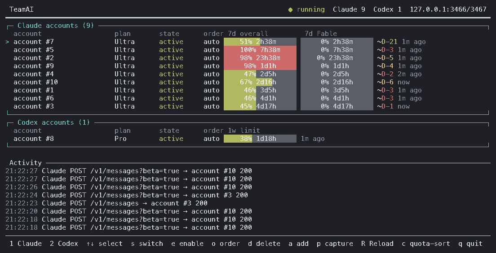

# TeamAI

**English** · [한국어](README.ko.md) · [日本語](README.ja.md) · [中文](README.zh-CN.md) · [Español](README.es.md)

TeamAI is a local multi-account relay for **Claude Code**, the official **Codex CLI** and the official **Grok CLI**. It keeps a separate account pool for each provider and retries a request with another account when the selected subscription is unavailable or out of quota.



<sub>The dashboard above is a real capture, taken with <code>teamai capture --redact full</code>: real quota and activity, no account addresses.</sub>

> TeamAI is an independent open-source project. It is not affiliated with Anthropic, OpenAI, xAI, or the unrelated service at teamai.com.

## Requirements

- Node.js 20+
- macOS, Linux, or Windows
- `claude` and/or `codex` installed separately
- Your own Claude Pro/Max/Ultra, ChatGPT Codex or SuperGrok subscription accounts

## Install

```bash
git clone https://github.com/soulduse/team-ai.git
cd team-ai
./scripts/install.sh
```

`install.sh` installs dependencies, builds, links the `teamai`/`tai`/`tac`/`tax`
commands, and offers to add the shell block. It is idempotent — re-run it to
upgrade. Pass `--no-shell` to skip the shell block, or `--dry-run` to see what it
would do.

To do the same by hand:

```bash
npm install
npm run build          # required: dist/ is not committed
npm link
```

On Windows, `install.sh` needs a bash shell, so use these manual steps instead.
`npm link` creates `teamai`/`tai`/`tac`/`tax` commands for `cmd.exe` and
PowerShell, and the launchers start an npm-installed `claude.cmd`/`codex.cmd`
with every argument escaped for `cmd.exe`. The shell setup and login-item
sections below are for macOS and Linux.

Automating this from an AI agent? See [AGENTS.md](AGENTS.md), which states the
same steps as deterministic commands with verification and failure branches.

## Quick start

```bash
teamai login
tai
```

`login` asks whether to add `[1] Claude`, `[2] Codex` or `[3] Grok`. Repeat it for additional accounts. `tai` is the short session command and is equivalent to `teamai start`: it launches the local relay and opens the dashboard. From the TUI press `1` to launch Claude Code, `2` to launch Codex or `3` to launch Grok. When the client exits, the dashboard returns.

For a direct provider session, use the dedicated launchers. They automatically start the TeamAI relay when necessary and pass every trailing argument to the official client:

```bash
tac                   # Claude Code through the TeamAI account pool
tac --resume          # same as: teamai claude --resume
tax                   # Codex through the TeamAI account pool
tax resume            # same as: teamai codex resume
tag                   # Grok CLI through the TeamAI account pool
teamai claude         # long form of tac
teamai codex          # long form of tax
teamai grok           # long form of tag
teamai session        # choose [1] Claude, [2] Codex or [3] Grok interactively
```

The names intentionally avoid replacing an existing TeamClaude `tc` shell function. `tc` can continue to target TeamClaude while `tac` and `tax` target TeamAI.

## Shell setup

```bash
./scripts/install-shell.sh            # adds a marked block to ~/.zshrc
./scripts/install-shell.sh --dry-run  # show the diff, write nothing
./scripts/install-shell.sh --uninstall
```

It defines `cl` (Claude Code) and `co` (Codex) through the pool, plus `tai`,
`tais` and `taistart`/`tairestart`/`taistop` for the LaunchAgent, and unsets a
globally pinned `ANTHROPIC_BASE_URL` — TeamAI points each session at its own
port, so a stale global value only routes traffic to a proxy that may no longer
be running. The block is delimited by markers and rewritten in place, so
re-running it upgrades rather than appends; every write leaves a timestamped
backup, and install/uninstall cycles restore the file byte for byte.

A supervisor is optional: `cl`, `co`, `tai` and `teamai run` all start the relay
themselves when nothing is listening, so they keep working if the LaunchAgent is
unloaded, fails, or was never installed. A stale `server.json` left by a killed
process is ignored and replaced. When startup does fail, the reason from the
server (a port already in use, an unreadable credential file) is reported
instead of a bare "did not start", and the full output is kept at
`~/.config/teamai/server-start.log`.

### Running the relay as a login item

This is optional. The `taistart`/`tairestart`/`taistop` aliases installed above
drive a LaunchAgent labeled `com.teamai.proxy`, so use exactly that label:

```xml
<!-- ~/Library/LaunchAgents/com.teamai.proxy.plist -->
<?xml version="1.0" encoding="UTF-8"?>
<!DOCTYPE plist PUBLIC "-//Apple//DTD PLIST 1.0//EN" "http://www.apple.com/DTDs/PropertyList-1.0.dtd">
<plist version="1.0">
<dict>
  <key>Label</key>          <string>com.teamai.proxy</string>
  <key>ProgramArguments</key>
  <array>
    <string>/usr/local/bin/node</string>
    <string>/ABSOLUTE/PATH/TO/team-ai/dist/src/cli.js</string>
    <string>server</string>
  </array>
  <key>RunAtLoad</key>      <true/>
  <key>KeepAlive</key>      <true/>
  <key>StandardErrorPath</key> <string>/tmp/teamai.err.log</string>
</dict>
</plist>
```

```bash
launchctl bootstrap gui/$(id -u) ~/Library/LaunchAgents/com.teamai.proxy.plist
```

Use `command -v node` for the real Node path; a LaunchAgent does not inherit
your shell's PATH.

## Accounts

Codex uses its normal browser login flow. TeamAI does not require ChatGPT's optional device-code authentication setting to be enabled.

Claude login opens the authorization page in the default browser (`open` on macOS, `xdg-open` on Linux, `rundll32` on Windows). The URL is always printed too, so on a headless box with no browser opener the login still goes ahead: open it on any machine and finish there.

Credential import is optional and only works when an exportable credential file exists:

```bash
# Import every account from an existing TeamClaude config.
teamai import claude --from ~/.config/teamclaude.json

# Import Codex CLI's current file-based login, when present.
teamai import codex
```

Recent Claude Code versions may store credentials in the macOS Keychain rather than `~/.claude/.credentials.json`; use `teamai login` in that case. `import` never modifies the original TeamClaude, Claude Code, or Codex files. TeamAI uses a persistent isolated Codex home for relayed sessions, so the user's original `~/.codex` remains untouched.

**Grok.** `teamai login grok` runs `grok login` in a throwaway `GROK_HOME`, so each account gets a sign-in of its own and your `~/.grok` session is neither replaced nor shared. Only xAI's own sign-in (`auth.x.ai`) can be pooled; an API key or a company SSO login cannot. `teamai import grok` reads `~/.grok/auth.json` without modifying it, but the imported account then shares one refresh token with your own `grok`: whichever refreshes first can sign the other out, so prefer `login` for an account you also use directly. A relayed session (`tag`) runs in `$TEAMAI_HOME/grok-home` with the relay's client token as its API key — your `config.toml` is copied in and `skills`, `installed-plugins` and `hooks` are linked, but no sign-in is — so every model request reaches the relay, which sends it on with a pooled account. Grok's weekly limit is read from the same endpoint its `/usage` screen uses, which spends no quota.

## Operations

```bash
teamai status                                  # server state + account table + recent notices
teamai accounts [claude|codex]                 # account table only
teamai start                                   # start relay, open dashboard
teamai stop                                    # stop the relay
teamai restart                                 # stop, start, open dashboard
teamai server                                  # run the relay in the foreground
teamai tui                                     # dashboard only, no auto-start
teamai disable codex user@example.com
teamai enable codex user@example.com
teamai priority claude user@example.com 1      # or: auto
teamai fable-only claude user@example.com on  # or: off
teamai capture [--redact partial|full|none] [--out DIR]   # dashboard → .txt + .png, no TTY needed
teamai usage [--json] [--redact partial|full|none]       # quota per account and window, as a table or JSON
```

Accounts are ordered by how much quota they have left, least-spent first, in
both the dashboard and the pool's own selection — so the top row is the account
the next request would go to. Claude is judged on its model-weekly (Fable)
window rather than the overall one, because that is what actually refuses the
top model first. Once every account is spent they all tie, and the order falls
through to whichever frees up soonest — on a fleet where nothing can serve a
request today, time-to-reset is the only thing that separates them (Claude on
its Fable window, Codex on its weekly one). An unmeasured
account sorts last (unknown is not the same as empty), a pinned priority still
wins, and `c` toggles back to configured order.

**Model-aware routing.** Only the top model (Claude's Fable tier) draws on the
model-weekly window, so a request that does not need it — Opus, Sonnet, Haiku —
is routed away from accounts that still have Fable budget and onto accounts
whose Fable window is already spent (at or above `fableReserveThreshold`),
ranked within that group by their overall weekly window. This keeps each
account's scarce Fable budget for the requests that actually need it, and puts
otherwise-idle weekly headroom to use. When no spent account is free the request
falls back to a reserved one rather than failing. A Fable request keeps the
plain least-spent order; set `fableReserveThreshold` to `1` to turn the split
off.

A Fable-tier 429 (`7d_oi` rejected while the shared `7d` window is still
allowed) benches only that account's Fable window, not the account: every other
model keeps being served from it, instead of the whole account sitting idle for
up to a week over a budget only the top model spends. A 429 that rejects a
shared window benches the account as usual.

**Fable-only accounts.** Off by default for every account: `teamai fable-only claude <account> on` turns one Claude account into the home for Fable. While its model-weekly (Fable) window still has budget, every Fable request goes there first — ahead of any other account, even a pinned priority — and no request for another model (Opus, Sonnet, Haiku) is routed to it (only the relay's own background quota probes may touch it). Fable's allowance is at most half of the weekly limit, so once that window is spent the rest of the account's week would sit idle: from then on Fable spills to the other accounts and the fable-only account serves every other model like any other. The dashboard shows its state as `fable` while it is reserved. A running relay picks the change up on `R` in the dashboard or `teamai restart`.

**Limit-reset tickets.** Claude may grant an account limit-reset tickets. The `resets` column and `teamai accounts` show how many each account holds: `R<n>` resets the whole weekly limit, `F<n>` only the Fable window. They are read from the same usage request the relay already makes (`?cedar_ember=1`); TeamAI only displays them and never redeems one — use them from Claude itself. The column appears only when some account holds tickets and the row still fits the terminal width. A count nobody has re-read in a day may already be spent, so it is dimmed (`, stale` in `teamai accounts`). If upstream refuses the ticket request for an account while the plain read works, the relay reads that account's quota the plain way and stops asking it for tickets for six hours.

The full-screen TUI groups Claude and Codex accounts and keeps the currently selected account anchored even when usage changes. Claude rows show the `7d overall` and model-scoped `7d Fable` windows independently — Claude folded its 5-hour session limit into the weekly one in November 2026, so a `5h session` column appears only while some account still reports a live 5-hour window; Codex rows show its primary and secondary windows, each titled with the span that account actually reports (`1w limit`); Grok rows show the plan's weekly limit, the figure its `/usage` screen shows. Quotas are learned from official-client responses and retained across restarts.

The footer exposes the same account workflow as TeamClaude: launch Claude/Codex/Grok, select, switch, enable/disable, order, delete, add/login, re-measure (`R`), and quit. `switch` pins the selected account to the front of its provider pool; order mode can assign a rank or return an account to automatic scheduling. Claude profile refreshes show the plan tier (`Ultra` (formerly Max 20x), `Max 5x`, `Pro`; a tier TeamAI does not recognise is shown by its reported name rather than as `OAuth`) and unhealthy subscription states such as `past_due` in red. Codex shows the plan named in its access token. Grok's token carries the plan only as a number: `7` is shown as `Super`, any other as `tier N`; because the number is fixed when the token is issued, a plan change shows after the next token refresh. An account whose subscription is in arrears (`past_due`, `unpaid`) is spent last: it still serves, but only once no healthy account can take the request, because upstream may cut it off mid-session.

`v` opens a show/hide menu: each account section (Claude, Codex, Grok), each gauge (Claude 5h session, 7d overall, 7d Fable, reset tickets; Codex first and second limit; Grok weekly limit), the plan, state, order, renewal and measured-at columns, and the activity log can be switched off and back on with Space or Enter. The choice is saved to `config.json` as `display.hidden`, so it holds across restarts and in `teamai capture`; it changes only what is drawn, never routing, and the cursor skips hidden sections. In the footer, `s` (pin to the front) is labelled `pin` and `d` `del`; when the hints are wider than the terminal, the least-needed ones (`↑↓ move` first) are dropped, while quit and the launch keys always stay.

`p` saves a capture of the dashboard, and `teamai capture` does the same from a script or an agent, no terminal required. Each capture is a pair of files under `~/.config/teamai/captures/` (or `--out DIR`): the frame as text with its colors intact, and the same frame as a PNG drawn with a built-in bitmap font, so nothing beyond Node is needed. Account addresses are masked before the frame is drawn — in the account column, the footer and the activity log alike — as `de•••••••••w@gm•••.com` by default; `--redact full` replaces them with `account #N`, and `--redact none` keeps them for a capture that stays private. From the dashboard, `P` (shift) takes the `account #N` capture and `p` the default one; both also reveal the PNG in your file manager and put the image on the clipboard — on macOS out of the box, on Linux where `xdg-open` and `wl-copy` or `xclip` are installed; on Windows the files are saved but neither step runs — and the footer says which of those happened. The image at the top of this README is one such capture.

`R` re-measures quota across the whole fleet. Quota is never polled from a separate endpoint — it is learned from the rate-limit headers upstream returns, so an account that has served no traffic shows `-` until something measures it. `R` replays a known-accepted request shape against every idle account in parallel (including already-measured and throttled ones, whose 429s still carry authoritative headers) and reports an honest `measured/targets` count. That shape is committed only from a real 2xx that flowed through the proxy, so until one request has succeeded `R` reports that no probe template exists yet rather than guessing a payload. Accounts missing the model-scoped weekly (Fable) window get one extra top-up probe, because that window only appears on responses to Fable-tier requests. `R` also re-reads every account's subscription status, so a bill just paid stops showing `past_due` without waiting for the six-hourly refresh. While it runs, the footer shows a yellow spinner with how many accounts have been read and the elapsed time, and each row's measured-at column shows a spinner until that account is read, then a green `✓ updated`; when it finishes, an account that could not be read shows a red `✗` and why (`blocked`, `re-login`, `retrying`, or the failed read's status such as `403`) for a few seconds, and the footer sums up in green, yellow or red with up to three of those accounts named.

The server also warms up on its own every five minutes (`warmupIntervalMs`, 0 to disable): it clears quota windows upstream has already reset and measures only the accounts that are unmeasured, so a settled fleet costs nothing per tick and a window that rolls over refills without anyone pressing `R`. An account whose upstream never reports quota is dropped after three fruitless attempts, and that budget is renewed whenever its window resets or you press `R`.

Idle accounts are kept alive on the same five-minute cycle: any account whose token is expiring or whose last attempt errored is refreshed, one at a time. Ordinary traffic sticks to a few accounts and warm-up deliberately never refreshes, so without this an account no one uses could let its refresh-token chain lapse and be invalidated upstream. The sweep is sequential on purpose — refreshing the whole fleet at once after a long downtime would burst the token endpoint into a rate limit.

A failed refresh is told apart by cause, and the dashboard's `state` column shows which. A token endpoint that did not answer (a timeout, a dropped connection) or said it was overloaded or down (429, 5xx) shows as yellow `retrying`: the token is not dead, the account is only benched, and the relay retries it 30 seconds later, doubling up to 4 minutes, until it answers — no re-login needed. Only a refusal from the token endpoint (a revoked or expired refresh token) shows as red `error`, and that is the case that needs `teamai login`. Red `blocked` is not a token problem: Claude answered `403 oauth_not_allowed_for_organization`, which Anthropic does while the subscription is past due. The account is benched at once rather than retried every 30 minutes, the usage endpoint (which spends no quota) is re-read on the warm-up cycle, and the account comes back by itself as soon as it answers — after the bill is paid. When a usage read fails, the measured-at column turns red and names the reason (`3h ago (403)`): the figures are the last ones known, but nothing is refreshing them. Each failure and recovery is kept with the account's label in a notice log apart from the request lines, and `teamai status` prints the last ten under the account table.

Learned quota (usage, windows, reset times, subscription profile) is written to disk and restored on the next start, so the dashboard and ranking survive a restart without re-measuring; the probe shape `R` replays is persisted the same way. Per-response signals are not: a cooldown or an error is deliberately dropped on restart, so an account is never re-benched by a stale 429's retry-after — if it really is spent, the next request re-derives the right state.

If more requests arrive at once than the fleet's combined per-account concurrency can serve, the relay rejects the overflow with `429` (`x-teamai-429-reason: concurrency_saturated`) before reading the request body, rather than buffering unbounded bodies. The same header distinguishes a busy fleet from a spent one (`quota_exhausted`) on the "no account available" 429.

The `~D-N` subscription value is an estimate, not an authoritative expiry date: Anthropic's profile endpoint exposes subscription status and creation time, but no current billing-period end. TeamAI therefore estimates the next monthly billing anniversary and marks it with `~`. Profile state is refreshed at server startup, every six hours, and whenever you press `R`.

## Checking usage from other sessions and scripts

The dashboard is for you; `teamai usage` is the same data for everything else —
another Claude Code or Codex session, a shell script, a status line, an agent
deciding whether to start a long job.

```bash
teamai usage                    # table: every account, every window, time to reset
teamai usage --json             # the same as JSON
teamai usage --json --redact full   # accounts as "account #N"
```

```text
TeamAI usage (live from the server, 2026-11-17T02:17:41.007Z)

claude: 3/9 available, next reset 9h43m
  ○ account #1  7d 98% (2d15h)  7d_oi 100% (2d15h)
  ● account #5  7d 5% (6d17h)  7d_oi 8% (6d17h)
  ● account #6  7d 35% (3d11h)  7d_oi 69% (3d11h)  [2 in flight]

codex: 1/1 available, next reset 1d5h
  ● account #8  primary 37% (1d5h)  secondary 0%
```

When the relay is running, the report comes live from its pools, including
requests in flight and why an account is cooling down. When it is not (or is an
older version without the endpoint), the same report is built from
`state.json`, and `source` says which one you got. Nothing is measured to answer
it: it reads what the relay already knows and spends no quota, so it is safe to
call as often as you like.

The JSON, abridged:

```json
{
  "source": "live",
  "generatedAt": "2026-11-17T02:17:41.007Z",
  "providers": {
    "claude": {
      "summary": { "accounts": 9, "enabled": 9, "available": 3, "nextResetAt": "2026-11-17T12:00:00.475Z" },
      "accounts": [{
        "id": "…", "label": "de•••••••••w@gm•••.com", "enabled": true, "priority": null,
        "plan": "default_claude_max_20x", "usage": 0.05,
        "windows": { "7d": { "usage": 0.05, "resetsAt": "…", "resetsInMs": 579600000 },
                     "7d_oi": { "usage": 0.08, "resetsAt": "…", "resetsInMs": 579600000 } },
        "measuredAt": "…", "resetTickets": null, "cooldownUntil": null, "cooldownReason": null,
        "error": null, "errorKind": null, "measureError": null, "inflight": 0, "available": true
      }]
    },
    "codex": { "summary": { "…": "…" }, "accounts": [] }
  }
}
```

`usage` is a share from 0 to 1. Window names are the ones upstream reports:
Claude's `7d` (overall weekly), `7d_oi` (the top model's weekly) and `5h` while
it still exists; Codex's `primary` and `secondary`; Grok's `weekly`. `available` means enabled,
not erroring, not cooling down, and under `switchThreshold`. `inflight` is
`null` when the report came from `state.json`. `resetTickets` is `null` for Codex and for a Claude account never read with tickets; otherwise `{ general, fable, nextExpiry, readAt, stale }`, where `stale` means the counts are over a day old. Account addresses are masked as
in captures (`--redact`); tokens and credentials are never part of the report.

### The HTTP endpoint

The same report is served on the control port, bound to `127.0.0.1` and gated by
the relay's client token like everything else there:

```bash
curl -s -H "Authorization: Bearer $TOKEN" "http://127.0.0.1:3556/usage?redact=partial"
```

`3556` is the default `proxy.controlPort`; if you changed it, use your value (`jq .proxy.controlPort ~/.config/teamai/config.json`). Inside a session started with `tac`, `$ANTHROPIC_AUTH_TOKEN` already holds that
token. Elsewhere, `teamai usage --json` is simpler: it reads the token from your
config itself.

### Ways to use it

**Ask before a long job.** An agent, or a script, can check headroom before
starting something that will burn through a lot of quota:

```bash
available=$(teamai usage --json | jq '.providers.claude.summary.available')
[ "$available" -gt 0 ] || { echo "No Claude account free right now"; exit 1; }
```

**Wait for a reset instead of failing.** A batch job can sleep until the
soonest window rolls over:

```bash
until [ "$(teamai usage --json | jq '.providers.claude.summary.available')" -gt 0 ]; do
  sleep 600
done
```

**Show it in Claude Code's status line.** Point `statusLine` in
`~/.claude/settings.json` at a small script; it reads the endpoint directly so
it stays fast:

```bash
#!/bin/sh
# ~/.claude/teamai-statusline.sh
config="${TEAMAI_HOME:-${XDG_CONFIG_HOME:-$HOME/.config}/teamai}/config.json"
port=$(jq -r '.proxy.controlPort // 3556' "$config")
curl -s -m 1 -H "Authorization: Bearer $ANTHROPIC_AUTH_TOKEN" "http://127.0.0.1:$port/usage" |
  jq -r '.providers.claude.summary |
    "TeamAI \(.available)/\(.enabled) free" +
    (if .nextResetAt then " · reset in \(((.nextResetAt | sub("\\.[0-9]+Z$";"Z") | fromdate) - now) / 3600 | floor)h" else "" end)'
```

```json
{ "statusLine": { "type": "command", "command": "~/.claude/teamai-statusline.sh" } }
```

**Tell an agent about it.** Add a line to your project's `CLAUDE.md` or
`AGENTS.md` — "Before a long or parallel job, run `teamai usage --json` and
check `providers.claude.summary.available`" — and every session in that project
can see how much room the fleet has, without opening the dashboard.

**Alert when the fleet runs dry.** A cron job or a LaunchAgent can poll the
summary and send a notification when `available` drops to 0, or list the
accounts whose `errorKind` is `refused` so you know which ones need `teamai login`
again (`unreachable` means the relay is retrying on its own; `blocked` means the
organization refuses OAuth — check that account's billing). `measureError` names
why the last usage read failed (`403`, `timeout`) and is `null` once a reading lands.

## Configuration

Configuration and credentials live in `$TEAMAI_HOME`, falling back to
`$XDG_CONFIG_HOME/teamai` and then `~/.config/teamai`. The proxies bind to
`127.0.0.1` and require a generated local client token.

`config.json` is created on first run with these defaults:

| Key | Default | Meaning |
| --- | --- | --- |
| `proxy.host` | `127.0.0.1` | Bind address. Loopback only by design. |
| `proxy.claudePort` | `3456` | Claude relay port. |
| `proxy.codexPort` | `3457` | Codex relay port. |
| `proxy.grokPort` | `3458` | Grok relay port. Optional; an older config without it uses the default. |
| `proxy.controlPort` | `3556` | Control channel the TUI and `teamai usage` talk to (`/probe`, `GET /usage`). |
| `proxy.clientToken` | generated | Local token every relayed client must send. |
| `switchThreshold` | `0.98` | Usage ratio above which an account stops being selected. |
| `warmupIntervalMs` | `300000` | Background re-measure interval. `0` disables it. |
| `maxConcurrentPerAccount` | `16` | In-flight requests allowed per account. `0` means unlimited. |
| `fableReserveThreshold` | `0.8` | Fable-window usage at or above which an account is preferred for non-Fable requests. `1` turns model-aware routing off. |
| `display.hidden` | — | Optional. Dashboard parts switched off from the `v` menu, e.g. `["section:codex", "activity"]`. Display only. |
| `proxy.legacyPorts` | — | Optional. Extra ports to keep answering on, per provider — e.g. `{ "claude": [3400] }`. |
| `sync.role` | — | Optional. `"follower"` makes this machine follow another machine's logins (see below). |
| `sync.peer` | — | ssh destination of the leader, e.g. a `~/.ssh/config` alias. |
| `sync.providers` | `["claude"]` | Providers whose logins are followed. |
| `sync.intervalMs` | `120000` | How often the leader's credentials are read. |
| `sync.failoverAfterMs` | `0` | Refresh here anyway once the leader has been unreachable this long and a token is about to lapse; the token goes back to the leader when it returns. `0` disables failover. |
| `sync.node` | `node` | `node` on the leader, used for that push-back (a non-login ssh has a short `PATH`). |
| `sync.path` | `~/.config/teamai/credentials.json` | The leader's credentials file. |

Change a port if something else already owns it — that is the usual cause of a
failed start, and the reason appears in `server-start.log`.

A client is handed its base URL at startup and cannot be redirected afterwards,
so moving a port in `config.json` would otherwise strand every session already
open with connection refused. The relay therefore also answers on the built-in
default port and any `proxy.legacyPorts` you list, keeping open sessions alive
across a port change. A legacy port that something else already owns is skipped
without affecting the main port, and a socket error after startup is logged
rather than allowed to take the relay down.

### Using the same accounts on two machines

A Claude refresh token is spent by the refresh that replaces it. Copy `credentials.json` to a second machine and the two keep signing each other out: whichever refreshes first wins, and the other is left with "re-login needed". Either sign in on each machine separately — every `teamai login` is an independent login — or let one machine follow the other:

```json
"sync": { "role": "follower", "peer": "my-laptop", "failoverAfterMs": 1800000 }
```

A follower never refreshes an account its leader also holds. Every `sync.intervalMs` it reads the leader's `credentials.json` over `ssh <peer>` (key-based, non-interactive) and adopts any token that expires later than its own, so signing in again once on the leader is enough for both machines. Accounts only the follower holds refresh as usual, and a token upstream just answered 401 to is never handed back while it still looks unexpired.

With `sync.failoverAfterMs` set, a follower whose leader has been unreachable — ssh could not connect at all — for that long refreshes a lapsing token itself, and writes the newer token back into the leader's `credentials.json` once it can reach it again. The leader adopts it, and re-reads its own file right before any refresh, so it does not spend the refresh token the follower already used. Leave failover off when the leader is normally reachable: a leader that is awake but cut off from the follower would race it for the same refresh token.

## Scope and compliance

Version 0.1 targets subscription OAuth accounts and wrapper-launched CLI sessions. It does not expose a public OpenAI-compatible API, convert Claude requests to Codex requests, support Codex Desktop, or pool credentials between different people. You are responsible for complying with provider terms and policies. Production/commercial API workloads should use the providers' official API billing mechanisms.

**Gemini / Antigravity is not supported, on purpose.** Every provider's terms treat rotating several subscription accounts to get around usage limits as outside ordinary use, but Google is the one that enforces it: its Antigravity FAQ names "automating account rotation" as unsupported on consumer plans, its terms make reaching Antigravity through third-party software grounds for suspension, and open-source tools that pool Antigravity or Gemini CLI logins have reported accounts disabled in waves through 2026, with a repeat violation meaning a permanent ban. The Antigravity CLI also has no documented endpoint override and keeps its consumer sign-in in the OS keychain, so it could only be pooled by TeamAI holding Google tokens itself. Google's advice for third-party tools is an AI Studio or Vertex API key, which is pay-as-you-go rather than a subscription pool, so it is outside what TeamAI does.

## Development

```bash
npm run typecheck
npm test
npm run lint
```

See [NOTICE](NOTICE) for derived work and [SECURITY.md](SECURITY.md) for the local security model.

TeamAI persists relay routing in the isolated `codex-home/config.toml` and passes `TEAMAI_PROXY_TOKEN` to the client so nested `codex exec` processes that retain this environment can use the relay. The original `~/.codex` is unchanged. A launcher that replaces the home or higher-priority provider settings can still select another route; the outer CLI's `-c` arguments are not automatically inherited by child processes. Automation that requires the relay should pass the provider overrides explicitly and verify `provider: teamai` in its execution log. Missing relay credentials must be treated as an error rather than silently falling back to direct authentication.

<!-- transient-recovery-2026-09-22 -->
Transient upstream errors retain their original HTTP status, body and Retry-After. After account failover, the relay allows up to two retry rounds (at most 10 seconds of backoff per round and 20 seconds total); longer waits are returned to the client. Successful streams are never replayed. Codex HTTP retries remain disabled to avoid multiplying relay retries. Restart the relay after rebuilding to activate changes.
