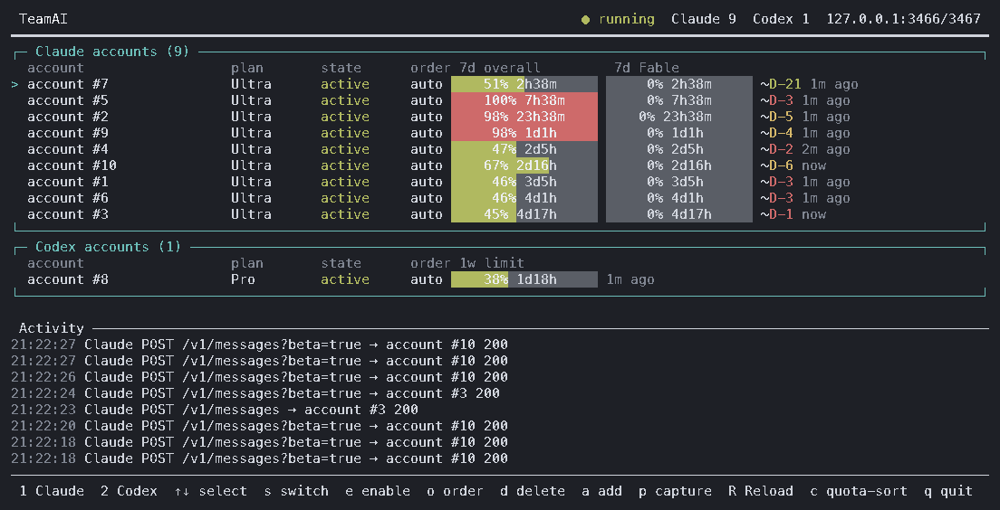

# TeamAI

[English](README.md) · [한국어](README.ko.md) · [日本語](README.ja.md) · **中文** · [Español](README.es.md)

> **翻译滞后说明：** 本译文尚未反映英文 README 的近期变更（自进行中 Activity 显示起新增的功能和配置项）。行为与配置请以[英文 README](README.md) 为准。

> **新增待译内容：** Codex 上游容量错误重试和 `codexCapacity*` 设置、Claude keep-warm 与 `warmup.claude` / `warmup.codex` 设置，以及 Claude 会话绑定和禁止自动交接策略尚未翻译，请参阅[英文版](README.md)。

TeamAI 是面向 **Claude Code** 和官方 **Codex CLI** 的本地多账号中继。它为每个服务商维护独立的账号池。对于 Codex CLI，当所选订阅账号不可用或配额耗尽时，会换另一个账号重试请求。对于 Claude Code，每个会话永久固定到其初始账号（`sessions.json`），以保护对话历史，并在配额耗尽或出错时阻止自动交接到其他账号。



<sub>上方的仪表盘是用 <code>teamai capture --redact full</code> 得到的真实截取：真实的配额与活动日志，没有账号地址。</sub>

> TeamAI 是一个独立的开源项目，与 Anthropic、OpenAI 以及与之无关的 teamai.com 服务均无任何关联。

## Claude 账号组

在现有 `config.json` 中添加 `"groups": {"master": ["lead@example.test", "backup@example.test"], "worker": ["worker@example.test", "backup@example.test"]}`。成员使用 `teamai accounts claude` 显示的标签或 id，同一账号可以属于多个组。使用 `teamai claude --group master` 或 `TEAMAI_GROUP=worker tac`，显式参数优先。该参数不会传给 Claude，Codex 会拒绝它。未知组在启动客户端前报错；未知或有歧义的账号引用会使启动或整个配置重载失败。组名以英文字母或数字开头，最多64个英文字母、数字、`_`、`.`、`-`，成员列表不能为空。

新会话只在组内按现有优先级和配额规则选择首个账号，跳过冷却中的成员；全部不可用时返回429，不会使用组外账号。模型路由也不能越过组边界。未指定组时行为不变。组保存在待绑定注册记录和持久绑定中，重启、`--resume`、`--continue` 都会保留。**Claude 仍永久固定到首个账号，已绑定会话在冷却或出错时也不会切换到组内其他账号。** 恢复时省略组参数即可使用已存组，指定不同组会返回409。删除组或移除绑定账号的成员资格会返回503，绑定保持不变。修改账号名称或删除账号时请保持引用有效。

编辑后重启中继，或通过账号命令、仪表盘进行配置重载；无效配置会使整个重载被拒绝。`teamai status` 显示组剩余额度及已存会话的组；仪表盘显示组剩余额度及 Activity 中的 `[group:name]`。剩余额度按启用成员各自使用率最高的已知配额窗口计算，以账号份额相加，未测量成员单独显示。成员可能重叠，请勿把不同组的总量相加。详情以[英文 README](README.md#claude-account-groups)为准。

两种仪表盘布局都会按配置顺序把 Claude 账号框分成组，并在标题显示可用账号数和剩余额度。各组内保留当前配额/配置排序，未分组账号放在最后的 `그룹 없음`。共享账号在每个所属组中重复显示，名称前标记 `↔`。选择会同时高亮所有副本，↑/↓ 按首次出现顺序访问每个账号一次，操作仍针对同一个账号。优先级编辑期间固定组内顺序。没有配置组时界面保持不变。


## 环境要求

- Node.js 20 及以上
- macOS 或 Linux
- 单独安装的 `claude` 和／或 `codex`
- 你自己的 Claude Pro/Max 或 ChatGPT Codex 订阅账号

## 安装

```bash
git clone https://github.com/soulduse/team-ai.git
cd team-ai
./scripts/install.sh
```

`install.sh` 会安装依赖、执行构建、链接 `teamai`/`tai`/`tac`/`tax` 命令，并询问是否添加 shell 配置块。该脚本是幂等的——升级时重新执行即可。加 `--no-shell` 可跳过 shell 配置块，加 `--dry-run` 则只显示将要执行的操作。

如果想手动完成同样的步骤：

```bash
npm install
npm run build          # 必需：dist/ 未提交到仓库
npm link
```

打算用 AI 智能体来自动化安装？请参阅 [AGENTS.md](AGENTS.md)，其中把相同的步骤写成了带校验环节与失败分支的确定性命令。

## 快速开始

```bash
teamai login
tai
```

`login` 会询问要添加 `[1] Claude` 还是 `[2] Codex`。要添加更多账号，重复执行即可。`tai` 是简写的会话命令，等价于 `teamai start`：启动本地中继并打开仪表盘。

若想直接开启某个服务商的会话，请使用专用启动命令。它们会在必要时自动拉起 TeamAI 中继，并把后面跟的所有参数原样传给官方客户端：

```bash
tac                   # 经由 TeamAI 账号池的 Claude Code
tac --resume          # 等同于：teamai claude --resume
tax                   # 经由 TeamAI 账号池的 Codex
tax resume            # 等同于：teamai codex resume
teamai claude         # tac 的完整写法
teamai codex          # tax 的完整写法
teamai session        # 交互式选择 [1] Claude 或 [2] Codex
```

这些名称是有意取的，以免覆盖已有的 TeamClaude `tc` shell 函数。`tc` 可以继续指向 TeamClaude，而 `tac` 和 `tax` 指向 TeamAI。

### Claude 会话绑定与恢复

Claude Code 的每个会话都永久固定到记录在 `sessions.json` 及持久账本中的初始账号，以保护对话历史：

- **新会话：** `tac` 和 `teamai claude` 在启动前从经过认证的本地控制端口获取并登记中继签发的 UUID。首次对话请求原子地消耗登记并绑定初始账号。未登记 ID 一律返回 `409`，不以消息数量、角色或账号元数据作为新会话证据。不支持用户指定 `--session-id` 或 `--fork-session`。
- **轮次、压缩和子请求：** 保持相同规范 ID（`x-claude-code-session-id` 或一致的元数据）的请求在模型切换、压缩后仍使用初始绑定。子代理或会话内 `/resume`、`/clear`、fork 若使用未登记 ID 将被拒绝。中继不会根据正文推断父会话或登记 ID。兼容性要求客户端保持 ID；测试使用合成请求，未使用真实订阅会话。
- **恢复 (`--resume`, `--continue`)：** 直接传递参数，不登记新 ID。只有已记录绑定的 ID 才能在原账号恢复。未经证明的会话返回 `409`，存储缺失或不一致返回 `500`。使用选择器或名称恢复时，最终 ID 也必须已有绑定。
- **存储和迁移：** 登记、账本校验及绑定使用同一个跨进程文件锁。文件缺失、不可读、损坏、不一致、删除条目后重启及绑定写入中断均返回 `500`。完整旧绑定与一致的旧账本仍可使用；没有记录的对话不会自动迁入（见下文 adopt）。修复时应恢复一致的备份，而不是删除文件。内部账号预热使用进程专用令牌，不能登记对话 ID。
- **接管登记前已在运行的会话（adopt）：** 升级后，在旧中继下启动的 Claude 会话没有登记，会返回 `409`。管理员可以显式记录：`teamai adopt claude <会话 ID> --account <账号>`（`<账号>` 为 `teamai accounts` 显示的标签或 id）通过运行中中继的认证控制端口（`POST /claude/sessions/adopt`，正文 `{"sessionId", "account"}`）发出请求。中继从自己的账号池取出凭据和实际账号 ID，在会话锁内一并写入绑定和账本记录；凭据既不发送也不返回。**所选账号即成为该会话的初始账号**：此后只使用该账号，配额耗尽、禁用或出错时也不会切换到其他账号，因此请选择会话实际使用的账号。用同一账号重复执行不做任何改变并直接成功；其他账号、仍为 `pending` 的中继签发 ID、已禁用/已删除/不存在的账号以及无效 ID 均被拒绝；存储损坏时不写入任何内容并返回 `500`。会话 ID 是 Claude Code 通过 `x-claude-code-session-id` 发送的完整值（即 `~/.claude/projects/` 下对话记录文件的文件名）。

[Claude Code CLI 文档](https://code.claude.com/docs/en/cli-reference) 说明 UUID、恢复及 fork 创建新 ID 的行为。[钩子文档](https://code.claude.com/docs/en/hooks#common-input-fields) 区分会话 ID 与子代理 ID，但不保证所有功能及版本的 HTTP 头行为。


## Shell 配置

```bash
./scripts/install-shell.sh            # 向 ~/.zshrc 添加带标记的配置块
./scripts/install-shell.sh --dry-run  # 只显示差异，不写入文件
./scripts/install-shell.sh --uninstall
```

它会定义经由账号池的 `cl`（Claude Code）和 `co`（Codex），以及 `tai`、`tais` 和用于 LaunchAgent 的 `taistart`/`tairestart`/`taistop`，同时取消全局固定的 `ANTHROPIC_BASE_URL`——TeamAI 会让每个会话指向自己的端口，残留的全局值只会把流量导向一个可能早已停止运行的代理。该配置块由标记界定并就地重写，因此重新执行是更新而不是追加；每次写入都会留下带时间戳的备份，反复安装／卸载也能让文件逐字节还原。

守护进程是可选的：`cl`、`co`、`tai` 和 `teamai run` 在发现没有进程监听时都会自行启动中继，所以即使 LaunchAgent 被卸载、启动失败或从未安装过，它们依然能正常工作。进程被杀后残留的过期 `server.json` 会被忽略并替换掉。启动确实失败时，报告的是服务端给出的具体原因（端口已被占用、凭据文件无法读取等），而不是一句干巴巴的 "did not start"，完整输出则保留在 `~/.config/teamai/server-start.log`。

### 将中继作为登录项运行

这一步是可选的。上面安装的 `taistart`/`tairestart`/`taistop` 别名操作的是标签为 `com.teamai.proxy` 的 LaunchAgent，所以请严格使用该标签：

```xml
<!-- ~/Library/LaunchAgents/com.teamai.proxy.plist -->
<?xml version="1.0" encoding="UTF-8"?>
<!DOCTYPE plist PUBLIC "-//Apple//DTD PLIST 1.0//EN" "http://www.apple.com/DTDs/PropertyList-1.0.dtd">
<plist version="1.0">
<dict>
  <key>Label</key>          <string>com.teamai.proxy</string>
  <key>ProgramArguments</key>
  <array>
    <string>/usr/local/bin/node</string>
    <string>/ABSOLUTE/PATH/TO/team-ai/dist/src/cli.js</string>
    <string>server</string>
  </array>
  <key>RunAtLoad</key>      <true/>
  <key>KeepAlive</key>      <true/>
  <key>StandardErrorPath</key> <string>/tmp/teamai.err.log</string>
</dict>
</plist>
```

```bash
launchctl bootstrap gui/$(id -u) ~/Library/LaunchAgents/com.teamai.proxy.plist
```

Node 路径请用 `command -v node` 查到的真实路径填写；LaunchAgent 不会继承你 shell 的 PATH。

## 账号

**在另一台机器上登录。** `teamai login claude` 会打开浏览器并等待 `localhost` 回调，同时也接受终端中的粘贴。若浏览器与 TeamAI 不在同一台设备上，授权后会停在一个打不开的 `localhost` 页面：复制地址栏中的 URL（或其中的授权码）粘贴进来即可。先到的一方完成登录，另一方随即被清理；粘贴的 URL 或 `code#state` 中的 `state` 若不属于本次登录，会被拒绝并要求重新粘贴，发到回调端口的无关请求只会得到 `400`，不会结束登录。`teamai login claude --manual` 完全不启动回调服务器：在任意设备上打开输出的 URL 并授权，然后粘贴页面显示的授权码。从仪表盘发起的登录（`a` → `1`）只等待浏览器回调，以免干扰仪表盘的按键；stdin 不是终端时同样不接受粘贴。

Codex 沿用其常规的浏览器登录流程（`codex login`）。在远程机器上，`teamai login codex --device-auth` 会改为运行 `codex login --device-auth`，显示一个可在任意设备上输入的代码；这需要在 ChatGPT 设置中开启设备码认证。不加该选项时，TeamAI 不要求开启这一设置。

导入凭据是可选的，且仅在存在可导出的凭据文件时才有效：

```bash
# 从已有的 TeamClaude 配置中导入全部账号。
teamai import claude --from ~/.config/teamclaude.json

# 导入 Codex CLI 当前基于文件的登录信息（如果存在）。
teamai import codex
```

较新版本的 Claude Code 可能把凭据存放在 macOS 钥匙串而不是 `~/.claude/.credentials.json` 中；这种情况下请改用 `teamai login`。`import` 绝不会修改原有的 TeamClaude、Claude Code 或 Codex 文件。TeamAI 为中继会话使用一个持久化的隔离 Codex 主目录，因此用户原本的 `~/.codex` 保持原样。

## 运维

```bash
teamai status                                  # 服务器状态 + 账号表
teamai accounts [claude|codex]                 # 仅账号表
teamai start                                   # 启动中继并打开仪表盘
teamai stop                                    # 停止中继
teamai restart                                 # 停止、重启并打开仪表盘
teamai server                                  # 在前台运行中继
teamai tui                                     # 仅仪表盘，不自动启动
teamai disable codex user@example.com
teamai enable codex user@example.com
teamai priority claude user@example.com 1      # 或者：auto
teamai capture [--redact partial|full|none] [--out DIR]   # 把仪表盘保存为 .txt 和 .png（无需 TTY）
teamai adopt claude <会话 ID> --account user@example.com   # 旧中继下的会话：把该账号记为它的初始账号
teamai route list                              # 模型路由（按尝试顺序）
teamai route add luna --provider codex --match 'gpt-6-luna*' --accounts a@x.com,b@y.com --mode prefer --color blue
teamai route rm luna
```

同一优先级的账号按 **每周进度** 排序，仪表盘与账号池自身的选择使用同一顺序——最上面一行就是下一个请求会去的账号。每周预算被看作一条直线：一周开始时为 0%，重置时为 100%；账号的偏差 = 周用量 − 本周已过去的比例。落后于这条线（负值）的账号手里有不用就会在重置时作废的预算，所以排在前面。这只是顺序而不是拦截：所有账号都超前时，就用超前最少的那个。临近重置且仍有余量的账号本身就是落后最多的，因此没有单独的“即将重置”规则。周窗口指请求实际消耗的那个：Claude 用 `7d`（Fable 请求用 Fable 周窗口），Codex 用长度为 10080 分钟的窗口，不看名字。偏差相差 5 个百分点以内视为并列，避免每个请求都来回切换；并列时依次看：会话已在使用的账号、每剩余一周所剩周预算更多者、周重置更早者、5 小时窗口重置更早且用量更低者。没有未来重置的周窗口（未测量或重置已过）的账号排在有周窗口的账号之后。显式优先级、切换阈值（5 小时窗口达到阈值的账号无论周进度如何都会被排除）、会话固定和并发上限仍像以前一样先行生效。每行以 `+12%p` / `-30%p` 显示偏差。`routing.balance: "level"` 仅适用于 Claude，会恢复旧的排序（5 小时与周窗口中较满者，按 10% 分档，在途请求少者优先）；Codex 无论 `routing.balance` 取值如何都始终使用每周节奏，5 小时窗口只用于阈值和并列判断。`c` 可切换回配置顺序。

**Fable 与其他模型。** 只有顶级模型（Claude 的 Fable 档）才会动用按模型计的周窗口。账号池不会为 Fable 预留账号：无论是否为 Fable，所有请求都先按优先级（显式值优先，数字小者优先），再按上面的均衡规则排序——非 Fable 请求看共享周窗口，Fable 请求看 Fable 窗口。Codex 请求在这一步始终看每周窗口。Fable 请求只会跳过无法接收它的账号：Fable 窗口已用尽（100%）的账号，以及已测量却完全没有 Fable 窗口的账号（如 Pro 这类不含 Fable 的套餐）；尚未测量的账号仍会尝试。这些账号照样承接其他模型。若想让 Opus 或 Sonnet 请求避开要留给 Fable 的账号，请使用模型路由。旧的 `fableReserveThreshold` 键不再读取，仍带有该键的 `config.json` 照常启动。

Fable 档的 429（`7d_oi` 被拒，而共享的 `5h`／`7d` 窗口仍为允许）只会把该账号的 Fable 窗口搁置，而不是整个账号：其余各模型仍会继续由它服务，而不至于让整个账号为了一份只有顶级模型才消耗的余量而空闲长达一周。若某个 429 拒绝的是共享窗口，则照常搁置整个账号。

全屏 TUI 会把 Claude 和 Codex 账号分组显示，并在用量变化时保持当前选中的账号位置不动。Claude 行分别独立显示 `5h session`、`7d` 以及按模型划分的 `7d Fable` 三个窗口；Codex 行显示其各个窗口，每个窗口的标题取自该账号实际上报的时间跨度（`5h`、`7d`）。仪表盘上一周一律写作 `7d`，其他代理的框和窄终端布局也不例外。账号框和下方其他代理的框都把用量条画在同样的三列、同样的宽度上：第一列是会话窗口（5h），第二列是每周窗口，第三列是其余窗口（Claude 的 `7d Fable`、OpenCode Go 的 `30d`）。窗口按其长度放入对应的列，因此只有每周窗口的 Codex 账号或 Grok 会留空第一列，而不是把每周用量条左移。用量条前面的列（account、plan、state、order，或分组名）在所有框中宽度相同，用量条后面的信息（测量时间、进度偏差 `+12%p`，然后是 Codex 行的 `RC<n>`）也逐项在所有框中从同一列开始；终端变窄时，所有框按同一规则一起收窄。配额是从官方客户端的响应中学习得来的，并会在重启后保留。

**窄终端。** 仪表盘按终端的实际尺寸绘制，尺寸一变就立即重绘（尺寸变化后的第一帧会先清屏，不会留下旧帧的碎片），适用于桌面和手机轮流查看同一个终端的情况。宽度小于 80 列，或宽布局的框放不下三个用量条时（78 列加上路由标记列数），切换为摘要布局。每个区段的规则行在列上方只写一次窗口名（`5h`、`7d`、Claude 的 `F`、`30d` 等第三个窗口），下面的账号行和用量组行只显示数值：短名称（用 `…` 截断）、光标 `>` 和下一个请求的账号标记 `►`、最多三个短用量条，并在各列内右对齐。每行的第二行（淡色）把各窗口自己的重置时间放在对应量条下方，使数值、上方的窗口名和重置时间在同一列结束；没有重置的窗口留空，完全没有重置的行保持一行。这种形式下去掉了名称和右侧重置列，省下的宽度用于用量条和名称，因此 40 列也能同时看到三个窗口及各自的重置时间。当两行布局放不下整个账号列表加上标题行、Activity 规则行和底栏时，退回旧的一行布局，在右侧重置列显示用得最多的窗口的重置。极窄的屏幕则改为只画与用量条同色的数字。停用账号名为灰色，出错为红色，冷却中为黄色。plan、state、order、测量时间和进度偏差只在宽布局中显示。Activity 每个请求一行（时间、会话、`C`/`X`、状态（进行中则为已用秒数）、账号），在右边缘截断，绝不换行，并占用剩余的行数；完整地址放不下时保留本地部分而不是只留开头。底栏用缩写（`↑↓ sel`、`p shot`）显示放得下的快捷键，并附 `? help`；按 `?` 在任一布局下列出所有按键的完整名称。高度也不够时按固定顺序去掉行（其余的活动日志、其他代理、标题行、当前与选中以外的账号），因此每个提供方的当前账号及其用量始终可见。任何一行都不超过终端宽度，宽字符按 2 列计算。所有按键照常工作。

**本机负载。** 标题行显示本机的 CPU 与内存使用率，由仪表盘自己用 Node 的 `os` 模块测量（无服务器 API、无额外依赖），每次重绘时更新：`CPU 12% · RAM 46% 7.3/16.0GB`。CPU% 是自上次重绘以来的繁忙比例，所以第一帧显示 `CPU –`；70% 起为黄色，90% 起为红色。已用/总量只在宽布局中显示。标题行在标题旁只显示这些，宽布局中另有中继的地址和端口；宽度不够时，先去掉用量，再去掉整个 CPU/RAM，然后才轮到端口。`teamai status` 也以 `Host:` 一行输出同样的数值，截图中也包含它们。

底栏提供与 TeamClaude 相同的账号操作流程：选择、切换、启用／禁用、排序、删除、添加／登录、重新测量（`R`）以及退出。`switch` 会把选中的账号固定到其所属服务商账号池的最前面；排序模式下可以指定名次，也可以把某个账号交回自动调度。刷新 Claude 资料时会显示套餐等级，并以红色标出 `past_due` 这类异常的订阅状态。

**账号变更无需重启即可生效。** 仪表盘中的切换、启用／禁用、优先级调整、登录和删除都会先保存到 `config.json`，再通过控制端口（`POST /reload`，仅限回环地址，使用同一个客户端令牌）发送给正在运行的服务器，服务器就地重新读取账号、模型路由和 `routing.balance`。进行中的请求不会被切断：请求会用开始时分配的账号一直走到结束——即使该账号刚被禁用或删除也是如此；被删除的账号会处理完手头的请求，不再接新请求，最后一个请求结束后离开账号池。从下一个请求起按新设置选择账号。已学习的状态（用量、窗口、冷却、重置额度、其他代理的用量）保持不变。文件在做任何改动之前会被整体检查（每个账号条目、各服务商的路由、balance 设置），服务器无法使用的文件会被拒绝，原因显示在仪表盘上，服务器继续沿用原有设置。`proxy`、`switchThreshold` 和 `maxConcurrentPerAccount` 无法替换进正在运行的进程：若它们有变化，reload 会指出，并在下次 `teamai restart` 时生效。仪表盘只在没有服务器运行时才启动服务器。`teamai login`、`import`、`enable`、`disable` 和 `priority` 也以同样方式让正在运行的服务器 reload（已停止的服务器保持停止）。更新 TeamAI 本身之后请执行一次 `teamai restart`：用旧版本启动的服务器没有 reload 路由，仪表盘会提示这一点。

**模型路由。** `routes.claude` / `routes.codex` 可以把指定模型的请求发往指定账号（第一个匹配的路由生效）。在仪表盘按 `g` 可管理所选行所属提供方的路由：列表、添加（`a`）、编辑（`e`）、删除（`d`，按 `y` 确认）、调整顺序（`[` `]`）；`Tab` 切换 Claude/Codex，`Esc` 不保存直接退出。保存前用服务器启动时同一个解析器校验，失败则不写入并在屏幕上显示原因。保存只以原子方式改写 `config.json` 中的 `routes`，并通过 control 端口让运行中的服务器重新读取（无需重启）。`teamai route list|add|rm` 走同一路径。各字段（`match`、`accounts`、`prefer` / `exclusive`、`color`）的详细含义见英文 README 的 Model routes / Editing routes。

仪表盘保存前会把编辑开始时读取的路由列表与文件再次比较；如果 CLI 或其他编辑器已经修改，保存会提示重新加载并拒绝覆盖。`exclusive` 路由必须至少包含一个已在该提供方配置的账号。control reload 只接受 loopback 请求，并先解析所有提供方再交换路由，因此一个提供方出错时运行中的路由都保持不变。

`p` 会把仪表盘截取并保存，`teamai capture` 则可以在没有终端的情况下从脚本或代理完成同样的事。每次截取会在 `~/.config/teamai/captures/`（或 `--out DIR`）下留下一对文件：保留原有颜色的文本帧，以及用内置位图字体绘制的同一帧 PNG，除 Node 之外不需要任何东西。账号地址在绘制帧之前就已被遮盖，因此账号列、页脚和活动日志中都不会残留。默认是 `de•••••••••w@gm•••.com` 这样的部分遮盖；`--redact full` 会替换为 `account #N`；`--redact none` 则保留地址，用于只给自己看的截取。在仪表盘中按 `p`，除了保存之外，还会在文件管理器中定位到该 PNG，并把图片复制到剪贴板——macOS 上开箱即用，Linux 上需要安装 `xdg-open` 以及 `wl-copy` 或 `xclip`。页脚会说明哪些操作实际完成了。本 README 顶部的图片就是这样得到的一次截取。截图的宽度就是所在终端的宽度（至少 40 列，没有终端时为 120 列），所以在手机上截取得到的是窄布局。

已启用的账号还会在后台每五分钟（每个账号带最多 30 秒抖动、并发上限为 2、失败时按 30 秒至 15 分钟指数退避）通过各提供方不消耗配额的用量接口（Claude 为 `/api/oauth/usage`，Codex 为 `/wham/usage`）自动刷新配额，快过期的令牌会先行刷新，已禁用（`disabled`）的账号会被跳过，`POST /reload` 也会原地更新探测目标。`R` 会立即对整批账号重新测量配额：它先读取用量接口，仅对未能从该接口读取的空闲账号并行重放已知会被接受的请求形态（包括已测量过的和已被限流的账号，后者的 429 响应同样带有权威的响应头），并如实报告 `measured/targets` 计数。这个请求形态只有在真正经代理成功返回 2xx 后才会被确定下来，所以在还没有一次成功请求之前，`R` 会告知尚不存在探测模板，而不是去猜测一个请求体。缺少按模型计的周窗口（Fable）的账号会额外收到一次补充探测，因为该窗口只会出现在 Fable 级别请求的响应里。

Codex keep-warm 采用事件驱动。已测量的 5 小时窗口重置 10 秒后，TeamAI 会重新读取该账号的 usage；只有新读数确认广告窗口为空（`0%`）时，才会通过固定本地路径 `/tc-acct/<account>/codex` 对该账号运行一次真正的 `codex exec`（最小模型，提示词 `hi`）。账号逐个处理；永久失败在 10 分钟后只重试一次，随后标记为 `gave-up`，并在状态中显示一小时后的到期时间和下一次检查时间。中继判定为容量或过载的失败、没有终止事件就结束的流，以及 warm 超时或 signal 退出都属于临时失败，不计入永久失败次数，并使用上限为一小时的指数退避重试。判断依据是 usage 读取发送的时间，因此 warm 前发出的延迟响应不会触发重复 warm。warm 6 分钟后（超过区分空窗口与刚开启窗口的 5 分钟容差）会再读一次 usage；若窗口仍为空，则计为一次失败，失败 warm 的重试计时器会再次发送 warm，而不会把确认读取算作第二次失败。已开启的窗口即使仍显示 `0%`，在重置前也不会再次 warm。指向未配置账号的固定路径会以 404 拒绝，而不会交给其他账号处理。warmer 的判断每次变化以及每次 warm 结果都会以一行（仅含账号编号）写入服务器输出；按需启动的中继会写入 `$TEAMAI_HOME/server-start.log`。

空闲账号也会由独立的五分钟扫描保活：凡是令牌即将过期、或上一次尝试出错的账号，都会被逐个刷新。日常流量往往只集中在少数几个账号上，而预热又刻意从不刷新令牌，所以若没有这一步，一个无人使用的账号就可能让它的 refresh-token 链条失效，进而被上游吊销。这次扫描是刻意串行的——在长时间停机之后一次性刷新整批账号，会把令牌接口打成一波限流。

学习得来的配额（用量、各窗口、重置时间、订阅资料）会写入磁盘并在下次启动时恢复，因此重启后仪表盘和排序无需重新测量即可延续；`R` 重放所用的探测形态也以同样方式持久化。而按响应产生的临时信号则不会：冷却（cooldown）和错误状态会在重启时被有意丢弃，这样账号就不会被某个过期 429 的 retry-after 再次搁置——如果它确实已经用尽，下一个请求会重新推导出正确的状态。

当同时到达的请求数超过整批账号按账号并发上限所能承载的总量时，中继会在读取请求体之前就用 `429`（`x-teamai-429-reason: concurrency_saturated`）拒掉溢出的部分，而不是无上限地缓冲请求体。在"没有可用账号"的 429 上，同一个响应头也用来区分是账号繁忙还是已耗尽（`quota_exhausted`）。

Anthropic 的资料接口会暴露订阅状态和等级，但不提供当前计费周期的结束时间。资料状态会在服务端启动时刷新，此后每六小时刷新一次。

**重置额度 (Codex 与 Claude)。** ChatGPT 和 Anthropic (Claude) 账号可能持有用于重置用量窗口的票据（重置额度，即 Codex CLI 的 `/usage` "Full reset" 或 Claude 用量重置）。开启 `codexResetCredits`（针对 Codex）或 `claudeResetCredits`（针对 Claude，默认关闭）后，当中继因该提供方所有账号均已耗尽配额（而非仅仅繁忙）而无法承接请求时，会自动在符合条件的最优账号上兑换一张票据（票据最多者优先，票数相同时周重置时间最晚者优先），并在该账号上继续提供服务。账号仅在周窗口已满（开启 `codexResetCreditsSessionWindow` / `claudeResetCreditsSessionWindow` 时 5 小时窗口耗尽亦符合条件）、用量接口读出的票据数超过保留数（`codexResetCreditsReserve` / `claudeResetCreditsReserve`）、且距上次尝试已超过冷却时间（`codexResetCreditsCooldownMs` / `claudeResetCreditsCooldownMs`）时才具备资格。单个请求最多消费一张票据。票据无法退还，因此中继绝不会凭猜测消费。Codex 和 Claude 行均会以 `RC<n>` 显示持有票据数，`teamai status` 会按账号列出，在对应行按下 `t` 键可打开选择器手动消费指定票据（按 `y` 确认）。两个提供方默认均关闭（`false`），关闭时绝不会自动发起任何重置额度调用。

## 配置

配置和凭据存放在 `$TEAMAI_HOME` 中，若未设置则依次回退到 `$XDG_CONFIG_HOME/teamai` 和 `~/.config/teamai`。各代理均绑定在 `127.0.0.1` 上，并要求提供一个自动生成的本地客户端令牌。

每次修改 `config.json` 或 `credentials.json` 时，都会在持有 `<文件>.lock`（同一时刻只有一个进程：服务器、仪表盘或命令）的情况下重新读取文件，并把每次写入专用的临时文件 rename 到原位。因此重叠的保存既不会损坏文件，也不会互相覆盖——登录不会因服务器保存而丢失，已删除的账号也不会被写回。已退出进程遗留的 lock 会被接管。

`config.json` 会在首次运行时以下列默认值创建：

| 键 | 默认值 | 含义 |
| --- | --- | --- |
| `proxy.host` | `127.0.0.1` | 绑定地址。按设计仅限回环地址。 |
| `proxy.claudePort` | `3456` | Claude 中继端口。 |
| `proxy.codexPort` | `3457` | Codex 中继端口。 |
| `proxy.controlPort` | `3556` | TUI 通信所用的控制通道。 |
| `proxy.clientToken` | 自动生成 | 每个被中继的客户端都必须发送的本地令牌。 |
| `switchThreshold` | `0.98` | 用量比例超过该值后，该账号不再被选中。 |
| `warmup.enabled` | `true` | Codex 与 Claude 事件驱动 keep-warm；`false` 两者均禁用。 |
| `warmup.claude` | `true` | 启用 Claude 账号 keep-warm（待翻译，见英文说明）；`false` 禁用。 |
| `warmup.codex` | `true` | 启用 Codex 账号 keep-warm；`false` 禁用。 |
| `maxConcurrentPerAccount` | `16` | 每个账号允许的并发在途请求数。设为 `0` 表示无限制。 |
| `routing.balance` | `"pacing"` | 同一优先级 Claude 账号的排序方式：`pacing`（每周进度，见上文）或 `level`（窗口最空者优先，按 10% 分档）。Codex 始终使用每周节奏。 |
| `codexResetCredits` | `false` | 自动消费 Codex 重置额度。 |
| `codexResetCreditsPolicy` | `"fleet"` | `fleet`: 所有 Codex 账号耗尽时。`account`: 账号自身 429 耗尽时亦立即消费。 |
| `codexResetCreditsCooldownMs` | `1800000` | 同一账号两次尝试之间的最小时间间隔(ms)。 |
| `codexResetCreditsReserve` | `0` | 自动消费时保留的每个账号最少票据数。 |
| `codexResetCreditsTimeoutMs` | `10000` | 兑换调用的超时时限(ms)；超时按结果未知处理。 |
| `codexResetCreditsListRefreshMs` | `600000` | `t` 键显示的票据列表缓存时间(ms)。`0` 表示仅获取一次。 |
| `codexResetCreditsSessionWindow` | `false` | 仅 5 小时窗口耗尽时亦允许消费票据。 |
| `claudeResetCredits` | `false` | 自动消费 Claude 重置额度（默认关闭）。 |
| `claudeResetCreditsCooldownMs` | `1800000` | 同一 Claude 账号两次尝试之间的最小时间间隔(ms)。 |
| `claudeResetCreditsReserve` | `0` | 自动消费时保留的每个 Claude 账号最少票据数。 |
| `claudeResetCreditsTimeoutMs` | `10000` | Claude 兑换调用的超时时限(ms)；超时按结果未知处理。 |
| `claudeResetCreditsListRefreshMs` | `600000` | `t` 键显示的 Claude 票据列表缓存时间(ms)。`0` 表示仅获取一次。 |
| `claudeResetCreditsSessionWindow` | `false` | 仅 5 小时窗口耗尽时亦允许消费 Claude 票据。 |
| `routes` | — | 可选。按提供方的模型路由 `{ "claude": [...], "codex": [...] }`，可用仪表盘的 `g` 或 `teamai route` 编辑。 |
| `proxy.legacyPorts` | — | 可选。按提供方继续应答的额外端口 — 例如 { "claude": [3400] }。 |
| `proxy.maxBodyMb` | `512` | 可选。中继接受的请求体最大大小(MB)。须为大于 `0` 且不超过 `4096` 的数字，否则启动时报出原因并停止。超出的请求体不发往上游，直接返回 `413` 并只记录大小和上限；上游自己的 `413` 原样转发。 |
| `proxy.maxInflightBodyMb` | `1024` | 可选。同时保存在内存中的请求体总量(两个提供方合计)上限(MB)。未设置时不低于 `proxy.maxBodyMb`；小于 `proxy.maxBodyMb`，或不是大于 `0` 且不超过 `65536` 的数字时，启动时报出原因并停止。超出时请求以 `429`(`x-teamai-429-reason: body_budget`)被拒。 |
| `proxy.bodyTimeoutMs` | `300000` | 可选。接收完整请求体的最长时间(ms)，`0` 表示不限。超时返回 `408`(`x-teamai-408-reason: body_timeout`)，并归还其在 `proxy.maxInflightBodyMb` 中占用的额度。须为 `0` 到 `86400000` 的整数，否则启动时报出原因并停止。 |

如果某个端口已被别的程序占用，请改掉它——这正是启动失败最常见的原因，具体原因会记录在 `server-start.log` 中。

客户端的 base URL 是在启动时一次性交给它的，之后无法再重定向，因此若在 `config.json` 里改动端口，本会让每个已经打开的会话都陷入连接被拒。为此中继还会在内置的默认端口以及你在 `proxy.legacyPorts` 中列出的任意端口上应答，从而在端口变更时让已打开的会话保持存活。若某个旧端口已被别的程序占用，则会被跳过，并不影响主端口；而启动之后发生的套接字错误只会被记录下来，不会被放任而拖垮整个中继。

## 适用范围与合规

0.1 版本面向的是订阅制 OAuth 账号以及由包装器启动的 CLI 会话。它不对外提供 OpenAI 兼容的公开 API，不把 Claude 请求转换成 Codex 请求，不支持 Codex Desktop，也不会把不同人的凭据混在一个池里共用。遵守各服务商条款与政策的责任在你自己。生产环境／商业用途的 API 负载应当使用服务商官方的 API 计费方式。

## 开发

```bash
npm run typecheck
npm test
npm run lint
```

`npm test` 会在每个文件之前加载 `test/isolation.ts`。每个测试使用各自的临时 `TEAMAI_HOME` 和主目录，测试服务器监听端口 0；触及真实 TeamAI、Codex 或 Claude 目录、中继端口（3456/3457/3556 和 3466/3467/3566）或本机之外任何主机的测试都会失败，即使被测代码吞掉了错误。

衍生作品相关说明见 [NOTICE](NOTICE)，本地安全模型见 [SECURITY.md](SECURITY.md)。

> Translation update pending: see the canonical English README for nested Codex relay configuration inheritance.

<!-- transient-recovery-2026-09-22 -->
临时上游错误保留原始 HTTP 状态、正文和 Retry-After。切换账号后最多重试两轮，每轮等待不超过 10 秒，总等待不超过 20 秒。更长的等待交给客户端，成功的流不会重放。Codex HTTP 重试保持关闭，避免重复重试。构建后需重启中继才能生效。
